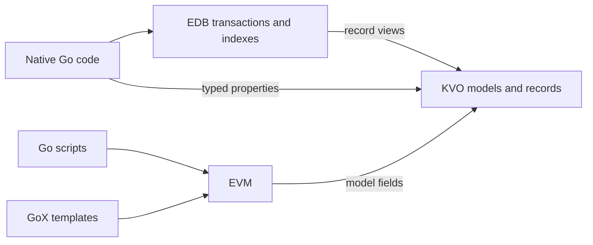

# EDB

**An embedded database for Go, with shared data models, Go scripting, and HTML templates.**

[](https://pkg.go.dev/github.com/andreyvit/edb)

EDB stores Go structs in [bbolt](https://github.com/etcd-io/bbolt). KVO reads their fields without decoding the whole row; EVM runs Go scripts; GoX renders Go-and-HTML templates. Use each on its own or together.

## Why?

A single server in the 2020s can handle an awful lot of a small-to-mid-sized company's workload. You can save on development time, costs and complexity by going back from the cloud to a dedicated unicorn server.

This won't be the right choice *every* time; there's availability and security boundaries to consider, too. But faster time-to-market and smaller development teams are worth a lot, especially for startups.

To realize those benefits, you need an efficient database:

- Fast data access means that, instead of optimizing tricky SQL, you can *loop over your data* with code. Imagine the savings.
- Serialized writes simplify statistics and read-modify-write logic, eliminating a whole class of concurrency errors.

Keep the data in your process. Avoid a network round trip for every lookup. EDB uses a memory-mapped bbolt file, concurrent readers and one writer. Replication, failover and service boundaries remain application decisions.

That also makes EDB a darn good target for AI-written code. An agent can read the Go types, write an ordinary loop, and test the result. Less time translating business rules into a query language; fewer layers to misunderstand. The same small, explicit pieces that help a person move fast help an agent too.

EVM takes this further: let an AI write a plugin, compile and check it, then load it into the running application. Change a reward rule, add a report, or customize a workflow without rebuilding the host. KVO supplies typed access to data; GoX supplies templates. The host chooses the APIs the plugin can call and the execution limits it gets. Review, activation and permissions remain application policy—generated code does not get unrestricted access to the process.

With EVM, **Go doubles as EDB's query language**. The host can offer a call that runs a one-off script with access to the entire database. Query, join, aggregate, or update rows with ordinary Go. Use the same models and helpers as the application, without turning every new question into a new host endpoint.

## How the pieces fit

| Component | What it does | A typical use |
| --- | --- | --- |
| [`edb`](https://pkg.go.dev/github.com/andreyvit/edb) | Transactions, tables, primary keys, secondary indexes, and schema migrations | Find a customer by email; update a balance atomically |
| [`kvo`](kvo/README.md) | Logical models and typed property access over encoded rows or native Go structs | Sum two fields across a large scan without decoding every customer |
| [`evm`](evm/README.md) + [`evm/evmcompiler`](evm/evmcompiler) | Compile a supported subset of Go to an embedded register VM | Run an application-defined reward rule against a customer |
| [`gox`](gox/README.md) | Compile Go functions containing HTML into EVM programs | Render a customer card with contextual escaping |
| [`values`](values/README.md) + [`nativebind`](nativebind) | Shared runtime values, type information, and native field operations | Pass records between KVO and EVM; share generated Go field access |
| [`evm/evmbind`](evm/evmbind/README.md) | Expose Go APIs to scripts and generate direct call/field bindings | Let scripts call selected application services or registered model helpers |

A **KVO model** defines a record type: its properties, their types, and stable numeric codes. EDB can store rows of that type; EVM can expose it as a script type, including for values that never enter a database.

A **record** is one value of that type. Its data can be a native Go struct, decoded memory, or bytes encoded as MessagePack, Fast2, or Compact2. The same property accesses work across these representations.



## Getting started

**Go 1.27+**. Install the API described here from the `kvo` branch:

```sh
go get github.com/andreyvit/edb@kvo
```

For a complete example, run this from a checkout:

```sh
go run ./examples/loyalty
```

The [loyalty example](examples/loyalty/main.go) creates a temporary database, inserts three customers, compares struct and KVO reads, runs a reward rule, renders HTML, and redeems points. It removes the database when finished. Its output includes:

```text
Alice & Bob: 1000 points
VIP balance (Go structs): 1500
VIP balance (KVO): 1500
VIP bonus (EVM): 100
```

The examples below build up that application. The complete [model declarations](examples/loyalty/model.go), [Go script](examples/loyalty/testdata/bonus.go), and [GoX template](examples/loyalty/testdata/card.gox) are executable sources, covered together by an [example test](examples/loyalty/main_test.go).

## Database

### Define rows and indexes in Go

The first field of a row is its primary key. A key can be a scalar or a struct containing a composite key. `msgpack:"-"` keeps the key out of the value payload; EDB restores it when decoding a Go row. The `kvo` tags below map fields to the model introduced later.

```go
type Customer struct {
    ID             uint64   `msgpack:"-" kvo:"-"`
    FirstName      string   `msgpack:"first_name" kvo:"first_name"`
    Email          string   `msgpack:"email" kvo:"email"`
    Tags           []string `msgpack:"tags" kvo:"tags"`
    PointsEarned   int64    `msgpack:"points_earned" kvo:"points_earned"`
    PointsRedeemed int64    `msgpack:"points_redeemed" kvo:"points_redeemed"`
}
```

An indexed table declares a KVO model and callbacks that yield index keys. The [model below](#declare-properties-once) supplies the typed properties; the same callback reads native rows and encoded records:

```go
var (
    DBSchema = &edb.Schema{}
    customersByEmailIndex *edb.Index[string]
    customersByTagIndex   *edb.Index[string]

    CustomersTable = edb.DefineTable(DBSchema, "customers", CustomerModel, func(b *edb.TableBuilder[uint64]) {
        customersByEmailIndex = b.AddIndex("by_email", edbindexing.ByFieldIfNonZero(Customer_Email), edb.IndexOptDeprecatedUnique)
        customersByTagIndex = b.AddIndex("by_tag", edbindexing.ByScalarList(Customer_Tags))
    })

    CustomerRows = CustomersTable.Rows[Customer]()
)
```

`edbindexing` supplies `ByField` (including zero), `ByFieldIfNonZero`, `ByTimeFieldIfNonZero` (using `IsZero`), and `ByScalarList`. Pass a callback directly for compound keys or domain-specific conditions.

One row can contribute several entries to an index, or none. This gives you tag indexes, filtered indexes, and compound keys without a query language. EDB maintains the entries when you update or delete the row.

### Open, write, read

Open a persistent file during application startup, and close it at shutdown:

```go
db, err := edb.Open("customers.db", DBSchema, edb.Options{})
if err != nil {
    return err
}
defer db.Close()
```

Use `edb.InMemory` as the path for the in-memory backend, useful in tests. The runnable example uses a temporary file to exercise bbolt.

Every operation runs inside a transaction. `true` opens a write transaction; `false` opens a read transaction. `Put` inserts or replaces the row at its primary key:

```go
err = db.Tx(true, func(tx *edb.Tx) error {
    CustomerRows.Put(tx, &Customer{
        ID: 101, FirstName: "Alice & Bob", Email: "alice@example.com",
        Tags: []string{"vip", "newsletter"},
        PointsEarned: 1250, PointsRedeemed: 250,
    })
    return nil
})
if err != nil {
    return err
}
```

Read by primary key or by an index:

```go
err = db.Tx(false, func(tx *edb.Tx) error {
    customer := CustomerRows.Get(tx, 101)
    if customer == nil {
        return fmt.Errorf("customer not found")
    }
    fmt.Println(customer.FirstName) // Alice & Bob

    id, byEmail := CustomerRows.Lookup(tx, customersByEmailIndex, "alice@example.com")
    if byEmail == nil {
        return fmt.Errorf("email not found")
    }
    fmt.Println(id) // 101
    return nil
})
if err != nil {
    return err
}
```

Both reads return owned Go structs, or `nil` when absent. To delete by key, call `CustomerRows.Delete(tx, 101)` inside a write transaction; it returns whether a row was deleted.

Returning an error from a write callback rolls back its changes. Check the error from `db.Tx`, including commit failures. Write callbacks use bbolt batching and can be retried: keep external effects such as sending email outside the callback, after a successful commit. `db.Read` and `db.Write` are convenience forms that panic on errors.

### Query with an index and a loop

Calculate the total available points for customers tagged `vip`:

```go
func balanceFromStructs(tx *edb.Tx, tag string) int64 {
    var total int64
    for customer := range CustomerRows.ExactIndexScan(tx, customersByTagIndex, tag).Rows() {
        total += customer.PointsEarned - customer.PointsRedeemed
    }
    return total
}
```

Use `CustomerRows.Scan(tx).Rows()` to visit every customer. Table and index handles provide `Exact`, inclusive `Range`, `From`/`After`, and `Through`/`Before`; append `.Reversed()` to reverse the order. For example:

```go
for id, customer := range CustomerRows.ExactIndexScan(tx, customersByTagIndex, "vip").Reversed().Entries() {
    // Export, aggregate, or join to another table using id.
    fmt.Println(id, customer.Email)
}
```

`slices.Collect(scan.Rows())` collects decoded rows when you need them all in memory. For aggregation or streaming, range over the iterator directly. Scans are reusable descriptions: each iteration opens a new cursor in the same transaction, including after an early `break`. `Keys()` reads primary keys without fetching row payloads.

For bounded reads, use `edb.ReadChunks(db, 500, query)` with a factory returning a
`RecordScan` or `RowScan`. Each chunk has its own read transaction and can be
passed directly to other table operations for joins. For application-controlled
transactions, use `scan.Resume(bookmark).Chunk(500)`. Bookmarks own the complete
index-and-primary-key position, including for reverse scans. Reopening between
chunks changes the snapshot. See [resumable scans, key-set composition, and
keys-first updates](_docs/SCANS.md) for examples and ownership rules.

`Lookup` returns the primary key and the first matching row in storage order, even for a nonunique index. Use `Exact(...).Entries()` for every match. `LookupKey` returns `(key, found)` without reading the row. Keys can be strings, named scalar types, or structs containing composite keys; each handle validates its declared types at construction.

## KVO

KVO separates **the model**, **the stored format**, and **how you access a value**. You can read a few fields directly from a stored row, decode once for repeated access, or wrap an existing Go struct. The application-facing property API stays the same.

### Declare properties once

Register properties with stable codes and types, then include them in a model. These declarations belong at package scope or in application initialization, not inside a request or scan:

```go
var (
    Models       = kvo.NewSchema()
    CustomerType = kvo.NewEntityType(Models, "customer", reflect.TypeFor[Customer]())

    Customer_FirstName = kvo.NewStringProp[string](Models, 1, "customer:first_name", kvo.TMachineString)
    Customer_Email     = kvo.NewStringProp[string](Models, 2, "customer:email", kvo.TMachineString)
    Customer_Tags      = kvo.NewListProp(Models, 3, "customer:tags",
        kvo.ListOf(kvo.TMachineString), values.StringCodec[string]())
    Customer_PointsEarned   = kvo.NewSignedProp[int64](Models, 4, "customer:points_earned", kvo.TInt64)
    Customer_PointsRedeemed = kvo.NewSignedProp[int64](Models, 5, "customer:points_redeemed", kvo.TInt64)

    CustomerModel = kvo.NewModel(Models, CustomerType, func(b *kvo.ModelBuilder) {
        b.Prop(Customer_FirstName)
        b.Prop(Customer_Email)
        b.Prop(Customer_Tags)
        b.Prop(Customer_PointsEarned)
        b.Prop(Customer_PointsRedeemed)
    })
)
```

`customer:first_name` is the globally qualified property name; `first_name` is its local name within the customer model. A field can use either spelling in its `kvo` tag. Reuse a property across models when it has the same meaning and type. Registration panics on code/name collisions, including ambiguous local names within a model. Treat persistent codes as schema identifiers: do not renumber them or reuse retired codes for a different meaning.

`kvo` here is `github.com/andreyvit/edb/kvo`; `values` is its sibling package. The [complete model file](examples/loyalty/model.go) includes all imports.

### Attach the model to a table

Pass the model after the table name. Its first registered native type supplies the storage binding; the builder specifies only the key type. MessagePack is the default storage format:

```go
table := edb.DefineTable(DBSchema, "customers", CustomerModel, func(b *edb.TableBuilder[uint64]) {
    // Indexes, indexer, migrations, and other table settings.
})
```

To store new rows in Fast2, add this inside the definition callback:

```go
b.SetRecordStorage(edb.RecordStorage{
    Format: edb.Fast2,
})
```

The example uses Fast2. Index callbacks read MessagePack, Fast2, Compact2, or an already-available native row. Indexing never requires decoding an encoded row into its Go struct.

`b.AddIndex` creates and registers each index, returning its handle. A nil callback leaves population to a shared `b.SetIndexer`. `IndexOptDeprecatedUnique` preserves the old one-row-per-key layout and last-write-wins behavior; it does not enforce uniqueness. The table model can expose a subset of an existing row; `RecordStorage` requires a complete storage binding. Supply optional field mappings through `model.RegisterNativeType` when adding tags is impractical. See the [binding guide](kvo/_docs/ACCESS.md).

### Read fields without decoding the row

`DefineTable` returns `*Table[Key]`; `AddIndex` returns `*Index[IndexKey]`. Tables provide record access directly. Index queries take the table, which supplies the primary-key type:

```go
id, customer := CustomersTable.Lookup(tx, customersByEmailIndex, "alice@example.com")
```

The native handles use `.Rows()` and return `*Customer`; record handles use `.Records()` and return `kvo.Record`. Both provide `.Entries()` and `.Keys()`. Shared calculations need only a record:

```go
func PointBalance(r kvo.Record) int64 {
    return r.Get(Customer_PointsEarned) - r.Get(Customer_PointsRedeemed)
}

func balanceFromRecords(tx *edb.Tx, tag string) int64 {
    var total int64
    for customer := range CustomersTable.ExactIndexScan(tx, customersByTagIndex, tag).Records() {
        total += PointBalance(customer)
    }
    return total
}
```

`Get(Customer_PointsEarned)` returns `int64`. String properties return strings; typed list properties return `kvo.List[T]`. No `AsInt` conversion is needed:

```go
r := CustomersTable.Get(tx, 101)
if r.Missing() {
    return fmt.Errorf("customer not found")
}
name := r.Get(Customer_FirstName) // string
list := r.Get(Customer_Tags)     // kvo.List[string]
fmt.Println(name, list.Len())
for tag := range list.Iter() {
    fmt.Println(tag)
}
tags := list.Slice() // allocate a Go slice when you actually need one
fmt.Println(strings.Join(tags, ", "))
```

`Iter()` is a single-pass, range-over-function iterator; call it again for another traversal. Child objects and lists of objects can also be borrowed as records, so you can keep using their own typed properties. Low-level `GetValue(code)` / `SetValue(code, value)` use the shared `values.Value` carrier. `GetPathValue(path)` and `FastSetPathValue(path, value)` handle nested paths; the fast setter accepts precomputed write options for callers such as EVM.

A `kvo.Record` is a **16-byte handle** on 64-bit platforms. It carries data and shared representation metadata, not a decoded copy of every field. Ordinary scalar reads and borrowed list traversal can allocate nothing after setup. MessagePack access scans encoded fields; Fast2 and Compact2 use their own field layouts.

### Edit inside a write transaction

A record edit remembers the table, primary key, and revision it was opened with. Validate the business operation, set typed properties, and save:

```go
func redeem(db *edb.DB, id uint64, points int64) error {
    return db.Tx(true, func(tx *edb.Tx) error {
        edit := CustomersTable.Edit(tx, id)
        if edit == nil {
            return fmt.Errorf("customer %d not found", id)
        }
        balance := edit.Get(Customer_PointsEarned) - edit.Get(Customer_PointsRedeemed)
        if points <= 0 || points > balance {
            return fmt.Errorf("cannot redeem %d points from a balance of %d", points, balance)
        }
        edit.Set(Customer_PointsRedeemed, edit.Get(Customer_PointsRedeemed)+points)
        CustomersTable.Save(tx, edit)
        return nil
    })
}
```

Saving maintains indexes and checks the edit's revision. Edits use copy-on-write or native editing according to the representation; editing and saving can allocate. Use `CustomersTable.New(tx, key)` and `CustomersTable.Save(tx, edit)` to prepare and save an insert with an explicit primary key. `CustomersTable.Put(tx, key, r)` replaces a whole record; `CustomersTable.Delete(tx, key)` removes one. These operations use the same write and index maintenance paths as native rows.

Record operations panic on errors by default. Use `Try...` forms where you want to handle errors explicitly. Advanced database reads also return metadata:

```go
r, meta, err := CustomersTable.TryGet(tx, 101)
if err != nil {
    return err
}
// r.Missing() distinguishes absence; meta has SchemaVer and ModCount.
if !r.Missing() {
    fmt.Println("stored schema:", meta.SchemaVer, "revision:", meta.ModCount)
}
```

### Keep keys and lifetimes explicit

A record does **not** implicitly contain its database primary key. Our `Customer` model omits `ID`, because it is not stored in the payload. Keep the lookup ID, take the key returned by `Lookup`, or iterate over entries:

```go
for id, customer := range CustomersTable.Scan(tx).Entries() {
    fmt.Println(id, PointBalance(customer))
}
```

For example, daily statistics can use a composite primary key:

```go
type StatsKey struct {
    CustomerID uint64
    Day        string
}

// statsTable is defined with TableBuilder[StatsKey] and a model.
stats := statsTable
for id, customer := range CustomersTable.ExactIndexScan(tx, customersByTagIndex, "vip").Entries() {
    day := stats.Get(tx, StatsKey{id, "2026-11-10"})
    if !day.Missing() {
        fmt.Println(customer.Get(Customer_FirstName), day.Get(orders))
    }
}
```

The [complete, tested join example](examples/loyalty/joins_test.go) includes the statistics model and table. `stats.Prefix(tx, StatsKey{CustomerID: id}, 1).Entries()` visits that customer's days. `Prefix` takes a count of tuple components; it does not perform string-prefix matching. Use `GetRaw` only when you already have an encoded primary key.

Typed handles return the declared primary-key type, including strings and composite structs. For low-level cursor access, `UintKey()` supports unsigned scalar keys. `Key()` returns a decoded `any` for general keys; `RawKey()` returns borrowed encoded key bytes. Index cursors expose the row's primary key through these methods too. For a join with the same key encoding, `tx.GetRecordByKeyRaw(otherTable, c.RawKey())` avoids boxing a Go key.

Encoded records, strings, and list elements borrow storage from their transaction. Copy a record before retaining it beyond that transaction:

```go
var saved kvo.Record
err = db.Tx(false, func(tx *edb.Tx) error {
    saved = CustomersTable.Get(tx, 101).Own()
    return nil
})
if err != nil {
    return err
}
fmt.Println(saved.Get(Customer_FirstName)) // safe after the transaction closes
```

`Own()` retains encoded data without decoding; it can return an already native object unchanged. Use `Clone()` for an independent snapshot, including native structs, before hypothetical edits. Keep a key or `edb.Ref` and reload when you want current state from a new transaction.

`list.Slice()` copies the slice but its elements can still borrow storage. Use `list.OwnedSlice()` for retained strings/bytes or owned record elements, and `recordList.CloneSlice()` for independent records. See the [ownership contracts](kvo/_docs/ACCESS.md#lifetimes-and-compatibility). These operations run at explicit boundaries; ordinary reads have no per-read expiry check.

Read sparse fields directly. For repeated access, `Fastest()` returns a decoded Go struct when bound, or indexed memory otherwise. `Fast()` keeps Fast2 and materializes other formats. Neither promises an independent snapshot; use `Clone()` for that.

See [KVO access](kvo/_docs/ACCESS.md) for native bindings, typed collections, ownership and decode costs.

## EVM

EVM runs Go source inside your application. It type-checks scripts against the packages you expose, compiles them to bytecode, and executes them with reusable VM storage. Use it for reward rules, administrative scripts, or other logic that needs to change independently of the host binary.

### Write a rule against the KVO model

This is [bonus.go](examples/loyalty/testdata/bonus.go), an EVM **`.go` file**:

```go
package rules

import "m"

func BonusPoints(customer *m.Customer) int64 {
    if customer == nil {
        return 0
    }
    balance := customer.points_earned - customer.points_redeemed
    if balance <= 0 {
        return 0
    }
    for _, tag := range customer.tags {
        if tag == "vip" {
            return balance / 10
        }
    }
    return 0
}
```

`m.Customer` is derived from the KVO model. Its selectors resolve to property codes at compile time; `customer.tags` can use borrowed list traversal. The rule works with the same supported representations as native record access. No Go `Customer` needs to be allocated just to call it.

### Compile once, then pass records

Register the model package, compile the source, and link it during setup. Here `bonusSource` is the file's contents, embedded by the [example host](examples/loyalty/main.go):

```go
models, err := evm.ModelPackage("m", Models)
if err != nil {
    return err
}
module, err := evmcompiler.Compile("bonus.go", bonusSource, models)
if err != nil {
    return err
}
program, err := evm.Link(module, models)
if err != nil {
    return err
}
vm := evm.New(program)
```

Inside a read transaction, pass the record's value directly and read the scalar result:

```go
r := CustomersTable.Get(tx, 101)
args := []values.Value{r.Value()}
var result [1]values.Value
err := vm.RunWithBudget(ctx, "BonusPoints", args, result[:], evm.Budget{Steps: 10_000})
if err != nil {
    return err
}
bonus := result[0].AsInt() // 100
```

`values.Value` is the common runtime carrier. The entry signature supplies its type; a record fits in the carrier without an extra box. Keep the transaction open for this invocation. Reuse a VM and argument/result storage for repeated calls; a VM is neither concurrent nor reentrant. An immutable linked program can be shared by separate VMs.

`ModelPackage` supplies **types**, not database access. Your application chooses whether scripts can look up customers, scan tables, write rows, or call services. Expose those operations through host packages. [`evmbind`](evm/evmbind/README.md) builds packages from Go API declarations and generates direct wrappers. It also supports [explicitly registered record methods](evm/evmbind/README.md#explicit-record-methods), letting a shared Go helper such as `PointBalance(kvo.Record)` appear as `customer.PointBalance()` in scripts.

EVM supports sequential Go, including functions, closures, interfaces, collections, and a selected standard library. It does not expose arbitrary native imports, goroutines, channels, or `unsafe`. Execution has instruction, allocation, depth, and cancellation limits; host functions must honor cancellation themselves. Bytecode and native bindings are trusted implementation inputs, not a portable bytecode format or an isolation boundary for arbitrary native code. Host APIs also declare borrowing effects so the compiler can copy escaping records when needed. See the [compiler/runtime guide](evm/README.md) and [Inside EVM](evm/_docs/EVMBook.md).

## GoX

GoX adds HTML to Go functions and compiles them through EVM. Templates use the same model types and host packages as scripts. Ordinary Go expressions and control flow do the work; markup determines where values render and how they are escaped.

Here is [card.gox](examples/loyalty/testdata/card.gox):

```gox
func CustomerCard(b *gox.Builder, customer *m.Customer) {
    <section class="loyalty-card">
        <h2>{customer.first_name}</h2>
        <p>
            customer.points_earned - customer.points_redeemed
            " points available"
        </p>
        for _, tag := range customer.tags {
            <span class="tag">{tag}</span>
        }
    </section>
}
```

A renderer takes a `*gox.Builder` followed by its typed inputs. Expressions in element bodies produce output; literal text is quoted. GoX files autoimport supplied packages by name, so `m` comes from the same `models` package used above. `.go` and `.gox` files can share a package, call one another, and define reusable components and slots.

Compile and link once:

```go
template, err := gox.Compile("card.gox", cardSource, models)
if err != nil {
    return err
}
card, err := template.Link(models)
if err != nil {
    return err
}
```

Render inside the transaction that supplies the customer, omitting the builder argument:

```go
r := CustomersTable.Get(tx, 101)
html, err := card.Render(ctx, []values.Value{r.Value()}, gox.RenderOptions{Strict: true})
if err != nil {
    return err
}
// Write html to an HTTP response, email body, or another output.
```

The result contains `<h2>Alice &amp; Bob</h2>` and `1000 points available`. GoX performs contextual escaping for HTML, attributes, URLs, JavaScript, and CSS using Go's `html/template` escaping rules. Template authors and host packages are trusted; data is escaped unless explicitly marked as trusted content. `Strict: true` turns nil-field rendering failures into errors. Renders support execution and output budgets, and a linked GoX program supports concurrent renders.

See the [GoX guide](gox/README.md) for components, slots, helper functions, CSS/text output, and diagnostics.

## Storage and migrations

Storage format is separate from access strategy. Full struct reads, borrowed KVO reads, and decode-once access can coexist on a table.

| Format | Status | Where it lives |
| --- | --- | --- |
| **Fast2** | Current indexed KVO format, aimed at direct access | [`kvo/codec/row2`](kvo/codec/row2) |
| **Compact2** | Current compact KVO format | [`kvo/codec/row2`](kvo/codec/row2) |
| **MessagePack** | Supported legacy format; transition intended; default for ordinary struct tables | [`kvo/codec/msgpack`](kvo/codec/msgpack) |
| **Fast1** | Supported legacy format; transition intended; used by the separate `KVTable` API | [`kvo/codec/fast1`](kvo/codec/fast1) |

Fast2 and Compact2 share value semantics and can coexist within a row, so they share a codec package. `kvo.Record` provides common access over MessagePack, Fast2, Compact2, native structs, and decoded memory. Fast1 retains its separate legacy access API. Historical code under [`research/`](research) is not the current implementation.

### Change the logical schema

Rows store a schema version, starting at 1. Set the new version and migrate older rows when they are loaded. For example, a version that normalizes surrounding whitespace in customer names:

```go
// Inside the existing DefineTable callback:
b.SetSchemaVersion(2)
b.AddMigrator(2, func(tx *edb.Tx, key uint64, customer *kvo.Editor) {
    customer.Set(Customer_FirstName, strings.TrimSpace(customer.Get(Customer_FirstName)))
})
```

Migrators run in registration order when the stored version is below their target. Targets cannot exceed the table schema version. Each callback edits decoded Go structs in place or batches changes to encoded records. Reads keep migrations in memory; saves and reindexing persist them. Read metadata retains the stored version for conflict checks. Keep old properties available while migrations need them; do not reuse stored property codes for incompatible types.

### Change the stored format deliberately

Passing a model to `DefineTable` adds KVO access without changing MessagePack storage. `RecordStorage` selects Fast2 or Compact2 for **new keys**; existing MessagePack rows keep their encoding on ordinary updates.

For a staged rollout, first deploy readers with the model and `RecordStorage{Format: edb.Fast2, MessagePackInserts: true}`. After every reader supports the new format, disable `MessagePackInserts`. Convert existing keys explicitly in write transactions:

```go
err := db.Tx(true, func(tx *edb.Tx) error {
    tx.UpgradeRecord(CustomersTable, uint64(101)) // no-op if already converted
    return nil
})
```

Conversion checks that the legacy data round-trips and the indexes agree. It preserves the revision and emits no logical change; migrate an outdated logical schema first. Plan batches appropriate for your database rather than holding one large write transaction. See [KVO storage and migration](kvo/README.md) for format and API details.

## Performance

The useful question is how much work a complete operation does: which rows it visits, which fields it reads, whether it decodes them, and what survives the transaction.

For a selective read, start with borrowed records and typed properties. For repeated broad access, benchmark `Fastest()` with the intended native binding. Keep model construction, compilation, linking, and reusable VM setup outside the hot loop. Generated bindings remove reflective native field/call access; they do not remove the cost of decoding a row.

Ordinary encoded scalar reads, positioned cursor records, and immediate borrowed-list traversal can have **zero per-row allocations after setup**. Opening transactions/cursors, first-use metadata, schema migrations, custom decoders, ownership copies, edits, and materialized collections can still allocate. Measure the whole operation with `-benchmem`; a zero-allocation field getter is not a zero-allocation database request.

The repository includes reproducible benchmarks and reports:

| Measurement | Report |
| --- | --- |
| Typed properties, list views, and representation choices | [Typed KVO access](kvo/_docs/BENCH-TYPED-ACCESS.md) |
| Typed table scans and joins, including transaction overhead | [Database record API measurements](_docs/RECORD-API.md) |
| Direct encoded reads versus generated/reflected native fields and decoded memory | [Access strategies](kvo/_docs/BENCH-RECORD-ACCESS.md) |
| Shared Go/EVM list cells | [List traversal](evm/_docs/LIST-CELLS.md) |
| VM workloads and other execution engines | [EVM benchmarks](evm/bench/README.md) |
| Realistic GoX rendering versus cached `html/template` | [GoX benchmarks](gox/_docs/BENCHMARKS.md) |

For example:

```sh
go test ./kvo -run '^$' -bench 'Benchmark(AccessStrategy|DecodedAccess|TypedList)$' -benchmem
go test ./gox -run '^$' -bench BenchmarkApplication -benchmem
```

## Documentation

- **[Runnable loyalty application](examples/loyalty/main.go)** — the complete flow from tables to scripts and templates.
- **[KVO models and codecs](kvo/README.md)** — package boundaries, format status, and migration from older APIs.
- **[Record access and bindings](kvo/_docs/ACCESS.md)** — typed properties, collections, inline fields, native bindings, ownership, and editing.
- **[Storage compatibility](_docs/STORAGE-COMPATIBILITY.md)** — persisted formats, partial edits, indexes, and cross-version validation.
- **[EVM](evm/README.md)** and **[Inside EVM](evm/_docs/EVMBook.md)** — language support, host APIs, execution limits, and implementation details.
- **[Host binding generator](evm/evmbind/README.md)** — generated fields/calls and explicit record methods.
- **[GoX](gox/README.md)** — template language, components, escaping, and rendering.
- **[Go package reference](https://pkg.go.dev/github.com/andreyvit/edb)** — exported database APIs; the checked-out branch is authoritative for these examples.

For lower-level integration, `db.Bolt()` and `tx.BoltTx()` expose the bbolt database and transaction. They return `nil` for the in-memory backend.

## Development

```sh
go test ./...             # full suite, including bbolt-backed database tests
go test -short ./...      # database tests using the in-memory backend
go test ./examples/loyalty
```

Tests live beside their implementation. Run `gofmt` on Go changes; use both full and short test runs when changing storage or scan behavior. [`AGENTS.md`](AGENTS.md) describes repository conventions. Contributions, focused bug reports, and reproducible benchmarks are welcome.

## License

Copyright (c) 2023 Andrey Tarantsov. Published under the [MIT license](LICENSE).
