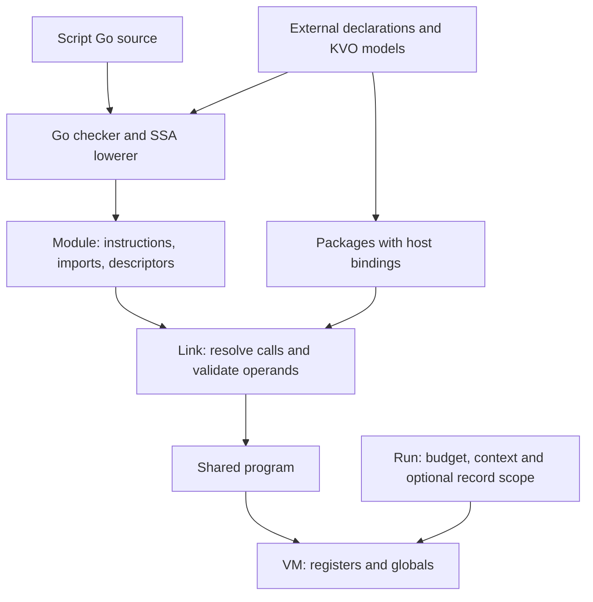

# Inside EVM

*How EVM compiles Go scripts and runs them inside a Go application.*

1. **The design.** The host application defines an external API. EVM compiles and runs scripts against it.
2. **Values, types, shapes, and KVO.** A type identifies a value. A shape describes its storage.
3. **The program image and the calling convention.** Each function owns its code and uses two register banks.
4. **Instruction set.** Each opcode entry gives the encoding, operands and effect.
5. **From Go source to a linked program.** Follow an addition through type checking, register assignment and instruction selection.
6. **Go, construct by construct.** Compare each Go example with the bytecode it produces.
7. **How Go enters the machine.** Follow a script that reads a row and passes its value to an external method.
8. **Running and stopping.** See when initialization runs and how limits, cancellation and script panics affect a session.
9. **Inside the evaluator.** Trace a call and return through the two frames that share its arguments.
10. **What makes a script fast.** Follow a packed read, a recursive call, a numeric loop and a transaction write. Compare EVM with Go and Lua interpreters and with LuaJIT.

**Appendix.** The author’s brief explains how to revise and check the book.

## 1. The design

A script calls `meter.Take("abc", 4)`. To compile it, EVM needs the declaration `func Take(string, int) int`. To run it, EVM also needs the Go function that implements `Take`. The host application supplies both. It can bind the same compiled script to a different meter without compiling the script again.



The schema holds the external API declarations. Compiling against that schema produces a module containing instructions and imports. Binding selects the Go receiver that implements the package functions. Linking resolves the imports and produces a program. Each VM that runs that program has its own registers and globals. A KVO property read uses a different part of that same contract: the module records the model and numeric property code, the linker checks them, and the running VM reads the row through the record’s access metadata.

| Change | Work that follows |
|---|---|
| Different meter instance | Bind its receiver and link the existing module. |
| Same program, independent globals | Create another VM from that program. |
| New script source | Compile and link again using the existing schema. |
| Changed external declarations | Build a schema, verify the wrappers, and recompile against the new type identities. |

For a script entry named `Run` with no arguments or results, the application compiles the source, links the external API and starts a VM:

```go
module, err := evmcompiler.Compile("main.go", source, schema.Package())
if err != nil {
    return err
}
program, err := evm.Link(module, schema.Bind(host))
if err != nil {
    return err
}
return evm.New(program).Run(ctx, "Run", nil, nil)
```

The compiler can reject `meter.Take(4, "abc")` from the signature alone. It never has to construct a meter or run its Go code.

The host application chooses which packages a script can import when it passes the source to the compiler. The linker checks table indices, type layouts and frame sizes. It relies on the compiler to emit pointer operations with the correct types. An external function runs as native Go code in the host process. Chapter 8 describes how cancellation works during that call.

## 2. Values, types, shapes, and KVO

### 2.1 What is in a value?

The word `1` can represent an integer, true, a one-byte string’s length or a function reference. The instruction that reads the register determines how to use those bits. The `values` package defines the storage:

```go
type Value struct {
    R uint64
    P unsafe.Pointer
}

func Int(v int64) Value {
    return Value{R: uint64(v)}
}

func String(v string) Value {
    return Value{R: uint64(len(v)), P: unsafe.Pointer(unsafe.StringData(v))}
}
```

On a 64-bit machine a general cell is 16 bytes. Arithmetic uses only an R register; the VM does not allocate a 16-byte cell for every integer operation. A string uses both banks. P is a pointer as far as Go’s collector is concerned, so live registers can keep string data alive. P is never a spare second integer, and R must never be the only reference to a Go object.

| Script value | R | P |
|---|---|---|
| Integer, bool, float | Decoded bits; signed narrow integers sign-extended. | Unused. |
| String | Byte length. | Immutable byte data. |
| Mutable slice | Length in low 32 bits, capacity in high 32. | Start of the backing buffer. Its layout is fixed by the compiler or the external ABI. |
| Map | Unused. | Map object. |
| Pointer | Unused. | Address. |
| Struct or array value | Unused. | Flattened snapshot; nil can represent all zeros. |
| `complex64` | Real and imaginary parts packed as two float32s. | Unused. |
| `complex128` | Unused. | Points to two float64 cells, one for each part. |
| Function | Program’s function-reference index + 1. | Captures, if any. |
| Interface | Payload, tag or concrete-type index; see §2.5. | Scalar marker, backing pointer or fallback box. |
| KVO record/list | Typed-pair tag, representation ID and auxiliary length. | Encoded/native payload. |

For a slice with length 2 and capacity 5, R is `0x0000000500000002`. The constructor packs both bounds into R:

```go
return Value{R: uint64(length) | uint64(capacity)<<32, P: p}
```

Copy the pair and both copies see the same elements. Reslice one and its R changes independently; P may advance into the same allocation. That is why a mutable slice needs both bounds, whereas a string only needs its byte length. The limit is on the number of elements, not their type.

### 2.2 What is in a type?

Each `Type` has an identity and a register representation:

```go
type Type struct {
    name string
    repr Repr
}
```

Two separately created `*Type` values with identical names need not mean the same type. Signatures compare their lists of pointers. Two types can also share a representation and remain distinct: `type Points int` and `type Rank int` both fit in R.

### 2.3 Shapes and the 16-bit index

A **shape** describes one Go type to the VM. It points to the type identity, describes how a value occupies memory, and links to shapes for the parts of a compound type. An instruction can refer to a shape by its index in the compiled module’s `Shapes` table. A million values of the same type can use the same entry. Their R and P payloads carry no copy of the descriptor.

`typeEnvironment.shape` looks up each Go type before creating its shape:

```go
t = types.Default(types.Unalias(t))
if s, ok := e.shapes.At(t).(*values.Shape); ok {
    return s, nil
}
s := &values.Shape{Cells: 1, DisplayName: displayTypeName(t)}
e.shapes.Set(t, s)
e.shapeOrder = append(e.shapeOrder, s)
```

Suppose the compiler needs `type Points int`, `type Rank int`, and `type Score = Points`. Points and Rank each get a shape. Their values fit in the same register bank, but Go distinguishes the two types. Score reuses Points because it is an alias. Likewise, two occurrences of `[]Points` share a slice shape whose element points back to Points. A `[100000]Points` adds one array shape with a length of 100,000. The length changes the storage cost of an array value without consuming an index for every element.

For `type Row struct { Code [2]uint16; Name string }`, the compiler walks the fields in order. This is the assignment inside `typeEnvironment.shape` (line breaks adjusted):

```go
s.Fields = append(s.Fields, values.Field{
    Name: field.Name(), Shape: fs, Offset: s.Cells,
    Embedded: field.Embedded(), Tag: u.Tag(i),
})
s.Cells += fs.Cells
```

```text
             offset in cells       representation in storage
Row.Code     0                     cell 0: R for Code[0]
                                   cell 1: R for Code[1]
Row.Name     2                     cell 2: R length, P bytes
Total        3 cells               48 logical bytes on a 64-bit machine
```

Script offsets count cells. Native Go offsets count bytes. A user-defined script struct can have a different layout from the same declaration compiled by native Go. A binding that casts script cells to `*Row` would read the wrong memory. The generated wrappers in chapter 7 use field offsets and codecs instead.

The compiler installs a shape in its cache *before* descending into the fields. For `type Node struct { Next *Node }` building the pointer’s element shape takes it back to the pending Node. Both references resolve to the same shape. The field itself costs one pointer cell. The linker also caches each copy before visiting its fields. Later edits to the module cannot change the linked shapes.

During compilation, `alloc`, `load` and `store` get a numeric index for each storage shape they address. Once the compiler finishes emitting code, it also appends every other shape it built to the same table. Importing an external package makes the compiler check every entry in its `Package.Types` against the Go layout, including types the script never mentions. The field, element and method-signature shapes reached from those declarations also count, once per distinct type.

Here are the counts for package `h` from EDB’s binding tests. The third script calls `h.Pair()`, reads `row.Bits`, and calls `ctx.Credit` with the result. Chapter 7 shows its instructions.

| Script source | Shapes in module | Distinct shape indices read by memory instructions |
|---|---:|---:|
| Empty `Run`, no imports | 0 | 0 |
| Empty `Run` with `import _ "h"` | 15 | 0 |
| `Run` reads the Bits field of an external Row | 16 | 1 |

The 16-bit limit is **65,536 entries per compiled module**. Each compiled module numbers its own shapes. A large imported API can still exhaust the table in a tiny script. In a boundary check, an external package declared 65,536 distinct named empty structs. A script with only a blank import and an empty function compiled. Adding one more struct produced the compile error `too many storage shapes`.

One way to remove that pressure would be to keep the full shape graph for type checking and assign short indices only to descriptors an instruction addresses. The row example would need just one short index, for the `uint16` load. Other metadata, such as the element shape of a slice, already refers to its child by pointer. The compiler today puts both kinds of shape in the numbered table.

### 2.4 Copying data without breaking aliases

A Bag with an integer and a slice takes two cells. A value copy gets its own integer cell and a copy of the slice header:

```text
a:  [ N: 1 ][ len: 1, cap: 1, P ] ─┐
                                    ├──> [ element: 2 ]
b:  [ N: 1 ][ len: 1, cap: 1, P ] ─┘
```

Writing b.N cannot change a.N. Writing b.Items[0] changes the element both values see. Chapter 6 follows the exact addresses the compiler emits for these writes.

`Shape.Stored` can return a pointer into mutable cells. The executor’s `load` takes this extra step (error handling omitted here):

```go
v, err := snapshot(shape, shape.Stored(p[b]), &budget.allocated, limits)
```

Inside `snapshot`, scalar values and nil aggregate snapshots pass through unchanged. An aggregate with a non-nil backing pointer gets separate cells, even if all its fields are zero:

```go
p, err := allocCells(s.Cells, allocated, limits)
if err != nil {
    return values.Value{}, err
}
s.Store(p, v)
return values.Value{P: p}, nil
```

`Shape.Store` copies a contiguous slice of cells. No recursive copy follows a pointer inside one of them. Go value assignment and Go pointer aliasing both fall out of that one choice.

The address supplies the first cell. The compiler knows the Go type at the dereference and puts its shape index into the instruction. The executor uses the shape to choose the register bank, decide whether the value needs a snapshot, and count the cells. Structs, arrays and `complex128` use aggregate storage.

| Type at the address | Load | Store |
|---|---|---|
| `int` | Read R from one cell. | Write R and clear the cell's P. |
| `string` | Read length and data pointer into R and P. | Write both halves. The string bytes stay in place. |
| `*Customer` | Read the pointer into P. | Write P and clear the cell's R. |
| `struct{ Customer *Customer }` | Copy one cell into fresh storage and put its address in P. | Copy that cell into the destination. A nil snapshot clears it. |

The last two rows have the same cell count and register representation. In the pointer case P holds the customer’s address. In the struct case P holds the address of a snapshot *containing* the customer’s address. Clearing the original field must preserve both the snapshot and its reference to the customer. The `Detach` listing in chapter 6 exercises exactly that case.

The full shape is convenient because the compiler already built it. A specialized instruction set could encode the first three rows as `load.r`, `load.v` and `load.p`, with matching stores. Aggregate instructions could carry a cell count and use it for both the copy and the budget charge. Field names, field types and methods play no part in copying the flattened cells.

### 2.5 Dynamic type and presence each have their place

`any(int(1))` needs a runtime type because its consumer can ask what it contains. Scalars retain all 64 payload bits in R and put a real pointer into the linked program's type-marker array in P. Strings and common slice headers use high-bit tags in R while P retains their backing storage. Pointer payloads keep a concrete type ID in R and the original pointer in P. Headers that do not fit remain boxed. All forms decode through the same API:

```go
shape, payload, err := program.UnpackInterface(value)
```

Only R=0 together with P=nil is a nil interface. A scalar zero has a nonnil marker pointer; a typed nil pointer has a nonzero type ID; a typed nil slice has its slice tag. Marker pointers must be checked before R tags because scalar bits can match any prefix. The exact type ID belongs to the linked program. Copying the pair into another program and hoping the ID still means the same thing is invalid; a host must pack against the destination's registration. [Exact layouts](../../values/README.md).

Presence is a different question. `m[k]` can hold zero whether the key was set or absent. The comma-ok form emits a second output, a bool. `values.Map.Find` returns `(*MapEntry, bool, error)`: a missing key is neither a zero-valued entry nor a failure comparing keys. Equality uses the key shape; for interface keys, comparability can depend on their *dynamic* type.

### 2.6 KVO gives a stored word a meaning

A KVO property code identifies a logical property across records. A VM field
offset identifies storage within one shape. Neither is a Go byte offset.

```go
count := kvo.NewSignedProp[int64](schema, 1, "sample:count", kvo.TInt64)
labels := kvo.NewMapProp(schema, 2, "sample:labels",
    kvo.MapOf(kvo.TMachineString, kvo.TMachineString),
    values.StringCodec[string](), values.StringCodec[string]())
model := kvo.NewModel(schema, entity, func(b *kvo.ModelBuilder) {
    b.Prop(count, kvo.PresenceIsSignificant)
    b.Prop(labels, kvo.Compact | kvo.KeepDictionaryZeroValues)
})
```

The declaration gives `count` its code and signed type. The model preserves a
stored zero. `KeepDictionaryZeroValues` controls entries inside `labels`,
independently of the outer property's presence. Native fields map by `kvo` tag;
presence-significant native scalars require `kvo.Optional[T]`. Registration
rejects incompatible mappings.

The codec supplies bytes; the property supplies interpretation:

```go
field := view.RawField(count.Code()) // Compact2 payload: ff
field.Decode(row2.Signed).AsInt()    // -1
field.Decode(row2.Word).AsUint()     // 255
```

Compact2 sign-extends short integers and walks a trailing catalog. Fast2 uses
full-width scalar slots and a key directory. Both can skip unknown fields;
Fast2 can contain Compact2 children. Neither needs to box a scalar read.
`Has` distinguishes absent from present-zero.

An immutable `kvo.Record` is one 16-byte typed pair: payload pointer plus tag,
representation ID and auxiliary length. Shared metadata identifies the model
and physical access strategy. MessagePack, Fast2, Compact2, native structs and
decoded memory use the same carrier. `call.SetRecordResult(model, cursor.Record())`
passes that carrier to EVM without a wrapper allocation.

The compiler resolves script selectors to property codes. For `c.profile.balance`,
it can fuse adjacent child/scalar reads when the child has one use. The operation
visits two directories without storing an intermediate record. A missing child
is an invalid dereference; a present child with no balance yields zero. Multiple
uses retain an ordinary child pair. There is no immutable-record scope slot or
per-read expiry check.

Borrowed bytes must remain valid. Host ownership effects tell the compiler which
results borrow, which calls retain arguments and which calls end a scope. The
compiler inserts ownership copies at escaping stores, returns and invalidating
calls. A search can copy only its returned match. Native Go callers must call
`Own()` or `Clone()` explicitly; they receive no compiler escape protection.

Mutable editors use scoped handles. A nested editor tracks its path to the root;
reads do not create missing children, while writes create required storage.
`FastSetPathValue` uses write options resolved at link time. The host flushes
materialized collection changes, saves the root and commits the transaction.

KVO records carry no hidden database key. Keep the lookup key separately, or
store an ordinary property marked `kvo.PrimaryKey`. Full decoding does not restore
an omitted key. See [access and ownership](../../kvo/_docs/ACCESS.md).

### 2.7 Collections and JSON in a record

Typed scalar/string lists can stay borrowed. Proven local, read-only EVM list
uses share KVO's 16-byte list cell; the VM caches traversal state. Escaping or
mutable uses materialize or own data as required. Reading a list does not always
mean decoding it into a Go slice. See [list cells](LIST-CELLS.md).

A JSON dictionary has fixed key type and dynamic values:

```go
extras := kvo.NewProp(schema, 34, "extras",
    kvo.MapOf(kvo.TMachineString, kvo.TJSON), nil)
```

Scripts see `map[string]any`. Present null differs from a missing key. JSON
integers retain signed/unsigned 64-bit precision. Materialized editor maps keep
aliases so assignments reach the same pending value; flush before save.

`Record.ToJSON` projects modeled data directly into an owned tree, applying
custom scalar JSON behavior at leaves. EVM converts that tree without a JSON
serialization round trip. `Program.JSONValue` produces owned Go JSON data;
`EncodeJSON` produces bytes. Both validate types, cycles, finite numbers, depth
and equivalent escaped output size. Native bindings may still need decoding for
custom codecs or schema migration.

## 3. The program image and the calling convention

### 3.1 What travels with a word of code

An EVM program is a Go object graph in memory. A `Function` owns its instruction words and a parallel array of source positions. A `Module` owns the things a word cannot hold: literal pools, variable-length lists of operands, signatures and type descriptions. The following fields hold the operands used in this example:

```go
// Selected fields of evm.Module
Functions    []Function
Imports      []Import
Words        []uint64
Strings      []string
Conversions  []Conversion
Shapes       []*values.Shape
ExtendedOps  []ExtendedOp
Globals      []*values.Shape
```

A reference in the instruction stream is an **index into a particular table**. Index zero in `Words` is unrelated to index zero in `Imports`. Code and data move together: copying only the instruction words from one module to another does not copy their meaning. Linking turns strings into ready-to-load length/pointer pairs, imports into call targets, and shape descriptions into a checked graph. There is no bytecode file to install.

The development assembler accepts this function:

```text
func square i64 -> i64
  registers 1 0
  mul.i64 r0 r0 r0
  ret
end
```

```text
square     1 R slot, 0 P slots
 PC  opcode    A  B  C
  0  mul.i64   0  0  0
  1  ret       0  0  0
```

On entry R0 contains the input. After PC 0 it contains the result. The assembler records signatures, labels and names first and resolves them as it emits instructions; there is no label lookup when the VM branches. It builds the same `Module` type as the compiler. It covers a small assembly vocabulary for writing machine tests; the compiler can emit operations the text assembler does not spell. The disassembler prints the full instruction set, so some listings cannot be assembled as text.

### 3.2 Two register banks, one window per call

Within a function R0 is a word in `vm.r` and P0 is a pointer in `vm.p`. They are unrelated unless the operand is V0, a *pair* which uses both at index zero. The signature determines the calling convention: `LayoutOf` gives pairs matching slots first, then independently numbers all remaining raw and pointer values in source order. For parameters `(string, *Bag, int)`, the layouts are:

```text
             source argument:   0: string    1: *Bag    2: int
             ABI slot:             V0           P1         R1
R window:                       byte length              int word
P window:                       byte data       Bag address
```

Result layout follows the same rule independently. A string parameter and an int result often both use R0. A wrapper must finish reading the incoming length before it writes the outgoing integer.

Inside a script function, the allocator handles a *new local* pair by aligning its two high-water marks. A nearly empty P bank can therefore have gaps:

```go
case values.Pair:
    n = max(f.r, f.p)
    f.r, f.p = n+1, n+1
```

In the compiled `Native(s string, n int) int { return meter.Take(s,n) }` example, the caller owns three R slots and one P slot. It writes the two halves of `s` and the word `n` into the outgoing area, then calls import zero. The unequal bases are visible in the operands:

```text
move.r r3 r0       ; caller R3 is callee R0
move.p p1 p0       ; caller P1 is callee P0
move.r r4 r1       ; caller R4 is callee R1
call.host imp0     ; meter.Take

                caller’s own slots   outgoing arguments / callee starts
word bank:      R0  R1  R2         | R3 = length   R4 = n
pointer bank:   P0                 | P1 = data
from callee:                         V0            R1
```

For a method, `ParameterLayout` reserves incoming V0 for the receiver, even if its concrete form needs just R or P. Explicit parameters begin at R1/P1. A virtual call can therefore read the incoming interface pair, resolve the concrete method, and overwrite the receiver in place; explicit arguments stay in their assigned slots.

The caller’s locals do not overlap the callee’s. The caller’s *outgoing* window overlaps the callee’s *incoming* window. The callee can return its result in that same area; no parameter array is copied or allocated at the call instruction. `VM.enterCode` computes the callee’s bases from the caller’s local counts:

```go
next := frame{
    function: int(ref.Index),
    rb: cur.rb + f.RCount, pb: cur.pb + f.PCount,
    recoverToken: recoverToken,
}
```

`RCount` and `PCount` are the caller’s own counts. The linker also computes larger sizes (`rSize`, `pSize`) that include the largest outgoing argument/result footprint the function may need. Advancing by those larger sizes instead would skip past the arguments. The VM grows the backing slices if necessary, clears any pointer slots beyond the callee’s parameters, installs captures and saves the caller’s frame. It also clears raw locals unless the linker proved each one is assigned before use. An address-taken script local lives in a separate cell, so growing a register slice leaves its address valid.

On return the callee leaves the result prefix intact and clears the remaining P slots. At the outermost return, the VM copies only the banks the declared result type uses into the host’s `[]values.Value`. That is how a scalar can leave the VM with P = nil even though the same-numbered P slot held a live object.

## 4. Instruction set

Consider the word `0x0003_0002_0001_0007`. The low sixteen bits, 7, mean `add.i64`. Read the other fields from right to left: A = 1, B = 2, C = 3. In the current frame this word executes `R[1] = R[2] + R[3]`. The same physical A field on a `store` names the pointer to write through. Its meaning comes entirely from the opcode.

### The instruction word and the module around it

```text
bits   63          48 47          32 31          16 15           0
ABC    |      C      |      B      |      A      |     opcode    |
A,BC   |             BC            |      A      |     opcode    |
```

The assembler builds the two wide-operand forms with shifts.

```go
func ABC(op Opcode, a, b, c uint16) Instruction {
    return Instruction(op) | Instruction(a)<<16 |
        Instruction(b)<<32 | Instruction(c)<<48
}

func WithBC(op Opcode, a uint16, bc uint32) Instruction {
    return Instruction(op) | Instruction(a)<<16 | Instruction(bc)<<32
}
```

Five fused operations use a third layout, ABCD12. The opcode still occupies bits 0–15. A, B, C and D start at bits 16, 28, 40 and 52. Each has twelve bits. A float expression can name its result and three inputs in one word. The stepped loop uses D for a signed displacement. If a register exceeds 4,095 or the branch falls outside −2,048…2,047, the compiler emits the original instructions.

The opcode selects the layout. In the second form, `BC = uint32(B) | uint32(C)<<16`. A function stores a slice of these 64-bit words. PC counts **words** from the start of that function. Every fetch advances PC by one, including a fetch that leads to a branch. A jump to itself has BC = 0xffffffff (−1). For a jump at PC 12 to PC 8, BC = 8 − 13 = −5. The linker rejects targets outside the function.

A module also carries tables. For example, `const` with A = 3 and BC = 0 reads `Words[0]` into R3. Set that table entry to `0x400921fb54442d18` and the single instruction loads the full float64 bit pattern for π. `add.f64` interprets those bits as a float. `eq.r` would compare the bits as words. Constants of any magnitude therefore cost one instruction, plus a pool entry when the value is new. String bytes, function signatures, source positions and variable-length operands likewise live outside the stream. These tables and the code form an in-memory Go `Module`. EVM has no serialized module format or specified file byte order.

When `VM.execute` enters or resumes a frame, it takes slices starting at the frame’s two bases. The fetch and add cases then index those local slices directly (intervening checks omitted):

```go
resumeFrame:
    f = &vm.program.functions[cur.function]
    r, p := vm.r[cur.rb:], vm.p[cur.pb:]
    // ... inside the dispatch loop ...
    ins := f.Code[cur.pc]
    cur.pc++
    a, b, c := int(ins.A()), int(ins.B()), int(ins.C())
    // ... in the opcode switch ...
    case OpAddI64:
        r[a] = r[b] + r[c]
```

Entering a callee can grow the backing arrays. Returning through `resumeFrame` takes fresh slices of the caller’s windows. In the tables below, `Ra` means the word at A in this frame, `Pa` the pointer at A, and `Va` both halves. A write to Ra leaves Pa alone. An index written `Shapes[C]` consumes only the 16-bit C field. An index written `Words[BC]` consumes both B and C. Fields marked **0** must literally be zero for the linker to accept the instruction. Opcode numbers are decimal; zero is not an instruction.

### Moving values and addressing memory

| Code | Mnemonic | Operation and operands |
|---:|---|---|
| 1 | `const` | Ra ← Words[BC]. |
| 2 | `string` | Va ← Strings[BC], already converted by the linker to a length and data pointer. |
| 3 | `move.r` | Ra ← Rb. C = 0. |
| 4 | `move.p` | Pa ← Pb. C = 0. |
| 5 | `move.v` | Va ← Vb. C = 0. |
| 6 | `clear.p` | Pa ← nil. B = C = 0. Releases this slot's reference. |
| 51 | `alloc` | Pa ← address of fresh zeroed storage for Shapes[B]. B is the 16-bit shape index. C is unused and must be zero. |
| 52 | `load` | Read through Pb into slot A using Shapes[C]. The shape chooses R, P or V. Snapshot an aggregate. |
| 53 | `store` | Write through Pa from slot B using Shapes[C]. The shape chooses the source bank(s) and how many cells to copy. |
| 55 | `global` | Pa ← address of session global BC. Read or mutate it with load/store. |
| 60 | `check.nil` | Raise a nil-pointer fault if Pa is nil. B = C = 0. |

`alloc` charges for the shape before allocating its cells. `load` and `store`
fault on a nil address. A field selection uses the enclosing shape's field list
and cell offset: `FieldAddr` computes an address, then `store` writes through it.
The same shape rules serve manual declarations and compiled structs. Opcode
numbers 36–39 belonged to the retired struct-specific family and remain reserved.

### Arithmetic, conversion and comparison

For each binary instruction below, A is the destination, B the left operand, C the right. Banks appear in the expression. Float operations read IEEE bits from R, operate at the stated width and write the result bits back into R. A float32 uses the low 32 bits. Every comparison writes exactly 0 or 1.

| Code | Mnemonic | Operation |
|---:|---|---|
| 7 | `add.i64` | Ra ← Rb + Rc modulo 2⁶⁴. |
| 8 | `sub.i64` | Ra ← Rb − Rc modulo 2⁶⁴. |
| 9 | `mul.i64` | Ra ← Rb × Rc modulo 2⁶⁴. |
| 10 | `div.i64` | Ra ← signed Rb / Rc, truncated toward zero. |
| 11 | `div.u64` | Ra ← unsigned Rb / Rc. |
| 12 | `rem.i64` | Ra ← signed remainder of Rb / Rc. |
| 13 | `rem.u64` | Ra ← unsigned remainder of Rb / Rc. |
| 18 | `and` | Ra ← bitwise AND of Rb and Rc. |
| 19 | `or` | Ra ← bitwise OR of Rb and Rc. |
| 20 | `xor` | Ra ← bitwise XOR of Rb and Rc. |
| 21 | `shl` | Ra ← Rb shifted left by Rc, discarding bits above bit 63. |
| 22 | `shr.i64` | Ra ← Rb shifted right by Rc with sign fill. |
| 23 | `shr.u64` | Ra ← Rb shifted right by Rc with zero fill. |
| 24 | `eq.r` | Ra ← Rb == Rc, comparing all word bits. |
| 25 | `eq.p` | Ra ← Pb == Pc, comparing pointer identity. |
| 26 | `lt.i64` | Ra ← signed Rb < Rc. |
| 27 | `lt.u64` | Ra ← unsigned Rb < Rc. |
| 40 | `convert` | Ra ← numeric conversion of Rb according to Conversions[C]. C is a descriptor index. |
| 41 | `check.shift` | Raise a shift fault if signed Ra < 0. B = C = 0. |

The compiler can use the same add for signed and unsigned operands. Their low 64 sum bits agree. It chooses distinct divide, remainder, right-shift and less-than instructions because those operations inspect the sign. All four integer division/remainder variants raise a language fault when Rc = 0. Shift counts use the full unsigned Rc. A signed script count of −1 must raise a fault *before* the shift, hence `check.shift`. The numeric conversion descriptor carries source and destination widths and signedness. Converting 260 from u64 to u8 masks it to 4.

| Code | Mnemonic | Operation |
|---:|---|---|
| 14 | `add.f64` | Ra ← Rb + Rc, float64. |
| 15 | `sub.f64` | Ra ← Rb − Rc, float64. |
| 16 | `mul.f64` | Ra ← Rb × Rc, float64. |
| 17 | `div.f64` | Ra ← Rb / Rc, float64. |
| 28 | `eq.f64` | Ra ← Rb == Rc, float64. |
| 29 | `lt.f64` | Ra ← Rb < Rc, float64. |
| 42 | `add.f32` | Ra ← Rb + Rc, float32. |
| 43 | `sub.f32` | Ra ← Rb − Rc, float32. |
| 44 | `mul.f32` | Ra ← Rb × Rc, float32. |
| 45 | `div.f32` | Ra ← Rb / Rc, float32. |
| 46 | `eq.f32` | Ra ← Rb == Rc, float32. |
| 47 | `lt.f32` | Ra ← Rb < Rc, float32. |
| 48 | `concat.str` | Va ← concatenation of Vb and Vc. |
| 49 | `eq.str` | Ra ← Vb == Vc by byte contents. |
| 50 | `lt.str` | Ra ← Vb < Vc, lexicographic byte order. |

For `eq.r`, +0.0 and −0.0 have different words. For `eq.f64` they compare equal. Floating division uses the floating-point rules for infinities and NaNs. A string comparison costs one instruction. Concatenation also reserves allocation bytes for the combined length.

### Branches, calls and returns

| Code | Mnemonic | Operation and operands |
|---:|---|---|
| 30 | `jump` | A = 0. Add signed BC to the next PC. |
| 31 | `jz` | If Ra = 0, add signed BC to the next PC. |
| 32 | `jnz` | If Ra ≠ 0, add signed BC to the next PC. |
| 33 | `call.func` | A = 0. Enter Functions[BC] at PC 0, using the caller's outgoing window. |
| 34 | `call.host` | A = 0. Call the native wrapper for Imports[BC] with the outgoing window. |
| 35 | `ret` | A = B = C = 0. Return results already in their ABI slots and restore the caller, or finish the outer Run. |
| 56 | `function` | Va ← (BC + 1, nil) for FunctionRefs[BC]. The target must be callable without captures. |
| 57 | `closure` | Va ← (function-reference index + 1, capture array). Closures[BC] gives the target and source registers. |
| 58 | `call.virt` | A = 0. The outgoing V0 holds the interface receiver. BC selects a shared method descriptor. Explicit arguments arrive in the outgoing window. |
| 59 | `call.indirect` | Call the function value Va with its captures and the outgoing window. BC selects the expected signature. |
| 66 | `loop.lt.i64` | Increment Ra by one, wrapping at 64 bits. If signed Ra < signed Rb, add signed C (16 bits) to the next PC. |
| 67 | `call.host.rr` | Call Imports[C] with Rb as its sole raw argument. Write its sole raw result to Ra. |
| 68 | `call.host.rp` | Call Imports[C] with Rb as its sole raw argument. Write its sole pointer result to Pa. |
| 69 | `jnil` | If Pa is nil, add signed BC to the next PC. |
| 70 | `jnotnil` | If Pa is non-nil, add signed BC to the next PC. |
| 71 | `load.index.r` | Read raw element Rc of slice Vb into Ra. Check the index against the slice length. |
| 72 | `store.index.r` | Store Rc at index Rb of slice Va. Check the same bound. |
| 73 | `le.i64` | Ra receives signed Rb ≤ signed Rc. |
| 74 | `le.u64` | Ra receives unsigned Rb ≤ unsigned Rc. |
| 75 | `mul.add.f64` | ABCD12. Ra ← (Rb × Rc) + Rd. Round the product to float64 before the addition. |
| 76 | `add.mul.f64` | ABCD12. Ra ← Rb + (Rc × Rd), with the same intermediate rounding. |
| 77 | `sub.add.f64` | ABCD12. Ra ← (Rb − Rc) + Rd. Preserve the order and rounding of both operations. |
| 78 | `loop.add.lt.i64` | ABCD12. Add Rc into Ra, wrapping at 64 bits. If signed Ra < signed Rb, add signed D to the next PC. |
| 79 | `loop.add.le.i64` | The same stepped loop with an inclusive upper bound. |
| 80 | `add.imm.i64` | Ra ← Rb + sign-extended C, wrapping at 64 bits. C holds a signed 16-bit literal. |
| 81 | `loop.le.i64` | Increment Ra by one, wrapping at 64 bits. If signed Ra ≤ signed Rb, add signed C to the next PC. |
| 139 | `load.index.byte` | Ra receives the byte at index Rc of local slice Vb, zero-extended. Check the index against the length. |
| 140 | `store.index.byte` | Store the low byte of Rc at index Rb of Va after the same check. |
| 141 | `load.index.word` | Ra receives the word at index Rc of local slice Vb. Each element occupies eight pointer-free bytes. |
| 142 | `store.index.word` | Store Rc at word index Rb of Va. |
| 143 | `load.index.ptr` | Pa receives the pointer at index Rc of local slice Vb. |
| 144 | `store.index.ptr` | Store Pc at pointer index Rb of Va through Go’s write barrier. |

All six check bounds before dereferencing the backing pointer. The compiler selects these words only when the slice and its aliases share the same packed layout.

A direct call indexes the function table. An external call (`call.host`) indexes the bound Go wrappers. An indirect call obtains the target from Va.R − 1, checks the BC signature and supplies Va.P as the environment. A zero function value raises a nil-function fault. An interface invocation resolves a method on the receiver's dynamic type, then unpacks the receiver in the same slot.

Even a call with no register operands can make the caller's linked frame larger. The linker reserves the largest outgoing parameter/result footprint among its calls. Each bank starts that area immediately after the caller's own slots. On return the VM clears callee P slots beyond the result prefix. A function with pending defers reaches `run.defers` before `ret`. A raw `ret` with an undrained stack is an invalid execution.

### External calls with register operands

Each word uses ABC. C is the 16-bit import index in every row. The suffix gives the explicit input types in order, followed by the result. A word (`u`) uses R, a string (`s`) uses both R and P, and a pointer (`p`) uses P. A method's receiver always lives in P[B].

| Call | A | B |
|---|---|---|
| Function with no arguments | Result | Literal zero |
| Function with one argument | Result | Argument |
| Function with two arguments | First argument, then result | Second argument |
| Pointer method with no explicit arguments | Result | Receiver |
| Pointer method with one explicit argument | Argument, then result | Receiver |

**Functions**

| Explicit arguments | Word result | String result | Pointer result |
|---|---|---|---|
| None | 88 `call.host.u` | 89 `call.host.s` | 90 `call.host.p` |
| `u` | 91 `call.host.uu` | 92 `call.host.us` | 93 `call.host.up` |
| `s` | 94 `call.host.su` | 95 `call.host.ss` | 96 `call.host.sp` |
| `p` | 97 `call.host.pu` | 98 `call.host.ps` | 99 `call.host.pp` |
| `u`, `u` | 100 `call.host.uuu` | 101 `call.host.uus` | 102 `call.host.uup` |
| `u`, `s` | 103 `call.host.usu` | 104 `call.host.uss` | 105 `call.host.usp` |
| `u`, `p` | 106 `call.host.upu` | 107 `call.host.ups` | 108 `call.host.upp` |
| `s`, `u` | 109 `call.host.suu` | 110 `call.host.sus` | 111 `call.host.sup` |
| `s`, `s` | 112 `call.host.ssu` | 113 `call.host.sss` | 114 `call.host.ssp` |
| `s`, `p` | 115 `call.host.spu` | 116 `call.host.sps` | 117 `call.host.spp` |
| `p`, `u` | 118 `call.host.puu` | 119 `call.host.pus` | 120 `call.host.pup` |
| `p`, `s` | 121 `call.host.psu` | 122 `call.host.pss` | 123 `call.host.psp` |
| `p`, `p` | 124 `call.host.ppu` | 125 `call.host.pps` | 126 `call.host.ppp` |

**Statically resolved pointer methods**

| Explicit arguments | Word result | String result | Pointer result |
|---|---|---|---|
| None | 127 `call.host.method.u` | 128 `call.host.method.s` | 129 `call.host.method.p` |
| `u` | 130 `call.host.method.uu` | 131 `call.host.method.us` | 132 `call.host.method.up` |
| `s` | 133 `call.host.method.su` | 134 `call.host.method.ss` | 135 `call.host.method.sp` |
| `p` | 136 `call.host.method.pu` | 137 `call.host.method.ps` | 138 `call.host.method.pp` |

For `call.host.method.su v3 p4 imp6`, the wrapper reads the string from R3/P3 and the receiver from P4. On success, R3 holds the boolean and P3 is cleared. If the script needs the old string again, the compiler copies it before the call. A raw-only destination ordinarily leaves the independent pointer at the same slot alone. Here the instruction owns both halves because A held a string. The disassembler prints `v` when either use of A is a string. For a tied raw-to-pointer or pointer-to-raw operation it prints the result bank. Both inputs may name the same register. The VM captures them before entering Go.

The linker checks the signature and local bank bounds, then replaces each register call with a private handler carrying the same A, B and C. The import supplies the argument and result banks there. Interface calls still resolve their target with `call.virt`.

Void bindings use the same argument forms with a `v` result suffix:
`call.host.v`, `call.host.uv`, `call.host.psv`, `call.host.method.sv`, and
the other combinations above. They read A and B without overwriting either
bank. Unused operands must be zero. For example,
`call.host.psv p2 v3 imp4` passes the pointer in P2 and the string in R3/P3;
`call.host.method.sv v3 p2 imp4` passes the receiver first. A void callback's
returned `values.Value` is ignored; its error still fails execution.
`HostCallOpcode(method, args, 0)` selects these instructions.

| Code | Mnemonic | Operation and operands |
|---:|---|---|
| 147 | `call.host.v` | Void register call; C is the import index; inputs follow the forms above. |
| 148 | `call.host.uv` | Void register call; C is the import index; inputs follow the forms above. |
| 149 | `call.host.sv` | Void register call; C is the import index; inputs follow the forms above. |
| 150 | `call.host.pv` | Void register call; C is the import index; inputs follow the forms above. |
| 151 | `call.host.uuv` | Void register call; C is the import index; inputs follow the forms above. |
| 152 | `call.host.usv` | Void register call; C is the import index; inputs follow the forms above. |
| 153 | `call.host.upv` | Void register call; C is the import index; inputs follow the forms above. |
| 154 | `call.host.suv` | Void register call; C is the import index; inputs follow the forms above. |
| 155 | `call.host.ssv` | Void register call; C is the import index; inputs follow the forms above. |
| 156 | `call.host.spv` | Void register call; C is the import index; inputs follow the forms above. |
| 157 | `call.host.puv` | Void register call; C is the import index; inputs follow the forms above. |
| 158 | `call.host.psv` | Void register call; C is the import index; inputs follow the forms above. |
| 159 | `call.host.ppv` | Void register call; C is the import index; inputs follow the forms above. |
| 160 | `call.host.method.v` | Void register call; C is the import index; inputs follow the forms above. |
| 161 | `call.host.method.uv` | Void register call; C is the import index; inputs follow the forms above. |
| 162 | `call.host.method.sv` | Void register call; C is the import index; inputs follow the forms above. |
| 163 | `call.host.method.pv` | Void register call; C is the import index; inputs follow the forms above. |

Direct void calls retain context cancellation, allocation charging and source
positions. Indirect calls, deferred calls, and calls beyond the compact import
range use the ordinary ABI. A script function that only forwards its unchanged
parameters to a direct void binding can compile to that binding without an extra
script frame. Functions with other statements, conversions or return values
retain their normal call semantics.

### Extended operations

| Code | Mnemonic | Operation and operands |
|---:|---|---|
| 54 | `extended` | A = 0. BC indexes ExtendedOps. The descriptor selects the operation and all input and output registers. |

In `v, ok := m[k]`, the map, key and two results need four register operands. An ABC word has room for three. A lookup also needs the key shape to hash k and the value shape to choose its output bank. The compiler records those facts in a descriptor. The linker validates each descriptor before execution:

```go
type ExtendedOp struct {
    Record  *RecordType // KVO key operations
    Kind    ExtendedKind
    Shape   *values.Shape
    Source  *values.Shape
    In, Out []Operand
    Index   uint64
    ChildKey uint64 // leaf property for ExtendedGetChildKey
    Flags   uint8
    Packed  bool    // typed backing for a local array or slice
}
type Operand struct {
    Slot uint16
    Repr values.Repr
}
```

For a `map[string]int` in P2, a string key in V0 and outputs in R3/R4, the descriptor is equivalent to the following. If this is descriptor four, the listing reads `extended ext4`. The VM reads the kind and operands from that module table entry; there is no second instruction word or setup register. Field access and interface assertions use the same encoding.

```text
Kind = Lookup     Shape = map[string]int
In   = [P2, V0]   Out   = [R3, R4]
```

The table omits the common `Extended` prefix from the kind names. Parentheses in the operation column denote optional operands. The linker checks register banks and arity for each kind. For instance, a map lookup can omit the presence output, whereas a string iterator always has three output slots.

| Kind | Inputs → outputs and effect |
|---|---|
| MakeInterface | value → interface. R gets the nonzero Index directly. A P value uses its own pointer. Other representations get a payload cell. |
| TypeAssert | interface → value (, ok). On a miss, write zero and false for comma-ok, or panic for a single output. |
| GetKey / SetKey | Read or write a KVO property by schema code. Immutable records/children use RP pairs; mutable editors use scoped handles. Scalar results use their declared register representation. |
| GetChildKey | Immutable parent handle → leaf word. Index identifies the child property, ChildKey its leaf. Source describes the intermediate pointer and Shape the result. The linker checks the model chain. |
| FieldAddr / Field | struct address → address, or struct value → field value. Index holds VMFieldBase plus the field ordinal. Its offset counts cells. |
| IndexAddr / Index | array or slice, index → checked element address or value. Packed selects byte, word or pointer stride. String indexing produces a byte. |
| PackedArray | No inputs → P. Allocate Shape.Len zeroed elements. Shape.Elem selects their stride and whether Go must trace pointers. |
| PackedLoad / PackedStore | Element address → scalar value, or address and value → write. The element address came from a checked index. A nil address faults. |
| Slice | base, low, high, max → header. Flags bits 0 and 1 default high to length and max to capacity. |
| MakeSlice / SliceToArray | length, capacity → new slice, or slice → pointer to array after a length check. |
| MakeMap | (reserve hint) → new map. The current allocator ignores the hint. |
| Lookup / MapUpdate | map, key → value (, ok), or map, key, value → update. Writing a nil map panics. |
| Delete / Clear | map, key → delete entry, or map/slice → remove entries or zero elements. |
| Len / Cap | collection → R length or capacity where defined by Go. |
| Append / Copy | destination, source → updated slice or element count. Flag 1 admits a string source for a byte slice. |
| Range / Next | map/string → iterator, then iterator → more, key, value. For strings the last two outputs are byte offset and rune. |
| Convert | value of Source → value of Shape. Handles string, byte/rune slice, integer-to-string and complex conversions. |
| Equal | two values → equality by Shape, including dynamic comparability for interface payloads. |
| Complex / Real / Imag | real, imaginary → complex, or complex → selected component. |
| ComplexBinary / ComplexNegate | two complex values → sum, difference, product or quotient selected by Flags, or one → negation. |
| MinMax | one or more values → minimum (Flags = 0) or maximum (1), using the shape's ordering. |

### Defers and panic

| Code | Mnemonic | Operation and operands |
|---:|---|---|
| 61 | `defer.stack` | Ra ← current frame's defer-stack handle. Create it on first use. B = C = 0. |
| 62 | `defer` | Capture target and evaluated arguments from Defers[BC]. A = 0 for the current frame, or Ra supplies the owner handle when ExternalStack is true. |
| 63 | `run.defers` | A = B = C = 0. Drain the current frame's saved calls, most recent first, then continue if none panicked. |
| 64 | `panic` | Begin unwinding with interface Va. B = C = 0. A nil interface becomes a PanicNilError value. |
| 65 | `recover` | Va ← panic interface if this invocation may recover it, otherwise the nil interface. B = C = 0. |

A defer descriptor selects a direct target, function value, interface invocation, panic or recover. An external stack handle lets a synthesized range-function body register a call on its enclosing function. Each handle carries a generation and a stack index. The VM rejects a handle once the owning frame has closed it. Budget exhaustion and cancellation abort execution outside script panic/recover.

A final instruction must be `ret`, `panic` or an unconditional `jump`. Otherwise execution could fall past the end even if every operand was individually valid. Link-time validation checks indices, window bounds, representations and these control-flow edges. Pointer provenance still comes from the typed compiler. The interface for untrusted scripts accepts Go source.

## 5. From Go source to a linked program

### 5.1 Adding two bytes

<!-- listing: Arithmetic | Arithmetic(250,10)==4 -->
```go
func Arithmetic(x, y uint8) uint8 {
    return x + y
}
```

<!-- bytecode -->
```text
fun0 Arithmetic   R=2 P=0
     ; Arithmetic.go:2      return x + y
  0  add.i64       r0 r0 r1
  1  convert       r0 r0 cnv0  ; u64 -> u8
  2  ret
```
<!-- /bytecode -->

With inputs 250 and 10, PC 0 writes 260 to R0, reusing x’s slot. PC 1 narrows it to 4 in place. PC 2 returns that word. The VM implements eight-bit addition with these two operations:

```go
case OpAddI64:
    r[a] = r[b] + r[c]
// ...
case OpConvert:
    r[a] = vm.program.conversions[c].convert(r[b])
```

The low eight bits of 260 are 4. The compiler selects a u64-to-u8 conversion to keep those bits. The add itself can operate on a full word.

### 5.2 Get a typed function

A script can start with a function without a package declaration. The frontend scans the first token and, when needed, prepends `package plugin`. It counts that extra line. Diagnostics use physical file positions and subtract the prefix; a `//line` comment cannot move an error to a different file.

`compileTyped` supplies its own importer to the Go type checker:

```go
config := types.Config{
    GoVersion: "go1.23", Sizes: types.SizesFor("gc", "amd64"),
    Importer: c.env,
}
pkg := types.NewPackage("plugin", "")
err := types.NewChecker(&config, c.files, pkg, info).Files([]*ast.File{file})
```

The target has Go 1.23 language semantics and 64-bit Go sizes, even when compiling elsewhere. `info` records declared objects, selector resolutions and generic instantiations. The importer admits explicitly supplied packages and the virtual standard library. From `typeEnvironment.Import`:

```go
decl, ok := e.packages[p]
if !ok {
    if source, exists := evm.StandardLibrarySource(p); exists {
        return e.importStandard(p, source)
    }
    return nil, fmt.Errorf("package %q is not exposed", p)
}
```

A script that calls `meter.Take` must import `"meter"`, even when its schema is available. Conversely, `import "os"` cannot reach the host filesystem. A program that type-checks in Go can still be outside the VM language. The frontend rejects channel types, sends, select and goroutines; lowering can reject an unsupported operation with its source position. On error `Compile` returns diagnostics instead of a partial module.

The typed package then enters `golang.org/x/tools/go/ssa`. The compiler supplies the parsed files for script and virtual Go bodies, and typed declarations for an external package. The compiler builds the SSA package and finds the functions to lower:

```go
prog := ssa.NewProgram(c.files, ssa.InstantiateGenerics|ssa.SanityCheckFunctions)
// ... create the imported packages ...
c.pkg = prog.CreatePackage(pkg, []*ast.File{file}, info, true)
c.pkg.Build()
functions := c.discoverFunctions(prog, file, info, needsInit)
```

For `Arithmetic`, SSA records the two parameters and the typed result of a binary add. In a loop there are also basic blocks, control-flow edges and phi inputs. For a closure there is a separate function and a list of free variables. The lowerer reads these SSA instructions.

### 5.3 Turn SSA values into slots

Discovery visits concrete script functions and follows call targets and method sets, including instantiated functions and generated method wrappers. An open generic template has no executable calling convention yet. Each discovered executable gets a function index **before any body is lowered**. For mutually recursive functions A and B, the compiler can emit a call to B while it is still lowering A.

For each function, `lowerFunction` assigns positions for incoming parameters and result slots, reserves captures, then visits the SSA instructions to register their results and operands. Its register map is one-to-many:

```go
regs map[ssa.Value][]vreg

type vreg struct {
    slot uint16
    typ  *values.Type
}
```

A result tuple has one slot per component. For `x, ok := m[k]`, the extended lookup can write x and ok directly to their two slots. Each SSA projection becomes another name for one of them during register assignment:

```go
if extract, ok := v.(*ssa.Extract); ok {
    f.register(extract.Tuple)
    if regs := f.regs[extract.Tuple]; regs != nil {
        f.regs[v] = regs[extract.Index : extract.Index+1]
    }
    return
}
```

The `Extract` instruction itself emits no move. A call that returns a tuple still uses the outgoing window. When all its users extract components, the call emitter moves only the results they use back to caller-local slots. Calling a function for its side effects still emits the call.

The emitter loads constants, globals and function references that need slots, then emits one basic block at a time. For the addition, `lowerer.binary` chooses a word opcode and explicitly narrows narrow integers:

```go
f.emit(evm.ABC(op, dst.slot, x.slot, y.slot))
if numeric && n.Kind != evm.NumericFloat && n.Bits < 64 {
    f.numericConvert(dst, dst, evm.NumericType{Kind: n.Kind, Bits: 64}, n)
}
```

Both addition and narrowing write R0. The add has already read x when it reuses that slot. Return reads R0 directly. The allocator normally assigns a fresh slot to each SSA result. It shares equal non-nil scalar and string constants of the same Go type within the function (complex constants are handled separately). The pool shares bit patterns across the module; the per-function literal map also saves the repeated load and register. Loop-carried scalar updates have one further reuse rule below.

Two operands depend on information the compiler gets later: the PC of a branch target and the base of an outgoing window. The lowerer records both uses and patches the instructions after it has emitted the body.

`emit` appends an instruction and its source position at the same index:

```go
func (f *lowerer) emit(ins evm.Instruction) {
    f.code.Code = append(f.code.Code, ins)
    var pos evm.SourcePosition
    if f.pos.IsValid() {
        pos = f.c.position(f.pos)
    }
    f.code.Positions = append(f.code.Positions, pos)
}
```

A failing arithmetic instruction or external function can therefore identify its script source line by function and PC.

### 5.4 Decisions the emitter makes before it knows the final PCs

The script code calls a helper and multiplies its result:

```go
func sum(x, y int) int {
    return x + y
}

func SumThenDouble(x, y int) int {
    return 2 * sum(x, y)
}
```

In `2*sum(x,y)`, the literal needs a register because multiplication reads two registers. The direct call needs a function index. The parameters already have slots in the caller’s frame.

When `lowerFunction` scans a call’s operands, it skips the function used as a direct target:

```go
case *ssa.Function:
    if call, ok := i.(ssa.CallInstruction); ok && operand == &call.Common().Value {
        continue
    }
```

The pointer comparison identifies the operand's *role*. In `apply(sum)`, the same function can appear as an argument. The scan then registers a function value, and the prologue can emit `function` to materialize it. For the integer literal, the module pool is shared across functions. The first half of `typedCompiler.word` looks up the bits in a map. On a miss the new index equals the old pool length:

```go
i := uint32(len(c.module.Words))
c.words[x] = i
c.module.Words = append(c.module.Words, x)
return i
```

Compile this example with `evmcompiler.Options{NoOptimization: true}` to see the call window. The default compiler inlines `sum`. The first six instructions in debug mode use these operands.

```text
0  const      r4 wrd0   ; word 0x2
1  move.r     r5 r0
2  move.r     r6 r1
3  call.func  fun2      ; sum
4  move.r     r2 r5
5  mul.i64    r3 r4 r2
```

The compiler first emits PC 1 as a move into outgoing slot **zero**. Once lowering finishes, the local R count is five: two parameters, two intermediate results and the literal 2. The patch changes that destination to R5. PC 4 has the reverse problem: its *source* is outgoing result zero. The compiler records the direction of the patch when it emits the move. Both moves now refer to the same physical slot without either lowering routine having to predict the other's register use.

Pairs impose a second constraint on allocation. After three raw allocations and one pointer allocation, the next pair must start at index three so both halves have the same number. Here is the pair case in `lowerer.alloc`, where the two counters mean “first free slot”:

```go
case values.Pair:
    n = max(f.r, f.p)
    f.r, f.p = n+1, n+1
```

That allocation leaves two holes in the pointer bank. It also lets `move.v` name a complete pair with one source index and one destination index.

For a loop, the successor’s phi nodes specify an assignment for each incoming edge. An unconditional predecessor can emit its copies immediately and fall through if the destination block is next. A conditional predecessor must copy only on the chosen edge. If that edge needs copies, the lowerer creates a separate label, emits the copies after the ordinary blocks and jumps back to the destination. For a conditional whose false edge is physically next, it emits just `jnz` to the true edge. For `!=` used only by the branch, it can test equality and swap the successors.

Here is the body and return path of the compiled `Fib` example in chapter 6. At loop entry R3 holds n, R4 holds a and R6 holds b. R5 contains zero.

```text
 PC  instruction        effect
  6  add.i64 r1 r4 r6   compute a+b before changing a or b
  7  add.imm.i64 r3 r3 -1  n-- directly in the slot for the next n
  8  move.r  r4 r6      next a = old b
  9  move.r  r6 r1      next b = sum
 10  jump    2          go to the test at PC 13
 11  move.r  r0 r4      result = a
 12  ret
 13  lt.i64  r8 r5 r3   0 < n
 14  jz      r8 -4      exit at PC 11
 15  jump    -10        run the body at PC 6
```

Before emission, `reuseLoopSlots` recognized the back edge to a header that dominates its predecessor. It let the decrement write directly into the n phi’s slot: this arithmetic result stays local to the update and phi, and nobody reads the old n after the decrement. The pass also counts the other phis’ incoming values as reads at the end of the block. Writing the sum straight into b would destroy the old b that PC 8 still needs.

`parallelCopy` schedules the remaining assignments in their declared order. For the two moves above, neither destination overwrites a source that a later move needs. No scratch slot is needed. For a swap `R2 ← R1, R1 ← R2`, the first destination would clobber the second source. The emitter first saves R2 in a temporary, then emits the two moves. It tracks R and P separately: writing R2 cannot clobber P2, but it can clobber the R half of V2. The same scheduler assigns return slots.

Only do all labels have word addresses. These are the two lines that determine the displacement, with the signed-range check omitted:

```go
delta := int64(f.labels[p.target]) - int64(p.pc) - 1
f.code.Code[p.pc] = evm.WithBC(ins.Op(), ins.A(), uint32(int32(delta)))
```

In Fib, `14  jz r8 -4` branches to PC 11 when R8 is zero. Its displacement is `11 - 14 - 1 = -4`. The evaluator increments the PC during fetch, so it adds −4 to 15. Compiler and evaluator agree on the address of the *next* word as their origin.

### 5.5 Finish the program before dispatch

A `Module` can say “call import 0, `meter.Take`,” but has no receiver to call. `Link` builds an export map keyed by package, name and receiver type. For each import it takes a copy of the declaration, compares the signatures, and computes the two slot layouts. Record results retain their model and pair representation. The essential lines are below.

```go
g := linkNative(f, args, results)
// The linked declaration retains its signature and ownership effects.
p.natives = append(p.natives, g)
```

The linker appends wrappers in import order, so both a general call’s BC and a register call’s C keep their original index. `linkNative` records the maximum of parameter and result counts for each bank. On a hot host call those two numbers already give the size of the borrowed window. At runtime dispatch indexes `p.natives`; no map or string is involved. A nonmatching receiver or a different nominal parameter type fails linking, even when the types happen to have the same storage.

The linker snapshots mutable input slices and shapes, computes each function’s outgoing footprint, binds method targets, and checks each instruction against the resulting frame and tables. For example:

```go
case OpConvert:
    valid = r(a) && r(b) && c < len(p.conversions)
```

This verifies that both R slots exist and the descriptor index is valid. That is distinct from proving the bit pattern in Rb came from a script `uint64`. That information came from the typed frontend. The architecture relies on both checks in that order.

## 6. Go, construct by construct

A type alias disappears during type checking. SSA turns a short-circuit expression into a branch between basic blocks. A map lookup reaches the interpreter as a typed operation.

The disassembly below each Go example comes from compiling that example.
The book calls `Module.DisassembleFunction` for each listing. A comment gives the source line when it changes. Trailing unused zero fields disappear. Register names start with r, p or v. A table operand has a three-letter prefix followed by its index. For example, `call.func fun2` enters the function whose listing starts with `fun2`. A branch displacement is a signed number.

| Table | Prefix | Table | Prefix |
|---|---|---|---|
| Functions | `fun` | External imports | `imp` |
| Function references | `ref` | Call signatures | `sig` |
| Word constants | `wrd` | String constants | `str` |
| Shapes | `shp` | Field references | `fld` |
| Struct descriptors | `stc` | Globals | `gbl` |
| Extended operations | `ext` | Numeric conversions | `cnv` |
| Closures | `cls` | Interface methods | `mth` |
| Deferred calls | `dfr` | Dynamic types | `typ` |

The PC starts at zero in each function. Registers are local to one frame;
`V3` means R3 and P3 together. Pool and function indices are local to one
compilation. Recompiling after a source change can assign different register numbers.

### 6.1 Local variables and addressable storage

<!-- listing: Visit | Visit()==7 && Visit()==9 -->
```go
type Points int
type Total = Points

const (
    First Points = 1 << iota
    Next
)

var balance Total = First

func init() {
    balance += 4
}

func Visit() Points {
    balance += Next
    return balance
}
```

<!-- bytecode -->
```text
fun1 Visit   R=4 P=1
     ; Visit.go:15  func Visit() Points {
  0  global        p0 gbl0  ; plugin.Points
     ; Visit.go:16      balance += Next
  1  load          r1 p0 shp0  ; plugin.Points
  2  add.imm.i64   r2 r1 2
  3  store         p0 r2 shp0  ; plugin.Points
     ; Visit.go:17      return balance
  4  load          r3 p0 shp0  ; plugin.Points
  5  move.r        r0 r3
  6  ret

fun2 init   R=3 P=2
  0  global        p0 gbl1  ; bool
  1  global        p1 gbl0  ; plugin.Points
  2  const         r1 wrd3  ; word 0x1
  3  const         r2 wrd3  ; word 0x1
  4  load          r0 p0 shp1  ; bool
  5  jnz           r0 3  ; -> PC 9
  6  store         p0 r1 shp1  ; bool
     ; Visit.go:9  var balance Total = First
  7  store         p1 r2 shp0  ; plugin.Points
  8  call.func     fun3  ; init#1
  9  ret

fun3 init#1   R=2 P=1
     ; Visit.go:11  func init() {
  0  global        p0 gbl0  ; plugin.Points
     ; Visit.go:12      balance += 4
  1  load          r0 p0 shp0  ; plugin.Points
  2  add.imm.i64   r1 r0 4
  3  store         p0 r1 shp0  ; plugin.Points
     ; Visit.go:11  func init() {
  4  ret
```
<!-- /bytecode -->

The machine has an address for `balance` and no address for `Next`. At PC 0,
`global` puts the address of this session's `balance` in P0. PC 1 loads its value. PC 2 adds the literal two encoded in the instruction. The load, add and store implement
`+=`. The caller can observe the store: a fresh session initializes `balance`
to one, calls the user's `init` to add four, then two calls to `Visit` return
seven and nine. The compiler builds a package initializer in addition to the
user's function; PCs 7–8 of `init` store the initial Points value and call `init#1`, the user's initializer.

That is the difference between a package variable, which lives across calls in
one VM, and a constant declaration. Go typing resolves typed and untyped
constants, including `iota`, before emission. The defined type
`Points` keeps its identity for methods and type assertions; `Total` is another
spelling for the same type. Neither declaration executes. A local `var` or
`:=` does not push a slot just because it starts a scope. SSA can keep a local in
a register, merge its values at a join, or put it in a cell if something needs
its address. A zero value can be a word of zero bits, a cleared P slot, or
zeroed cells. Assigning to `_` discards a result, not the side effects of
evaluating it.

A package clause, an import, its alias, a dot import and a qualified package
selector settle names before emission. A blank import must still resolve. The
compiler forbids global variables and `init` functions in virtual standard
packages, so blank-importing one does not add work to session startup.

### 6.2 Operators: what a type makes the compiler emit

<!-- listing: Mask | Mask(255,1)==60 -->
```go
func Mask(x uint8, shift int) uint8 {
    return (x &^ 0x87) >> shift
}
```

<!-- bytecode -->
```text
fun1 Mask   R=6 P=0
     ; Mask.go:1  func Mask(x uint8, shift int) uint8 {
  0  const         r3 wrd3  ; word 0x87
     ; Mask.go:2      return (x &^ 0x87) >> shift
  1  const         r4 wrd4  ; word 0xffffffffffffffff
  2  xor           r5 r3 r4
  3  and           r2 r0 r5
  4  convert       r2 r2 cnv0  ; u64 -> u8
  5  check.shift   r1
  6  shr.u64       r0 r2 r1
  7  convert       r0 r0 cnv0  ; u64 -> u8
  8  ret
```
<!-- /bytecode -->

`0x87` and all ones come out of the pool. XOR produces the complement, AND
clears those bits of x, and the first conversion narrows the result. Although
the value being shifted is unsigned, the *count* has signed type `int`.
Hence the check on R1 followed by an **unsigned** shift of R2. With x = 255
and count = 1, the answer is 60. A negative count takes the script panic path.
The emitter rewrites the right operand of AND-NOT before it selects the final AND. These lines account for the two different masks and the temporary at PC 2:

```go
case token.AND_NOT:
    mask := f.literal(^uint64(0))
    tmp := f.alloc(y.typ)
    f.emit(evm.ABC(evm.OpXor, tmp.slot, y.slot, mask.slot))
    y = tmp
    op = evm.OpAnd
```

Parentheses and unary plus need no
instruction. A constant expression can fold, including string concatenation;
a surviving number loads from the word pool, a string from the string pool.

| Go expression | Lowering decision |
|---|---|
| Integer `+ - *`, unary `-` | Word addition, subtraction, multiplication; negate as zero minus x. Narrow the result when needed. |
| Integer `/ %` | Signed or unsigned division/remainder. A zero divisor raises a script panic. |
| `&`, `\|`, `^`, `&^` | AND, OR, XOR. Unary complement XORs with all ones. AND-NOT uses the two operations in Mask. |
| `<< >>` | Check a dynamic signed count. Right shift selects arithmetic or logical shift by the *left* operand's type. |
| `!`, `==`, `!=` | Negate a boolean by comparing it to zero. Pointer equality compares P. String equality compares content; struct, array, complex and interface equality use a shape. |
| `< > <= >=` | Pick signed, unsigned, float or string comparison. Swap operands for greater-than. Integers have a direct less-or-equal instruction. Strings and floats combine less-than and equality. Negating greater-than gives the wrong result for NaN. |
| Float arithmetic and conversion | Use f32 or f64 opcodes. Unary minus flips the sign bit, including on zero. Numeric conversion selects a descriptor with both widths and both numeric kinds. |
| String `+` | Read two length/pointer pairs, reserve space for concatenation, return another pair. |
| `&&`, `\|\|` | Branch around the right operand. Any calls on that side are conditional (§6.3). |
| Complex arithmetic, negation | A typed descriptor selects the complex operation; the shape says where to find the two components. |
| `min`, `max` | Fold constants when possible; otherwise use MinMax with a flag selecting max. |

<!-- listing: Components | Components(3,4)==7 -->
```go
func Components(x, y float32) float64 {
    z := complex(x, y)
    w := complex128(z)
    return max(real(w), imag(w)) + min(real(w), imag(w))
}
```

<!-- bytecode -->
```text
fun1 Components   R=9 P=1
     ; Components.go:2      z := complex(x, y)
  0  extended      ext0  ; Complex complex64  [r0,r1] -> [r2]
     ; Components.go:3      w := complex128(z)
  1  extended      ext1  ; Convert complex64 -> complex128  [r2] -> [p0]
     ; Components.go:4      return max(real(w), imag(w)) + min(real(w), imag(w))
  2  extended      ext2  ; Real complex128  [p0] -> [r3]
  3  extended      ext3  ; Imag complex128  [p0] -> [r4]
  4  extended      ext4  ; MinMax f64  [r3,r4] -> [r5] flags=1
  5  extended      ext5  ; Real complex128  [p0] -> [r6]
  6  extended      ext6  ; Imag complex128  [p0] -> [r7]
  7  extended      ext7  ; MinMax f64  [r6,r7] -> [r8]
  8  add.f64       r0 r5 r8
  9  ret
```
<!-- /bytecode -->

The first four instructions use `extended` with different descriptors. `complex(x,y)`
packs two float32 bit patterns into R2. The conversion needs two float64 cells,
so the next result lives in P0. Real and Imag read those cells into separate
raw slots. The two MinMax descriptors select max and min (flags 1 and 0); only
the final addition is a scalar arithmetic opcode.

A spelling that looks like a numeric conversion can request a copy or a new
encoding. `string(r)` treats r as a Unicode code point; `string([]byte)` and
`[]rune(s)` create the target representation. The conversion descriptor carries
the source and destination shapes. A change between named types of the same
underlying representation, such as `Points(n)` for `n int`, can lower to a
move. Converting a slice to an array also checks its length and copies the elements.

### 6.3 Statements become edges

<!-- listing: Choose | Choose(0,9)==0 && Choose(2,9)==4 -->
```go
func Choose(d, n int) int {
    if d != 0 && n/d > 1 {
        return n / d
    }
    return 0
}
```

<!-- bytecode -->
```text
fun1 Choose   R=7 P=0
     ; Choose.go:1  func Choose(d, n int) int {
  0  const         r3 wrd0  ; word 0x0
  1  const         r6 wrd4  ; word 0x1
     ; Choose.go:2      if d != 0 && n/d > 1 {
  2  eq.r          r2 r0 r3
     ; Choose.go:1  func Choose(d, n int) int {
  3  jz            r2 5  ; -> PC 9
  4  jump          2  ; -> PC 7
     ; Choose.go:3          return n / d
  5  div.i64       r0 r1 r0
  6  ret
     ; Choose.go:5      return 0
  7  move.r        r0 r3
  8  ret
     ; Choose.go:2      if d != 0 && n/d > 1 {
  9  div.i64       r4 r1 r0
 10  lt.i64        r5 r6 r4
     ; Choose.go:1  func Choose(d, n int) int {
 11  jz            r5 -5  ; -> PC 7
 12  jump          -8  ; -> PC 5
```
<!-- /bytecode -->

PC 2 tests `d == 0`, even though the source says `d != 0`. Only the branch
reads that boolean. The compiler can keep the equality result and exchange
the two successors. For a zero divisor, r2 is one. PC 3 falls through to
the jump at 4 and the function returns zero at PCs 7–8. For a nonzero
divisor, PC 3 jumps to 9 to evaluate the second half of `&&`. If that
test succeeds, PC 12 sends execution to 5, which divides again for the
return expression.

The exchange happens before the emitter chooses the branch opcode:

```go
yes, no := f.edge(b, b.Succs[0]), f.edge(b, b.Succs[1])
slot := f.regs[i.Cond][0].slot
if neg, ok := i.Cond.(*ssa.BinOp); ok && branchUsesInequality(neg) {
    yes, no = no, yes
}
```

When one successor follows in the instruction stream, control can fall
through to it. Otherwise the emitter writes a conditional branch and a
jump. It patches the displacements after laying out the blocks. At PC 12,
`jz r6 -5` reaches PC 8 because the instruction fetch has already advanced
the PC to 13. An `if` initializer, an `else if` and a nested `if` change
the graph and the scope of names. The same branch instructions suffice.

A loop adds a second incoming path to its header. In the next example,
follow the old value of b as it changes roles on that path.

<!-- listing: Fib | Fib(6)==8 -->
```go
func Fib(n int) int {
    a, b := 0, 1
    for ; n > 0; n-- {
        a, b = b, a+b
    }
    return a
}
```

<!-- bytecode -->
```text
fun1 Fib   R=9 P=0
     ; Fib.go:1  func Fib(n int) int {
  0  const         r5 wrd2  ; word 0x0
  1  const         r7 wrd3  ; word 0x1
  2  move.r        r3 r0
  3  move.r        r4 r5
  4  move.r        r6 r7
  5  jump          7  ; -> PC 13
     ; Fib.go:4          a, b = b, a+b
  6  add.i64       r1 r4 r6
     ; Fib.go:3      for ; n > 0; n-- {
  7  add.imm.i64   r3 r3 -1
     ; Fib.go:1  func Fib(n int) int {
  8  move.r        r4 r6
  9  move.r        r6 r1
 10  jump          2  ; -> PC 13
     ; Fib.go:6      return a
 11  move.r        r0 r4
 12  ret
     ; Fib.go:3      for ; n > 0; n-- {
 13  lt.i64        r8 r5 r3
     ; Fib.go:1  func Fib(n int) int {
 14  jz            r8 -4  ; -> PC 11
 15  jump          -10  ; -> PC 6
```
<!-- /bytecode -->

The loop header needs n, a and b from either the entry or the previous
iteration. SSA represents each choice with a phi. On entry, PCs 2–4 put n
in r3, zero in r4 and one in r6. In the loop, PC 6 computes a+b in r1
while both old values are live. PC 7 decrements n in r3 itself. The
compiler can reuse that loop slot because the old n has had its last read.
PCs 8–9 install the next a and b in order: first `r4 ← r6`, then
`r6 ← r1`. PC 10 transfers control to the header test.

The lowerer emits phi assignments on each incoming edge. A block with a
single successor can make the assignments before its jump. A conditional
edge that needs its own copies gets a separate block. The same move
scheduler handles return values. Its decision to save a source depends on
whether a preceding destination in the planned order would overwrite the
bank that source uses:

```go
banks := src.typ.Repr()
if written[src.slot]&banks != 0 {
    tmp := f.alloc(src.typ)
    f.move(tmp, src)
    from[i] = tmp
}
dst := to[i]
written[dst.slot] |= dst.typ.Repr()
```

Those saves run before the destination writes. Fib can move the old b
straight into a. A swap would need to save the value that the first move
would destroy. Ordinary assignments, increments, decrements and compound
assignments likewise become reads, writes or new SSA values. Go evaluates
the operands of a multiple assignment before carrying out its writes.

<!-- listing: Route | Route(1)==3 && Route(9)==0 -->
```go
func Route(n int) int {
    v := 0
outer:
    for {
        switch n {
        case 0:
            break outer
        case 1:
            v++
            fallthrough
        case 2:
            v += 2
            goto done
        default:
            n = 0
            continue outer
        }
    }
done:
    return v
}
```

<!-- bytecode -->
```text
fun1 Route   R=11 P=0
     ; Route.go:1  func Route(n int) int {
  0  const         r2 wrd3  ; word 0x0
  1  const         r5 wrd0  ; word 0x1
  2  const         r9 wrd4  ; word 0x2
  3  move.r        r1 r0
     ; Route.go:6          case 0:
  4  eq.r          r3 r1 r2
     ; Route.go:1  func Route(n int) int {
  5  jz            r3 3  ; -> PC 9
  6  jump          14  ; -> PC 21
  7  move.r        r6 r5
  8  jump          3  ; -> PC 12
     ; Route.go:8          case 1:
  9  eq.r          r4 r1 r5
     ; Route.go:1  func Route(n int) int {
 10  jz            r4 4  ; -> PC 15
 11  jump          -5  ; -> PC 7
     ; Route.go:12              v += 2
 12  add.imm.i64   r7 r6 2
     ; Route.go:1  func Route(n int) int {
 13  move.r        r10 r7
 14  jump          4  ; -> PC 19
     ; Route.go:11          case 2:
 15  eq.r          r8 r1 r9
     ; Route.go:1  func Route(n int) int {
 16  jnz           r8 6  ; -> PC 23
 17  move.r        r1 r2
 18  jump          -15  ; -> PC 4
     ; Route.go:20      return v
 19  move.r        r0 r10
 20  ret
 21  move.r        r10 r2
 22  jump          -4  ; -> PC 19
 23  move.r        r6 r2
 24  jump          -13  ; -> PC 12
```
<!-- /bytecode -->

For `n == 1`, PC 9 recognizes case 1. PC 7 sets v to one. The jump at 8 enters the body of case 2 at 12, skipping its comparison at 15. PC 12 adds two. PCs 13–14 send the result to the common return at 19. That path implements `fallthrough` followed by `goto done`. The default case sets n to zero at 17 and jumps to the first test for `continue outer`.

Expression switches, expressionless switches, case lists and default all
use tests and edges. A case expression runs only when execution reaches
its test. Labels identify destinations for `goto`, `break` and
`continue`. An unconditional `for {}` has a back edge and still spends
dispatch fuel. A type switch builds its tests from assertions (§6.7).

### 6.4 Taking the address of a field

<!-- listing: Edit | Edit()==12 -->
```go
type Pair struct{ A, B int }

func Edit() int {
    p := new(Pair)
    *p = Pair{B: 3}
    q := &p.B
    *q *= 4
    return p.B
}
```

<!-- bytecode -->
```text
fun1 Edit   R=6 P=5
     ; Edit.go:3  func Edit() int {
  0  clear.p       p2
  1  const         r1 wrd1  ; word 0x3
  2  const         r4 wrd2  ; word 0x4
     ; Edit.go:4      p := new(Pair)
  3  alloc         p0 shp0  ; plugin.Pair
     ; Edit.go:5      *p = Pair{B: 3}
  4  extended      ext0  ; FieldAddr plugin.Pair.B (int)  [p0] -> [p1]
  5  store         p0 p2 shp0  ; plugin.Pair
  6  store         p1 r1 shp1  ; int
     ; Edit.go:6      q := &p.B
  7  extended      ext1  ; FieldAddr plugin.Pair.B (int)  [p0] -> [p3]
     ; Edit.go:7      *q *= 4
  8  load          r2 p3 shp1  ; int
  9  mul.i64       r3 r2 r4
 10  store         p3 r3 shp1  ; int
     ; Edit.go:8      return p.B
 11  extended      ext2  ; FieldAddr plugin.Pair.B (int)  [p0] -> [p4]
 12  load          r5 p4 shp1  ; int
 13  move.r        r0 r5
 14  ret
```
<!-- /bytecode -->

P0 is the address returned by `new(Pair)`. The keyed literal zeros the whole
struct (the source at PC 5 is a cleared P2), then sets field B to three. PC 7
selects field number one again and puts **its address** in P3. Thus the two
threes at PC 10 mean different things: the address is P3 and the product is R3.
The store's C field selects the `int` shape.

These lines of the executor resolve the selector:

```go
field := s.Fields[op.Index &^ VMFieldBase]
p := values.CellAt(x.P, field.Offset)
```

For FieldAddr the executor checks x.P for nil and returns p. A nested field's
offset counts VM cells, not native Go bytes. A `Field` read
from a struct *value* instead snapshots the field when it is itself an
aggregate. Chained selectors and promoted fields use the selection path that
Go typing resolved. Dereferencing a nil pointer fails at the operation that
needs its pointee.

`&T{...}`, keyed and positional literals, omitted fields, address-of on a
local and explicit dereference all use this vocabulary: `alloc`, stores to
components, and `load`. SSA can remove an allocation when the value stays in
registers. Manual host declarations use these same shape-based operations.

A selector on a copied struct can lead back to the original data. In the next example watch PCs 18–20 for the copy, then PCs 22 and 25 for the two writes.

<!-- listing: Copies | Copies()==17 -->
```go
type Bag struct {
    N     int
    Items []int
}

func Copies() int {
    a := Bag{N: 1, Items: []int{2}}
    b := a
    b.N = 9
    b.Items[0] = 7
    return 10*a.N + a.Items[0]
}
```

<!-- bytecode -->
```text
fun1 Copies   R=20 P=17
     ; Copies.go:6  func Copies() int {
  0  const         r1 wrd1  ; word 0x0
  1  const         r2 wrd2  ; word 0x2
  2  const         r6 wrd3  ; word 0x1
  3  const         r7 wrd4  ; word 0x9
  4  const         r11 wrd5  ; word 0x7
  5  const         r14 wrd6  ; word 0xa
     ; Copies.go:7      a := Bag{N: 1, Items: []int{2}}
  6  alloc         p0 shp0  ; plugin.Bag
  7  extended      ext0  ; FieldAddr plugin.Bag.N (int)  [p0] -> [p1]
  8  extended      ext1  ; FieldAddr plugin.Bag.Items ([]int)  [p0] -> [p2]
  9  alloc         p3 shp1  ; [1]int
     ; Copies.go:6  func Copies() int {
 10  extended      ext2  ; IndexAddr [1]int  [p3,r1] -> [p4]
     ; Copies.go:7      a := Bag{N: 1, Items: []int{2}}
 11  store         p4 r2 shp2  ; int
 12  const         r17 wrd1  ; word 0x0
 13  const         r18 wrd1  ; word 0x0
 14  const         r19 wrd1  ; word 0x0
 15  extended      ext3  ; Slice [1]int  [p3,r17,r18,r19] -> [v5] flags=3
 16  store         p1 r6 shp2  ; int
 17  store         p2 v5 shp3  ; []int
     ; Copies.go:8      b := a
 18  alloc         p6 shp0  ; plugin.Bag
 19  load          p7 p0 shp0  ; plugin.Bag
 20  store         p6 p7 shp0  ; plugin.Bag
     ; Copies.go:9      b.N = 9
 21  extended      ext4  ; FieldAddr plugin.Bag.N (int)  [p6] -> [p8]
 22  store         p8 r7 shp2  ; int
     ; Copies.go:10      b.Items[0] = 7
 23  extended      ext5  ; FieldAddr plugin.Bag.Items ([]int)  [p6] -> [p9]
 24  load          v10 p9 shp3  ; []int
 25  store.index.r v10 r1 r11
     ; Copies.go:11      return 10*a.N + a.Items[0]
 26  extended      ext6  ; FieldAddr plugin.Bag.N (int)  [p0] -> [p12]
 27  load          r12 p12 shp2  ; int
 28  mul.i64       r13 r14 r12
 29  extended      ext7  ; FieldAddr plugin.Bag.Items ([]int)  [p0] -> [p13]
 30  load          v15 p13 shp3  ; []int
 31  load.index.r  r16 v15 r1
 32  add.i64       r0 r13 r16
 33  ret
```
<!-- /bytecode -->

PCs 18–20 allocate the second Bag, snapshot the first Bag's cells, and
store them into the second. PC 22 writes nine to the integer field in the
second Bag. PC 25 reaches through its copied slice header to the backing
cell shared with the first Bag. The result is 17 because a.N still holds
one and a.Items[0] now holds seven.

The box and its first field share an address because the field has offset zero. The following loads read that cell through two different shapes.

<!-- listing: Detach | Detach(&Box{Customer: new(Customer)}) -->
```go
type Customer struct{ ID int }
type Box struct{ Customer *Customer }

func Detach(p *Box) bool {
    saved := *p
    customer := p.Customer
    p.Customer = nil
    return saved.Customer == customer
}
```

<!-- bytecode -->
```text
fun1 Detach   R=1 P=9
     ; Detach.go:4  func Detach(p *Box) bool {
  0  clear.p       p6
     ; Detach.go:5      saved := *p
  1  alloc         p1 shp0  ; plugin.Box
  2  load          p2 p0 shp0  ; plugin.Box
  3  store         p1 p2 shp0  ; plugin.Box
     ; Detach.go:6      customer := p.Customer
  4  extended      ext1  ; FieldAddr plugin.Box.Customer (*plugin.Customer)
                         ; [p0] -> [p3]
  5  load          p4 p3 shp2  ; *plugin.Customer
     ; Detach.go:7      p.Customer = nil
  6  extended      ext2  ; FieldAddr plugin.Box.Customer (*plugin.Customer)
                         ; [p0] -> [p5]
  7  store         p5 p6 shp2  ; *plugin.Customer
     ; Detach.go:8      return saved.Customer == customer
  8  extended      ext3  ; FieldAddr plugin.Box.Customer (*plugin.Customer)
                         ; [p1] -> [p7]
  9  load          p8 p7 shp2  ; *plugin.Customer
 10  eq.p          r0 p8 p4
 11  ret
```
<!-- /bytecode -->

At PC 2, P0 points at the box. Shape 0 tells `load` to snapshot its cell. At PC 5, P3 holds the same address, but shape 2 tells `load` to read the customer pointer stored there. PC 7 clears the field in the original box. At PC 10 the pointer in the saved box still compares equal to the original non-nil customer pointer.

### 6.5 Arrays, slices, strings and maps

Watch the third slice bound. It forces append to allocate a new backing buffer. The later copy shows which array changed.

<!-- listing: Tail | Tail()==29 -->
```go
func Tail() int {
    a := [...]int{1, 2, 3}
    s := a[1:2:2]
    s = append(s, 9)
    copy(s[:1], a[:1])
    return a[1]*10 + s[1]
}
```

<!-- bytecode -->
```text
fun1 Tail   R=24 P=14
     ; Tail.go:1  func Tail() int {
  0  const         r1 wrd1  ; word 0x0
  1  const         r2 wrd2  ; word 0x1
  2  const         r3 wrd3  ; word 0x2
  3  const         r4 wrd4  ; word 0x3
  4  const         r6 wrd5  ; word 0x9
  5  const         r15 wrd6  ; word 0xa
     ; Tail.go:2      a := [...]int{1, 2, 3}
  6  extended      ext0  ; PackedArray [3]int  [] -> [p0]
     ; Tail.go:1  func Tail() int {
  7  extended      ext1  ; IndexAddr [3]int  [p0,r1] -> [p1] packed
  8  extended      ext2  ; IndexAddr [3]int  [p0,r2] -> [p2] packed
  9  extended      ext3  ; IndexAddr [3]int  [p0,r3] -> [p3] packed
     ; Tail.go:2      a := [...]int{1, 2, 3}
 10  extended      ext4  ; PackedStore int  [p1,r2] -> []
 11  extended      ext5  ; PackedStore int  [p2,r3] -> []
 12  extended      ext6  ; PackedStore int  [p3,r4] -> []
     ; Tail.go:3      s := a[1:2:2]
 13  extended      ext7  ; Slice [3]int  [p0,r2,r3,r3] -> [v5] packed
     ; Tail.go:4      s = append(s, 9)
 14  extended      ext8  ; PackedArray [1]int  [] -> [p6]
     ; Tail.go:1  func Tail() int {
 15  extended      ext9  ; IndexAddr [1]int  [p6,r1] -> [p7] packed
 16  extended      ext10  ; PackedStore int  [p7,r6] -> []
 17  const         r17 wrd1  ; word 0x0
 18  const         r18 wrd1  ; word 0x0
 19  const         r19 wrd1  ; word 0x0
 20  extended      ext11  ; Slice [1]int  [p6,r17,r18,r19] -> [v8] packed
                          ; flags=3
     ; Tail.go:4      s = append(s, 9)
 21  extended      ext12  ; Append []int  [v5,v8] -> [v9] packed
     ; Tail.go:5      copy(s[:1], a[:1])
 22  const         r20 wrd1  ; word 0x0
 23  const         r21 wrd1  ; word 0x0
 24  extended      ext13  ; Slice []int  [v9,r20,r2,r21] -> [v10] packed flags=2
 25  const         r22 wrd1  ; word 0x0
 26  const         r23 wrd1  ; word 0x0
 27  extended      ext14  ; Slice [3]int  [p0,r22,r2,r23] -> [v11] packed
                          ; flags=2
 28  extended      ext15  ; Copy []int  [v10,v11] -> [r12] packed
     ; Tail.go:6      return a[1]*10 + s[1]
 29  extended      ext16  ; IndexAddr [3]int  [p0,r2] -> [p12] packed
 30  extended      ext17  ; PackedLoad int  [p12] -> [r13]
 31  mul.i64       r14 r13 r15
 32  load.index.word r16 v9 r2
 33  add.i64       r0 r14 r16
 34  ret
```
<!-- /bytecode -->

PC 13 forms the slice with bounds from r2, r3 and r3 again: 1, 2, 2.
Its length and capacity are both one. The compiler constructs a one-element
slice containing nine in v8. Appending it at PC 21 requires a new backing
array. At PC 28 the Copy descriptor takes v10 (`s[:1]`) as its destination
and v11 (`a[:1]`) as its source. The copy changes the new array. The
original still holds two at a[1], so the return value is 2 × 10 + 9 = 29.

The two omission flags matter. For `s[:]`, the compiler supplies zero
registers for the missing bounds but sets flags to distinguish an absent high
or max from an *explicit* zero. The core of the executor is:

```go
if op.Flags&1 != 0 {
    hi = length
}
if op.Flags&2 != 0 {
    capBound = capacity
}
if lo > hi || hi > capBound || capBound > capacity {
    return ErrBounds
}
```

After those checks, a nonempty tail advances the data pointer by `lo` elements using the backing buffer’s stride. A mutable slice packs length and capacity into R. A substring uses byte offsets and returns an immutable string view. Slice length and capacity
are limited to 32 bits. Builtin `copy` handles overlap; a string source for
copy or append to a byte slice sets a separate flag.

| Source | Result |
|---|---|
| `var s []T` / `make([]T,n,k)` | A nil pair / a MakeSlice descriptor with length, capacity and element shape. |
| `s[i] = x` / `x = s[i]` | A checked indexed word can read or write an element directly. A separately used address goes through IndexAddr and a typed load or store. |
| `a := [...]T{...}` / `[]T{...}` | Fixed-size array and element stores; the slice case also forms a header over its backing array. Omitted entries stay zero. |
| `len`, `cap`, `clear(s)` | Constant lengths and capacities can fold. A string’s length lives in R. A slice’s length occupies the low 32 bits of R. A descriptor reads its capacity or a map’s length. Clear zeros the current length. |
| `text[i]` / `for i,r := range text` | Index returns a byte; the iterator returns a byte offset and a decoded rune. |

<!-- listing: Counts | Counts("éé")==2 -->
```go
func Counts(text string) int {
    m := make(map[rune]int)
    for _, r := range text {
        m[r]++
    }
    n, ok := m['é']
    delete(m, 'é')
    clear(m)
    if ok {
        return n
    }
    return 0
}
```

<!-- bytecode -->
```text
fun1 Counts   R=10 P=3
     ; Counts.go:1  func Counts(text string) int {
  0  const         r8 wrd1  ; word 0xe9
  1  const         r9 wrd2  ; word 0x0
     ; Counts.go:2      m := make(map[rune]int)
  2  extended      ext0  ; MakeMap map[rune]int  [] -> [p1]
     ; Counts.go:3      for _, r := range text {
  3  extended      ext1  ; Range string  [v0] -> [p2]
     ; Counts.go:1  func Counts(text string) int {
  4  extended      ext2  ; Next string  [p2] -> [r1,r2,r3] flags=1
  5  jz            r1 4  ; -> PC 10
     ; Counts.go:4          m[r]++
  6  extended      ext3  ; Lookup map[rune]int  [p1,r3] -> [r4]
  7  add.imm.i64   r5 r4 1
  8  extended      ext4  ; MapUpdate map[rune]int  [p1,r3,r5] -> []
     ; Counts.go:1  func Counts(text string) int {
  9  jump          -6  ; -> PC 4
     ; Counts.go:6      n, ok := m['é']
 10  extended      ext5  ; Lookup map[rune]int  [p1,r8] -> [r6,r7]
     ; Counts.go:7      delete(m, 'é')
 11  extended      ext6  ; Delete map[rune]int  [p1,r8] -> []
     ; Counts.go:8      clear(m)
 12  extended      ext7  ; Clear map[rune]int  [p1] -> []
     ; Counts.go:1  func Counts(text string) int {
 13  jz            r7 2  ; -> PC 16
     ; Counts.go:10          return n
 14  move.r        r0 r6
 15  ret
     ; Counts.go:12      return 0
 16  move.r        r0 r9
 17  ret
```
<!-- /bytecode -->

At PC 6 the first Lookup writes the old count to r4, yielding zero for an
absent key. The second Lookup at 10 implements `n, ok := m['é']` and
writes both the count (r6) and presence (r7). The branch at 13 reads r7
directly. PC 8 implements the map assignment with one instruction.
`ext4` supplies the map p1, the key r3 and the new count r5.

The string iterator has a different result layout. At PC 4 r1, r2 and r3
hold success, byte index and rune. For `"éé"` the successful indices are 0 and 2. The execution
loop in `ExtendedNext` advances by bytes consumed, not by one:

```go
r, n := utf8.DecodeRuneInString(it.text[it.index:])
put(0, values.Bool(true))
put(1, values.Int(int64(it.index)))
put(2, values.Int(int64(r)))
it.index += n
```

Three loops, one aliased slice, and one copied array: follow the array conversion before tracing the repeated index and branch instructions.

<!-- listing: RangeKinds | RangeKinds([]int{2,3})==17 -->
```go
func RangeKinds(s []int) int {
    a := [2]int(s)
    p := (*[2]int)(s)
    p[0]++
    n := 0
    for i := range 2 {
        n += a[i]
    }
    for _, x := range s {
        n += x
    }
    for _, x := range p {
        n += x
    }
    return n
}
```

<!-- bytecode -->
```text
fun1 RangeKinds   R=27 P=10
     ; RangeKinds.go:1  func RangeKinds(s []int) int {
  0  const         r1 wrd0  ; word 0x0
  1  const         r5 wrd1  ; word 0x2
  2  const         r16 wrd5  ; word 0xffffffffffffffff
     ; RangeKinds.go:2      a := [2]int(s)
  3  alloc         p1 shp0  ; [2]int
     ; RangeKinds.go:1  func RangeKinds(s []int) int {
  4  extended      ext3  ; SliceToArray *[2]int  [v0] -> [p2]
     ; RangeKinds.go:2      a := [2]int(s)
  5  load          p3 p2 shp0  ; [2]int
  6  store         p1 p3 shp0  ; [2]int
     ; RangeKinds.go:3      p := (*[2]int)(s)
  7  extended      ext4  ; SliceToArray *[2]int  [v0] -> [p4]
     ; RangeKinds.go:4      p[0]++
  8  extended      ext5  ; IndexAddr [2]int  [p4,r1] -> [p5]
  9  load          r2 p5 shp1  ; int
 10  add.imm.i64   r3 r2 1
 11  extended      ext6  ; IndexAddr [2]int  [p4,r1] -> [p6]
 12  store         p6 r3 shp1  ; int
     ; RangeKinds.go:1  func RangeKinds(s []int) int {
 13  lt.i64        r4 r1 r5
 14  jz            r4 33  ; -> PC 48
 15  jump          29  ; -> PC 45
     ; RangeKinds.go:7          n += a[i]
 16  extended      ext7  ; IndexAddr [2]int  [p1,r7] -> [p7]
 17  load          r8 p7 shp1  ; int
 18  add.i64       r9 r6 r8
     ; RangeKinds.go:1  func RangeKinds(s []int) int {
 19  add.imm.i64   r10 r7 1
 20  lt.i64        r11 r10 r5
 21  jz            r11 31  ; -> PC 53
 22  jump          27  ; -> PC 50
 23  convert       r13 r0 cnv0  ; u64 -> u32
 24  move.r        r14 r12
 25  move.r        r15 r16
 26  add.imm.i64   r17 r15 1
 27  lt.i64        r18 r17 r13
 28  jz            r18 4  ; -> PC 33
     ; RangeKinds.go:9      for _, x := range s {
 29  load.index.r  r19 v0 r17
     ; RangeKinds.go:10          n += x
 30  add.i64       r14 r14 r19
     ; RangeKinds.go:1  func RangeKinds(s []int) int {
 31  move.r        r15 r17
 32  jump          -7  ; -> PC 26
 33  move.r        r21 r14
 34  move.r        r22 r16
 35  add.imm.i64   r23 r22 1
 36  lt.i64        r24 r23 r5
 37  jz            r24 5  ; -> PC 43
     ; RangeKinds.go:12      for _, x := range p {
 38  extended      ext8  ; IndexAddr [2]int  [p4,r23] -> [p9]
     ; RangeKinds.go:1  func RangeKinds(s []int) int {
 39  load          r25 p9 shp1  ; int
     ; RangeKinds.go:13          n += x
 40  add.i64       r21 r21 r25
     ; RangeKinds.go:1  func RangeKinds(s []int) int {
 41  move.r        r22 r23
 42  jump          -8  ; -> PC 35
     ; RangeKinds.go:15      return n
 43  move.r        r0 r21
 44  ret
 45  move.r        r6 r1
 46  move.r        r7 r1
 47  jump          -32  ; -> PC 16
 48  move.r        r12 r1
 49  jump          -27  ; -> PC 23
 50  move.r        r6 r9
 51  move.r        r7 r10
 52  jump          -37  ; -> PC 16
 53  move.r        r12 r9
 54  jump          -32  ; -> PC 23
```
<!-- /bytecode -->

Both conversions first perform the *same* bounds-checked slice-to-array-pointer
operation. The difference is PCs 5–6: `a` receives a snapshot; `p` keeps
the backing pointer. Incrementing through p leaves a at [2,3] and changes the
others to [3,3], giving 5 + 6 + 6. The three forms of range here are counter
loops: over an integer bound, over a slice length, and over a fixed array
length. Each element address advances by its shape's cell count. The Go
frontend gives iteration variables declared by the loop their Go 1.23
per-iteration lifetimes, including when a closure retains one.

<!-- listing: MapRange | MapRange()==5 -->
```go
func MapRange() int {
    m := map[int]int{1: 2, 2: 3}
    n := 0
    for k, v := range m {
        n += v
        delete(m, k)
    }
    return n + len(m)
}
```

<!-- bytecode -->
```text
fun1 MapRange   R=11 P=2
     ; MapRange.go:1  func MapRange() int {
  0  const         r1 wrd1  ; word 0x2
  1  const         r2 wrd2  ; word 0x1
  2  const         r3 wrd3  ; word 0x3
  3  const         r5 wrd4  ; word 0x0
     ; MapRange.go:2      m := map[int]int{1: 2, 2: 3}
  4  extended      ext0  ; MakeMap map[int]int  [r1] -> [p0]
  5  extended      ext1  ; MapUpdate map[int]int  [p0,r2,r1] -> []
  6  extended      ext2  ; MapUpdate map[int]int  [p0,r1,r3] -> []
     ; MapRange.go:4      for k, v := range m {
  7  extended      ext3  ; Range map[int]int  [p0] -> [p1]
     ; MapRange.go:1  func MapRange() int {
  8  move.r        r4 r5
  9  extended      ext4  ; Next map[int]int  [p1] -> [r6,r7,r8]
 10  jz            r6 3  ; -> PC 14
     ; MapRange.go:5          n += v
 11  add.i64       r4 r4 r8
     ; MapRange.go:6          delete(m, k)
 12  extended      ext5  ; Delete map[int]int  [p0,r7] -> []
     ; MapRange.go:1  func MapRange() int {
 13  jump          -5  ; -> PC 9
     ; MapRange.go:8      return n + len(m)
 14  extended      ext6  ; Len map[int]int  [p0] -> [r10]
 15  add.i64       r0 r4 r10
 16  ret
```
<!-- /bytecode -->

A map literal creates a map and inserts entries. Assignment copies the map
reference. Reading a nil map works; updating one raises a script panic. Map
range cannot compute the next key from an integer index and a stride. It saves
the entries slice on entry. Next walks that initial range, skipping entries
marked dead; Delete can therefore remove the current entry during traversal.
The result here is five regardless of visit order. A script must not depend on
the order of this implementation.

### 6.6 Calls, closures and methods

This listing uses the unoptimized compiler to show the two frames. In default mode the addition executes in the caller.

<!-- listing: SumThenDouble | raw | SumThenDouble(2,5)==14 -->
```go
func sum(x, y int) int {
    return x + y
}

func SumThenDouble(x, y int) int {
    return 2 * sum(x, y)
}
```

<!-- bytecode -->
```text
fun1 SumThenDouble   R=5 P=0
     ; SumThenDouble.go:5  func SumThenDouble(x, y int) int {
  0  const         r4 wrd0  ; word 0x2
     ; SumThenDouble.go:6      return 2 * sum(x, y)
  1  move.r        r5 r0
  2  move.r        r6 r1
  3  call.func     fun2  ; sum
  4  move.r        r2 r5
  5  mul.i64       r3 r4 r2
  6  move.r        r0 r3
  7  ret

fun2 sum   R=3 P=0
     ; SumThenDouble.go:2      return x + y
  0  add.i64       r2 r0 r1
  1  move.r        r0 r2
  2  ret
```
<!-- /bytecode -->

SumThenDouble owns r0 through r4. PCs 1–2 write the arguments to r5
and r6. The callee sees those same slots as r0 and r1. PC 3 needs only
the function index for `sum`. When `sum` returns, PC 4 reads its result
from r5. Here is the argument loop inside `emitCall`:

```go
for j, arg := range common.Args {
    f.outMove(params.Slots[j], f.regs[arg][0], false)
}
```

The call executes even if the script ignores its results. For a tuple
result whose uses are all extractions, the compiler can restrict the
copies out of the return window to the components the caller reads.

For a recursive direct call, the index can refer to the current function. Each
invocation still gets new local windows and a VM frame. The interpreter drives
the stack in a loop subject to its call-depth limit.

<!-- listing: Counter | Counter(4)()==5 -->
```go
func Counter(start int) func() int {
    return func() int {
        start++
        return start
    }
}
```

<!-- bytecode -->
```text
fun1 Counter   R=3 P=3
     ; Counter.go:1  func Counter(start int) func() int {
  0  alloc         p1 shp0  ; int
  1  store         p1 r0 shp0  ; int
  2  closure       v2 cls0  ; plugin.Counter$1$2, captures [p1]
     ; Counter.go:2      return func() int {
  3  move.v        v0 v2
  4  ret

fun0 BookCheck   R=5 P=2
     ; Counter.go:7  func BookCheck() bool {
  0  const         r2 wrd0  ; word 0x4
  1  const         r4 wrd1  ; word 0x5
     ; Counter.go:8      return Counter(4)()==5
  2  move.r        r5 r2
  3  call.func     fun1  ; Counter
  4  move.r        r1 r5
  5  move.p        p1 p2
  6  call.indirect v1 sig0  ; callable v1; () -> (int)
  7  move.r        r3 r5
  8  eq.r          r0 r3 r4
  9  ret

fun2 plugin.Counter$1$2   R=4 P=1
     ; Counter.go:3          start++
  0  load          r1 p0 shp0  ; int
  1  add.imm.i64   r2 r1 1
  2  store         p0 r2 shp0  ; int
     ; Counter.go:4          return start
  3  load          r3 p0 shp0  ; int
  4  move.r        r0 r3
  5  ret
```
<!-- /bytecode -->

The argument starts in R0. The compiler puts it in a cell and captures P1, the
cell's address. A capture of the *initial integer* would be wrong: two calls
on the same closure must see successive values. The function result is a pair:
a reference number and a pointer to the capture environment. Assigning that
pair to another variable preserves the shared cell. A function declaration
used as a value, without captures, needs only `function` to build a callable
pair. The check for this example calls `Counter(4)()`. Its first call names Counter; the second emits `call.indirect` on the returned pair. The instruction names that register and a signature. The runtime checks for nil and resolves the target before entry.

Find both calls to Plus: one calls through a bound function value, and the other has an explicit receiver. The helper bodies below the entry reveal the difference.

<!-- listing: Methods | Methods()==11 -->
```go
type Score int

func (s Score) Plus(n int) int {
    return int(s) + n
}

func first[T any](x T, rest ...T) T {
    return x
}

func Methods() int {
    s := first(Score(4), Score(2))
    bound := s.Plus
    return bound(3) + Score.Plus(s, 0)
}
```

<!-- bytecode -->
```text
fun2 Methods   R=13 P=7
     ; Methods.go:11  func Methods() int {
  0  const         r1 wrd1  ; word 0x0
  1  const         r2 wrd2  ; word 0x2
  2  const         r5 wrd3  ; word 0x4
  3  const         r8 wrd4  ; word 0x3
     ; Methods.go:12      s := first(Score(4), Score(2))
  4  alloc         p0 shp0  ; [1]plugin.Score
     ; Methods.go:11  func Methods() int {
  5  extended      ext0  ; IndexAddr [1]plugin.Score  [p0,r1] -> [p1]
  6  store         p1 r2 shp1  ; plugin.Score
  7  const         r10 wrd1  ; word 0x0
  8  const         r11 wrd1  ; word 0x0
  9  const         r12 wrd1  ; word 0x0
 10  extended      ext1  ; Slice [1]plugin.Score  [p0,r10,r11,r12] -> [v3]
                         ; flags=3
     ; Methods.go:12      s := first(Score(4), Score(2))
 11  move.r        r14 r5
 12  move.r        r13 r3
 13  move.p        p7 p3
 14  call.func     fun3  ; plugin.first[plugin.Score]$3
 15  move.r        r4 r13
     ; Methods.go:13      bound := s.Plus
 16  closure       v6 cls0  ; (plugin.Score).Plus$bound$4, captures [r4]
     ; Methods.go:14      return bound(3) + Score.Plus(s, 0)
 17  move.r        r13 r8
 18  call.indirect v6 sig0  ; callable v6; (int) -> (int)
 19  move.r        r7 r13
 20  move.r        r13 r4
 21  move.r        r14 r1
 22  call.func     fun5  ; (plugin.Score).Plus$thunk$5
 23  move.r        r9 r13
 24  add.i64       r0 r7 r9
 25  ret

fun0 (plugin.Score).Plus$0   R=3 P=1
     ; Methods.go:4      return int(s) + n
  0  move.r        r2 r0
  1  add.i64       r0 r2 r1
  2  ret

fun3 plugin.first[plugin.Score]$3   R=2 P=1
     ; Methods.go:8      return x
  0  move.r        r0 r1
  1  ret

fun4 (plugin.Score).Plus$bound$4   R=3 P=0
     ; Methods.go:3  func (s Score) Plus(n int) int {
  0  move.r        r3 r1
  1  move.r        r4 r0
  2  call.func     fun0  ; (plugin.Score).Plus$0
  3  move.r        r2 r3
  4  move.r        r0 r2
  5  ret

fun5 (plugin.Score).Plus$thunk$5   R=3 P=0
     ; Methods.go:3  func (s Score) Plus(n int) int {
  0  move.r        r3 r0
  1  move.r        r4 r1
  2  call.func     fun0  ; (plugin.Score).Plus$0
  3  move.r        r2 r3
  4  move.r        r0 r2
  5  ret
```
<!-- /bytecode -->

PCs 14, 16, 18 and 22 show how the compiler chooses callees. The type checker
inferred `Score`, so SSA instantiated `first[Score]` and PC 14 calls its
concrete body; the open template is never an executable target. At 16,
`s.Plus` saves the receiver's current value in a closure. Even if s later
changes, the indirect call at 18 still sees the captured Score. At 22, the method
expression `Score.Plus(s,0)` passes the receiver explicitly to a generated
thunk. A direct concrete method similarly passes its receiver as an argument.
A pointer receiver preserves mutations of its pointee; a nil dereference
required by an adapting method wrapper emits `check.nil`.

The discovery filter in the compiler distinguishes an open generic definition
from code that has type arguments:

```go
func genericTemplate(f *ssa.Function) bool {
    return (f.TypeParams().Len() > 0 || f.Signature.RecvTypeParams().Len() > 0) && len(f.TypeArgs()) == 0
}
```

Constraints, including type sets, determine which type arguments are legal.
Methods of instantiated generic types get concrete bodies too. The next
method returns two integers to a caller that passes them on in a slice.

<!-- listing: Spread | Spread()==11 -->
```go
type Duo[T any] struct{ Left, Right T }

func (d Duo[T]) Both() (T, T) {
    return d.Left, d.Right
}

func add(xs ...int) int {
    n := 0
    for _, x := range xs {
        n += x
    }
    return n
}

func Spread() int {
    a, b := (Duo[int]{5, 6}).Both()
    return add([]int{a, b}...)
}
```

<!-- bytecode -->
```text
fun1 Spread   R=12 P=8
     ; Spread.go:15  func Spread() int {
  0  const         r1 wrd1  ; word 0x5
  1  const         r2 wrd2  ; word 0x6
  2  const         r5 wrd3  ; word 0x0
  3  const         r6 wrd4  ; word 0x1
     ; Spread.go:16      a, b := (Duo[int]{5, 6}).Both()
  4  alloc         p0 shp0  ; plugin.Duo[int]
  5  extended      ext0  ; FieldAddr plugin.Duo[int].Left (int)  [p0] -> [p1]
  6  extended      ext1  ; FieldAddr plugin.Duo[int].Right (int)  [p0] -> [p2]
  7  store         p1 r1 shp1  ; int
  8  store         p2 r2 shp1  ; int
  9  load          p3 p0 shp0  ; plugin.Duo[int]
 10  move.p        p8 p3
 11  call.func     fun3  ; (plugin.Duo[int]).Both[int]$3
 12  move.r        r3 r12
 13  move.r        r4 r13
     ; Spread.go:17      return add([]int{a, b}...)
 14  alloc         p4 shp2  ; [2]int
     ; Spread.go:15  func Spread() int {
 15  extended      ext2  ; IndexAddr [2]int  [p4,r5] -> [p5]
     ; Spread.go:17      return add([]int{a, b}...)
 16  store         p5 r3 shp1  ; int
     ; Spread.go:15  func Spread() int {
 17  extended      ext3  ; IndexAddr [2]int  [p4,r6] -> [p6]
     ; Spread.go:17      return add([]int{a, b}...)
 18  store         p6 r4 shp1  ; int
 19  const         r9 wrd3  ; word 0x0
 20  const         r10 wrd3  ; word 0x0
 21  const         r11 wrd3  ; word 0x0
 22  extended      ext4  ; Slice [2]int  [p4,r9,r10,r11] -> [v7] flags=3
 23  move.r        r12 r7
 24  move.p        p8 p7
 25  call.func     fun2  ; add
 26  move.r        r8 r12
 27  move.r        r0 r8
 28  ret

fun2 add   R=10 P=2
     ; Spread.go:7  func add(xs ...int) int {
  0  const         r3 wrd3  ; word 0x0
  1  const         r5 wrd5  ; word 0xffffffffffffffff
  2  convert       r1 r0 cnv0  ; u64 -> u32
  3  move.r        r2 r3
  4  move.r        r4 r5
  5  add.imm.i64   r6 r4 1
  6  lt.i64        r7 r6 r1
  7  jz            r7 4  ; -> PC 12
     ; Spread.go:9      for _, x := range xs {
  8  load.index.r  r8 v0 r6
     ; Spread.go:10          n += x
  9  add.i64       r2 r2 r8
     ; Spread.go:7  func add(xs ...int) int {
 10  move.r        r4 r6
 11  jump          -7  ; -> PC 5
     ; Spread.go:12      return n
 12  move.r        r0 r2
 13  ret

fun3 (plugin.Duo[int]).Both[int]$3   R=4 P=4
     ; Spread.go:3  func (d Duo[T]) Both() (T, T) {
  0  alloc         p1 shp0  ; plugin.Duo[int]
  1  store         p1 p0 shp0  ; plugin.Duo[int]
     ; Spread.go:4      return d.Left, d.Right
  2  extended      ext5  ; FieldAddr plugin.Duo[int].Left (int)  [p1] -> [p2]
  3  load          r2 p2 shp1  ; int
  4  extended      ext6  ; FieldAddr plugin.Duo[int].Right (int)  [p1] -> [p3]
  5  load          r3 p3 shp1  ; int
  6  move.r        r0 r2
  7  move.r        r1 r3
  8  ret
```
<!-- /bytecode -->

The receiver of Both is a struct value. PC 10 passes its snapshot in p8.
The results come back in r12 and r13. PCs 12–13 move them to the caller's
r3 and r4. Those slots are also the values of a and b. The lowerer registers
each SSA Extract as a one-element view into the tuple's register list:

```go
if extract, ok := v.(*ssa.Extract); ok {
    f.register(extract.Tuple)
    if regs := f.regs[extract.Tuple]; regs != nil {
        f.regs[v] = regs[extract.Index : extract.Index+1]
    }
    return
}
```

There is no separate move for either extraction. The stores at 16 and 18
read r3 and r4 directly. A variadic function takes a slice. For ordinary
arguments, as in the call to `first`, the caller constructs that slice.
With `s...` it passes the existing header. PCs 23–24 transfer the two
halves of v7 into the outgoing r12 and p8. A bare return uses the usual
result slots too. A named result whose address escapes needs a cell so a
deferred closure can change its value before the function returns.

### 6.7 Interfaces: decide which method at run time

<!-- listing: Read | Read(7)==7 && Read("x")==0 -->
```go
type Measure interface{ Size() int }
type Weight int

func (w Weight) Size() int {
    return int(w)
}

func Read(x any) int {
    switch v := x.(type) {
    case int:
        var m Measure = Weight(v)
        return m.Size()
    default:
        _, ok := x.(Weight)
        if ok {
            return -1
        }
        return 0
    }
}
```

<!-- bytecode -->
```text
fun2 Read   R=10 P=5
     ; Read.go:8  func Read(x any) int {
  0  const         r8 wrd2  ; word 0xffffffffffffffff
  1  const         r9 wrd1  ; word 0x0
     ; Read.go:10      case int:
  2  extended      ext2  ; TypeAssert int  [v0] -> [r1,r2]
     ; Read.go:8  func Read(x any) int {
  3  jz            r2 8  ; -> PC 12
     ; Read.go:11          var m Measure = Weight(v)
  4  move.r        r3 r1
     ; Read.go:8  func Read(x any) int {
  5  extended      ext3  ; MakeInterface plugin.Weight  [r3] -> [v4] typ3
     ; Read.go:12          return m.Size()
  6  move.r        r10 r4
  7  move.p        p5 p4
  8  call.virt     mth0  ; plugin.Measure.Size
  9  move.r        r5 r10
 10  move.r        r0 r5
 11  ret
     ; Read.go:14          _, ok := x.(Weight)
 12  extended      ext4  ; TypeAssert plugin.Weight  [v0] -> [r6,r7]
     ; Read.go:8  func Read(x any) int {
 13  jz            r7 2  ; -> PC 16
     ; Read.go:16              return -1
 14  move.r        r0 r8
 15  ret
     ; Read.go:18          return 0
 16  move.r        r0 r9
 17  ret

fun0 (plugin.Weight).Size$0   R=2 P=1
     ; Read.go:5      return int(w)
  0  move.r        r1 r0
  1  move.r        r0 r1
  2  ret
```
<!-- /bytecode -->

A type switch looks like a series of assertions and branches. The first
TypeAssert checks for the exact `int` type and writes (value, ok). If ok is
true, the source converts the value to `Weight` and assigns it to `Measure`.
The `MakeInterface` descriptor knows that `Weight` is concrete type 3 in this
module. It writes that ID directly into r4. Zero is reserved for a nil interface. A Weight
occupies one word, so the executor puts it in a cell and puts the address in
p4. If the concrete payload had pointer representation, p4 could carry the
pointer directly. This is why a typed nil pointer has nonzero R and nil P.

At PCs 6–7 the compiler copies v4 into the outgoing r10 and p5. From the callee’s point of view that pair is V0. The receiver is argument zero, so its location is implicit in `call.virt mth0`. The instruction only needs to name the method.

Dispatch needs both halves of the interface. R0 identifies the concrete type whose method to call. P0 supplies its payload. For `Weight.Size`, dispatch reads the boxed weight through P0 and writes the raw weight into R0 before entering the method. For a pointer receiver, P0 already holds the pointer the method expects.

Reserving V0 fixes the position of every explicit parameter. Take `Add(delta int)`. The caller can put `delta` in incoming R1 before it knows which implementation will run. A raw receiver takes R0 and a pointer receiver takes P0. Either implementation finds `delta` in R1. The price is one unused half-slot for a single-bank receiver. In return, dispatch can unpack the receiver in place without moving any explicit argument.

Changing between statically compatible interface types preserves the
concrete type and payload. A pair move carries both.

A failed single-result assertion raises a script panic. In comma-ok form the
returned boolean carries failure and the value is zero. This is how the
executor distinguishes the two after it has tried the assertion:

```go
if len(op.Out) == 1 && !ok {
    return fmt.Errorf("%w to %s", ErrTypeAssertion, s.Type.Name())
}
put(0, v)
if len(op.Out) == 2 {
    put(1, values.Bool(ok))
}
```

Interface equality first checks dynamic types. If they agree, the shape
determines whether and how the payloads can be compared. Comparing two
interfaces containing slices can panic despite both operands having a
comparable *static* interface type.

### 6.8 Which frame owns a defer?

The return value changes *after* panic. Track the cell for the named result from its allocation to its final load.

<!-- listing: Saved | Saved()==8 -->
```go
func Saved() (n int) {
    n = 1
    defer func(x int) {
        if recover() != nil {
            n += x
        }
    }(7)
    panic("stop")
}
```

<!-- bytecode -->
```text
fun1 Saved   R=7 P=6
     ; Saved.go:1  func Saved() (n int) {
  0  const         r1 wrd1  ; word 0x1
  1  const         r3 wrd2  ; word 0x7
  2  string        v5 str0  ; "stop"
  3  alloc         p0 shp0  ; int
     ; Saved.go:2      n = 1
  4  store         p0 r1 shp0  ; int
     ; Saved.go:1  func Saved() (n int) {
  5  closure       v2 cls0  ; plugin.Saved$1$2, captures [p0]
     ; Saved.go:3      defer func(x int) {
  6  defer         dfr0  ; callable v2, capture [r3]
     ; Saved.go:1  func Saved() (n int) {
  7  extended      ext0  ; MakeInterface string  [v5] -> [v4] typ1
     ; Saved.go:8      panic("stop")
  8  panic         v4
     ; Saved.go:1  func Saved() (n int) {
  9  load          r6 p0 shp0  ; int
 10  move.r        r0 r6
 11  ret

fun2 plugin.Saved$1$2   R=6 P=4
     ; Saved.go:3      defer func(x int) {
  0  clear.p       p3
  1  const         r3 wrd3  ; word 0x0
     ; Saved.go:4          if recover() != nil {
  2  recover       v1
  3  extended      ext1  ; Equal any  [v1,v3] -> [r2]
     ; Saved.go:3      defer func(x int) {
  4  jnz           r2 3  ; -> PC 8
     ; Saved.go:5              n += x
  5  load          r4 p0 shp0  ; int
  6  add.i64       r5 r4 r0
  7  store         p0 r5 shp0  ; int
     ; Saved.go:3      defer func(x int) {
  8  ret
```
<!-- /bytecode -->

The named result n lives in the cell at P0. The closure at 5 captures that
cell; the defer at 6 separately saves the already evaluated argument 7.
Ordinary exit runs saved calls in reverse order. Here a panic starts the
drain carrying the interface value from V4. In the deferred closure, PC 2 executes `recover`; PCs 5–7 update the captured cell.

`recover` returns the panic value only in the directly deferred invocation
(with special handling for transparent compiler-generated wrappers). An
ordinary helper called from it has no matching recover token. On success the
parent resumes at the recovery continuation: PC 9 in Saved reloads P0 and
therefore sees the eight that its defer stored. An allocation-budget abort
is a different exit; it cannot be turned into an ordinary return by the
script.

The key instruction is in the synthesized callback: who owns the defer when that callback tells the iterator to stop?

<!-- listing: Yield | Yield()==13 -->
```go
func seq(yield func(int) bool) {
    for i := 1; i <= 3; i++ {
        if !yield(i) {
            return
        }
    }
}

func Yield() (n int) {
    for i := range seq {
        defer func() {
            n++
        }()
        n += i
        if i == 1 {
            break
        }
    }
    return n + 11
}
```

<!-- bytecode -->
```text
fun1 Yield   R=18 P=13
     ; Yield.go:9  func Yield() (n int) {
  0  const         r6 wrd1  ; word 0xffffffffffffffff
  1  string        v12 str0  ; "iterator call did not preserve panic"
  2  const         r14 wrd2  ; word 0x0
  3  const         r15 wrd3  ; word 0xfffffffffffffffe
  4  const         r17 wrd4  ; word 0x1
  5  alloc         p0 shp0  ; int
  6  defer.stack   r1
  7  move.r        r2 r1
  8  alloc         p1 shp0  ; int
  9  closure       v3 cls0  ; plugin.Yield$1$3, captures [p1,r2,p0]
 10  move.r        r18 r3
 11  move.p        p13 p3
 12  call.func     fun2  ; seq
 13  load          r4 p1 shp0  ; int
 14  eq.r          r5 r4 r6
 15  jz            r5 12  ; -> PC 28
 16  jump          9  ; -> PC 26
     ; Yield.go:19      return n + 11
 17  load          r7 p0 shp0  ; int
 18  add.imm.i64   r8 r7 11
 19  store         p0 r8 shp0  ; int
     ; Yield.go:9  func Yield() (n int) {
 20  load          r9 p0 shp0  ; int
     ; Yield.go:19      return n + 11
 21  run.defers
 22  jump          0  ; -> PC 23
     ; Yield.go:9  func Yield() (n int) {
 23  load          r10 p0 shp0  ; int
 24  move.r        r0 r10
 25  ret
 26  extended      ext0  ; MakeInterface string  [v12] -> [v11] typ1
 27  panic         v11
 28  eq.r          r13 r4 r14
 29  jz            r13 2  ; -> PC 32
 30  store         p1 r15 shp0  ; int
 31  jump          -15  ; -> PC 17
     ; Yield.go:16              break
 32  eq.r          r16 r4 r17
     ; Yield.go:9  func Yield() (n int) {
 33  jump          -17  ; -> PC 17

fun2 seq   R=7 P=1
     ; Yield.go:1  func seq(yield func(int) bool) {
  0  const         r2 wrd4  ; word 0x1
  1  const         r4 wrd5  ; word 0x3
  2  move.r        r1 r2
     ; Yield.go:2      for i := 1; i <= 3; i++ {
  3  le.i64        r3 r1 r4
     ; Yield.go:1  func seq(yield func(int) bool) {
  4  jz            r3 5  ; -> PC 10
     ; Yield.go:3          if !yield(i) {
  5  move.r        r7 r1
  6  call.indirect v0 sig0  ; callable v0; (int) -> (bool)
  7  move.r        r5 r7
     ; Yield.go:1  func seq(yield func(int) bool) {
  8  jz            r5 2  ; -> PC 11
  9  jump          2  ; -> PC 12
 10  ret
     ; Yield.go:4              return
 11  ret
     ; Yield.go:2      for i := 1; i <= 3; i++ {
 12  loop.le.i64   r1 r4 -8  ; -> PC 5
     ; Yield.go:1  func seq(yield func(int) bool) {
 13  jump          -4  ; -> PC 10

fun3 plugin.Yield$1$3   R=16 P=14
     ; Yield.go:10      for i := range seq {
  0  const         r4 wrd2  ; word 0x0
  1  const         r5 wrd1  ; word 0xffffffffffffffff
  2  const         r11 wrd4  ; word 0x1
  3  string        v13 str1  ; "yield function called after range loop exit"
  4  const         r14 wrd2  ; word 0x0
  5  const         r15 wrd4  ; word 0x1
  6  load          r2 p0 shp0  ; int
  7  eq.r          r3 r2 r4
  8  jz            r3 10  ; -> PC 19
     ; Yield.go:18      }
  9  store         p0 r5 shp0  ; int
     ; Yield.go:10      for i := range seq {
 10  move.r        r6 r1
 11  closure       v7 cls1  ; plugin.Yield$1$1$4, captures [p1]
     ; Yield.go:11          defer func() {
 12  defer         r6 dfr0  ; callable v7, owner r6
     ; Yield.go:14          n += i
 13  load          r8 p1 shp0  ; int
 14  add.i64       r9 r8 r0
 15  store         p1 r9 shp0  ; int
     ; Yield.go:15          if i == 1 {
 16  eq.r          r10 r0 r11
     ; Yield.go:10      for i := range seq {
 17  jz            r10 6  ; -> PC 24
 18  jump          2  ; -> PC 21
 19  extended      ext1  ; MakeInterface string  [v13] -> [v12] typ1
 20  panic         v12
     ; Yield.go:16              break
 21  store         p0 r11 shp0  ; int
 22  move.r        r0 r14
 23  ret
     ; Yield.go:18      }
 24  store         p0 r4 shp0  ; int
     ; Yield.go:10      for i := range seq {
 25  move.r        r0 r15
 26  ret

fun4 plugin.Yield$1$1$4   R=2 P=1
     ; Yield.go:12              n++
  0  load          r0 p0 shp0  ; int
  1  add.imm.i64   r1 r0 1
  2  store         p0 r1 shp0  ; int
     ; Yield.go:11          defer func() {
  3  ret
```
<!-- /bytecode -->

Range over a function compiles the loop body as a callback that returns a
boolean. `break` returns false; `seq` must stop calling the callback. The
defer in that body still belongs to **Yield**. The callback captures
the parent's `defer.stack` handle along with its result cell and loop state. In the
synthesized callback, PC 12 executes `defer` with A=6: R6 names the parent's stack. Returning false does not run the defer. The
body adds one to n; Yield's return expression stores twelve. PC 21 drains
the parent's stack, then PC 23 reloads n and returns thirteen. A normal SSA
return can omit the drain for a defer hidden in a synthesized range body.
The EVM lowerer recognizes the owner, emits `run.defers`, then jumps to its
existing result-reload block. Draining at callback return or using the value
already loaded at PC 20 would get this example wrong.

### 6.9 Builtins and the edge of the language

<!-- listing: Trace | Trace(7)==7 -->
```go
func Trace(n int) int {
    println("n:", n)
    return n
}
```

<!-- bytecode -->
```text
fun1 Trace   R=2 P=2
     ; Trace.go:1  func Trace(n int) int {
  0  string        v1 str0  ; "n:"
     ; Trace.go:2      println("n:", n)
  1  move.r        r2 r1
  2  move.p        p2 p1
  3  move.r        r3 r0
  4  call.host     imp0  ; evm/debug.println
     ; Trace.go:3      return n
  5  ret
```
<!-- /bytecode -->

The output statement has no result. Its arguments move into the outgoing window; the host supplies the debug sink and the script can still return its own n. The compiler's debug binding needs the argument types at this site to render both the string and the integer.

Most builtins have appeared above. `new` produces an SSA allocation; `make`
produces a typed slice or map constructor. `len`, `cap`, `append`, `copy`,
`clear`, `delete`, `min`, `max`, `complex`, `real` and `imag` use typed
descriptors when they survive folding. `panic` and `recover` have their own
opcodes. The debug builtins `print` and `println` are unusual: the compiler
interns an import called `evm/debug.print` or `evm/debug.println` for the
argument types at that call site. The final lines of `printBuiltin` use the
ordinary external-call ABI:

```go
for i, v := range call.Call.Args {
    f.outMove(layout.Slots[i], f.regs[v][0], false)
}
f.emit(evm.WithBC(evm.OpCallHost, 0, ref.Index))
```

`byte`, `rune` and `any` are aliases. The predeclared `error` is an
interface, and `comparable` constrains type arguments. None is an
instruction. Channels, send/receive, range over a channel, `close`,
`select` and goroutines have no execution support. Nor can a script import
`unsafe`, use cgo or import arbitrary native packages. Declarations must
type-check against the supplied environment and their SSA operations must
lower before the linker ever hands the program to a session.

## 7. How Go enters the machine

The binding tests expose a package named `h`. Its `Pair` function returns two pointers to the same row. The script takes the first row, reads its unsigned 16-bit `Bits` field and passes the number to a transaction through an interface:

```go
import "h"

func Run(ctx h.Context) int {
    row, _ := h.Pair()
    return ctx.Credit(int(row.Bits))
}
```

```text
fun0 Run   R=4 P=4
     ; credit.go:4      row, _ := h.Pair()
  0  call.host     imp2  ; h.Pair
  1  move.p        p1 p4
     ; credit.go:5      return ctx.Credit(int(row.Bits))
  2  extended      ext0  ; FieldAddr h.Row.Bits (uint16)  [p1] -> [p3]
  3  load          r1 p3 shp0  ; uint16
  4  convert       r2 r1 cnv0  ; u16 -> i64
  5  move.r        r4 r0
  6  move.p        p4 p0
  7  move.r        r5 r2
  8  call.virt     mth0  ; h.Context.Credit
  9  move.r        r3 r4
 10  move.r        r0 r3
 11  ret
```

PC 0 returns both row pointers in outgoing P4 and P5. The script uses only the first. PC 1 copies P4 into local P1. PC 2 puts the address of the field into P3. PCs 3–4 load its 16-bit value and convert it to `int`. PCs 5–7 stage the interface receiver in R4/P4 and the amount in R5. PC 8 dispatches `Credit` on the concrete transaction. In this run the field holds 65535, the balance starts at zero, and the method returns 65535.

### 7.1 An external call through an overlapping window

The native `meter` function reads an argument by its position in the Go signature. The wrapper can use the same argument number whether the value occupies one register or a pair:

```go
func(c *evm.Call) error {
    n := len(c.Argument(0).AsString()) + int(c.Argument(1).AsInt())
    c.SetResult(0, values.Int(int64(n)))
    return nil
}
```

<!-- listing: Native | Native("abc",4)==7 -->
```go
import "meter"

func Native(s string, n int) int {
    return meter.Take(s, n)
}
```

<!-- bytecode -->
```text
fun1 Native   R=3 P=1
     ; Native.go:4      return meter.Take(s, n)
  0  move.r        r3 r0
  1  move.p        p1 p0
  2  move.r        r4 r1
  3  call.host     imp0  ; meter.Take
  4  move.r        r2 r3
  5  move.r        r0 r2
  6  ret
```
<!-- /bytecode -->

The caller owns three R slots and one P slot. Its outgoing window starts at R3 and P1. The native wrapper sees those as its R0 and P0, the two halves of argument zero. Its R1 is the second argument. Writing the scalar result overwrites the word that held the string length. For `("abc", 4)`, PC 4 reads seven.

During a run, the VM reuses one `Call` object. Before each native call, `VM.invokeNative` sets the callee, context, source position, and the two slices the wrapper can access. These lines show how the wrapper gets its windows. The linked native function already knows each window’s size.

```go
g := &vm.program.natives[index]
rb, pb := cur.rb+f.RCount, cur.pb+f.PCount
rn, pn := g.rSize, g.pSize
// ... clear any result slots beyond the incoming arguments ...
// Program and budget were set at run entry.
vm.call.native, vm.call.Context, vm.call.Position = g, ctx, position
vm.call.output = vm.Output
vm.call.R = vm.r[rb : rb+rn : rb+rn]
vm.call.P = vm.p[pb : pb+pn : pb+pn]
err := g.Call(&vm.call)
vm.call.R, vm.call.P = nil, nil
if g.results.PCount < pn {
    clear(vm.p[pb+g.results.PCount : pb+pn])
}
```

The three-index slices bound both length and capacity. A wrapper must consume its `*Call` and its register slices before returning. The next call reuses that object. The pointer clear releases arguments outside the result prefix. No argument array was needed to pass the string.

For a call with one raw argument and one raw or pointer result, the compiler can put both register moves in the call word. Here is the sensor scan's call to `sensors.Reading(i)` before and after fusion:

```text
move.r        r17 r5             ; argument to the outgoing window
call.host     imp0               ; sensors.Reading
move.r        r9 r17             ; result out of the window

call.host.rr  r9 r5 imp0         ; same three operations in one dispatch
```

The Go wrapper still reads and writes its ordinary R0. The fused instruction copies the result to R9 only after a successful return. An ordinary pointer result uses `call.host.rp`; an immutable KVO result needs an RP pair. The linker verifies both banks against the import signature. These two move-fusing forms keep the general callback ABI, including its error return. A wrapper with a declared direct binding can take operands straight from locals. An import above 65535 uses the general call’s 32-bit index.

#### A pointer method in one word

This script knows the receiver's concrete type. The external package exposes `func (*Sensor) HasLabel(string) bool`. The script calls it like any Go method.

<!-- listing: Tagged | Tagged(&meter.Sensor{Label:"ready"}, "ready") && !Tagged(&meter.Sensor{Label:"ready"}, "off") -->
```go
import "meter"

func Tagged(sensor *meter.Sensor, label string) bool {
    return sensor.HasLabel(label)
}
```

<!-- bytecode -->
```text
fun1 Tagged   R=1 P=2
     ; Tagged.go:4      return sensor.HasLabel(label)
  0  call.host.method.su v0 p1 imp0  ; *meter.Sensor.HasLabel
  1  ret
```
<!-- /bytecode -->

The call word names an import and two local slots. The receiver goes into Go as a GC-visible pointer. A is wide enough for the incoming string. After Go returns a boolean, the VM writes the raw word and clears the old string pointer. A nil receiver reaches the method too, as it does in Go. An interface receiver takes the `call.virt` path.

Generated package functions also receive a leading `*evm.Call`. EVM supplies the same context, source position and R/P argument window that the regular wrapper exposes. A handwritten register wrapper that accepts its arguments directly can omit this window. The VM checks cancellation on both sides of the external call. A string result retains its Go backing storage and charges its length to the VM allocation budget. An immutable KVO result carries its typed pair. Compiler ownership analysis copies borrowed data when it escapes or crosses an invalidating call.

### 7.2 Declaring the external package

The binder reads Go declarations. Here is the part of the test package that explains the two calls above. The excerpts omit other fields and methods:

```go
type Row struct {
    // ... five fields precede Bits ...
    Bits uint16
}

type Context interface {
    Credit(int) int
    // ... other methods ...
}

func Pair() (*Row, *Row)
```

`Pair` has no Go body in the declaration file. That file carries the `evmguest` build tag. An ordinary Go build compiles the data types; the binder reads both files and gets the function signature as well. The test registers the native types and wrappers once:

```go
schema, err := evmbind.New("h", os.DirFS("internal/fixture"), evmbind.Options{
    Host:   reflect.TypeFor[*host](),
    Static: &fixturebindings.Bindings,
    Types:  []reflect.Type{reflect.TypeFor[fixture.Observer]()},
    Implementations: []evmbind.Implementation{
        evmbind.PointerForCall((*transaction).forCall),
    },
})
```

`Host` is the binder field for the Go receiver that implements package functions. Its `Pair` method has a leading `*evm.Call` parameter followed by the parameters in the external declaration. From the method signatures the binder discovers the native data types. `Implementations` also admits `*transaction` as a concrete value of the `Context` interface.

`PointerForCall` supplies the external call when a method needs its source position or execution budget. It lets the host return a receiver for that one call. The script still holds the original transaction pointer. Use `Pointer[transaction]()` when methods need no per-call information.

The fixture’s `Context` embeds `Observer`. A script can pass its context to a helper that takes only the observer methods. Here is one call from the binding test.

```go
var observer h.Observer = ctx
columns := []string{"n", "items"}
row := map[string]any{"n": uint64(1<<63) + 7, "items": []any{"a", true, nil}}
observer.Observe(columns, row)
```

An external method can also accept a synchronous `func()`. For example, the fixture declares `During(func())`. Its Go implementation calls `f()`. This script can capture a local and make another external call inside the callback.

```go
var n int
observer.During(func() {
    observer.Mark()
    n++
})
```

The binding calls `Call.RunCallback`. The callback gets its own register arrays and frame stack. The caller’s native argument and result windows therefore stay valid. Both evaluators use the same global cells, captures, record scope and remaining execution budget. The active parent frames still count towards the depth and register limits. The Go wrapper may invoke the callback synchronously while it owns the call. Invoking it after the wrapper returns fails.

The same two input conversions serve generated and reflective calls. The host gets a copy of the string slice and a JSON-compatible Go map. A JSON number arrives as `json.Number`, so the integer in `row` survives exactly. The test changes the host copies and reads the original values back in the script.

`evmbind.parse` parses non-test Go files, checks the package with `go/types`, and visits its exported scope. A type declaration creates a graph of shapes. A package function becomes an operation with an argument list and result list. Exported methods carry a receiver. Constants contribute their types and values. The struct case records the field and then advances by the field's **cell count**. These are the two updates to the binder's field metadata, shown with the shape construction wrapped to fit.

```go
n.fields = append(n.fields, field{f.Name(), c, sh.Cells})
sh.Fields = append(sh.Fields, values.Field{
    Name: f.Name(), Tag: u.Tag(i), Shape: c.shape, Offset: sh.Cells,
})
sh.Cells += c.shape.Cells
```

In the full Row declaration, the fields before Bits are Detail, Count, Active, Ratio and Amount. Detail contains one string, which takes one addressable cell. Each of the next four fields also takes one cell. Bits therefore has offset five and Row occupies six cells. Native Go may pad the struct differently. The binder checks names, order, types and tags. Native field operations use the Go layout; VM aggregates use the cell layout.

A script can allocate a slice of rows with ordinary script code. Exposing a package function that takes that slice requires a slice codec, which this binder does not supply. The same distinction applies to embedded data fields, variadic external functions and generic external declarations.

### 7.3 Binding the receiver and passing the transaction

Compiling against `schema.Package()` fixes the import signatures. The host application supplies two Go objects to run this example. One implements `h.Pair`. The other implements `ctx.Credit`. Their lifetimes can differ. The call sequence below omits the error checks:

```go
module, err := evmcompiler.Compile("credit.go", source, schema.Package())
program, err := evm.Link(module, schema.Bind(&host{}))
tx := new(transaction)
arg, err := schema.Interface(program, tx)
var result [1]values.Value
err = evm.New(program).Run(ctx, "Run", []values.Value{arg}, result[:])
```

`Bind` copies the function and method declarations and sets their wrappers. Linking checks each import's name, receiver type, parameter types and result types. The program keeps those bindings for its lifetime. Passing another transaction to `Run` uses the same program. Changing the receiver supplied to `Bind` requires another link.

Interface packing follows linking because the concrete type index belongs to the program. After checking the native pointer type, `Program.PointerInterface` returns:

```go
return values.Value{R: uint64(id), P: ptr}, nil
```

A typed nil `(*transaction)(nil)` has a nonzero R and nil P. An absent interface has both halves zero. For a live transaction, P is the original Go pointer. The script can call `Credit`; it cannot select the private balance field. To pass the transaction to a different program, pack the pointer using that program’s type registry.

### 7.4 Generated and reflective bindings

`evmbind` checks API declarations against native signatures during setup.
Generated wrappers replace reflection with typed Go calls and field operations.
Both paths use `nativebind` for live native fields; KVO can attach the same schema.

A registered host `*Row` stays the original pointer. Returning it twice preserves
aliasing. Script field assignments and native methods mutate the same object;
there is no detached copy to reconcile afterward. By-value struct arguments keep
value semantics. VM-cell pointers that cross into Go still use temporary
conversion and copyback where required; do not confuse those with host pointers.

For a native interface method, virtual dispatch restores the concrete receiver
in argument slot zero. Explicit arguments follow it. The generated wrapper calls
the actual Go interface method; its result goes through the declared scalar or
pointer conversion.

Schemas fingerprint sorted declarations and require a complete wrapper set.
`Automatic` uses matching generated bindings and otherwise selects reflection.
`StaticOnly` rejects missing/stale bindings. Both reject a wrong native signature.
Whitespace does not change the ABI; fields, constants and operation signatures
can. Regenerate after changing declarations.

Small signatures use `DirectBinding`: up to two function arguments, or a pointer
receiver plus one explicit argument, with zero or one result. Larger signatures
use register windows. Both support normal function values and deferred calls;
interface methods retain virtual dispatch. The generated code specializes the
actual call, not a reflective helper hidden behind a uniform API.

A returned native string keeps its Go backing storage and is charged to the VM
budget. A returned KVO record uses the pair convention and carries both words.
Ownership effects govern borrowed results; immutable records require no runtime
read scope. Mutable editors do.

[Binding guide](../evmbind/README.md) covers generation, supported boundary types,
record methods and reflection-only builds.

### 7.5 The result on each side of the call

The test implementation of `Credit` adds the argument to the transaction's balance and returns the new balance:

```go
func (t *transaction) Credit(n int) int {
    t.balance += n
    return t.balance
}
```

After PC 8, the external method has written 65535 into the Go object’s balance field. Its wrapper has written the same number into outgoing R4. PCs 9–10 copy it through R3 into the script’s result slot R0. When `Run` returns, the application can read both `tx.balance` and `result[0].AsInt()`. They agree because of the method body. Mutating external state and returning a VM value are separate operations.

### 7.6 External calls in the virtual standard library

The virtual standard library mixes script bodies and native leaves. `log.Printf` is a script body. This is the implementation the compiler sees.

```go
func Printf(format string, v ...any) {
    s := fmt.Sprintf(format, v...)
    if len(s) == 0 || s[len(s)-1] != '\n' {
        s += "\n"
    }
    fmt.Print(s)
}
```

Formatting may call user code. In virtual `fmt`, the branch for a matching `Stringer` contains `b.leaf(f.String(), verb)`. That call goes through ordinary script interface dispatch and runs on the same VM stack and budget. Printing finally reaches the native `fmt.output` leaf, which charges the output byte count and passes the string to `vm.Output`. With a nil sink it calls the normal Go logger.

A standard package can also declare a function with no body. For example, virtual `strings` declares `func HasPrefix(s string, sub string) bool`.

<!-- listing: Prefix | Prefix("custom_notice") && !Prefix("other") -->
```go
import "strings"

func Prefix(name string) bool {
    return strings.HasPrefix(name, "custom_")
}
```

<!-- bytecode -->
```text
fun1 Prefix   R=3 P=3
     ; Prefix.go:3  func Prefix(name string) bool {
  0  string        v2 str2  ; "custom_"
     ; Prefix.go:4      return strings.HasPrefix(name, "custom_")
  1  move.r        r3 r0
  2  move.p        p3 p0
  3  move.r        r4 r2
  4  move.p        p4 p2
  5  call.host     imp0  ; strings.HasPrefix
  6  move.r        r1 r3
  7  move.r        r0 r1
  8  ret
```
<!-- /bytecode -->

PC 0 of `Prefix` loads the literal `"custom_"`. PCs 1–4 move the two strings into the outgoing window. PC 5 is `call.host` with BC zero, the module's first import. The linker supplies this leaf.

```go
case "HasPrefix":
    v0 := strings.HasPrefix(args[0].AsString(), args[1].AsString())
    c.result(0, values.Bool(v0))
```

The importer type-checks a virtual package when script code imports it. For bodyless declarations it postpones VM type and layout construction until a leaf is reached. Script function discovery similarly decides which standard bodies need bytecode. Virtual packages cannot define globals or init functions. Adding another entry to the supported library therefore does not schedule another initializer for every VM session.

## 8. Running and stopping

<!-- listing: Spin | ErrSteps after 8 steps -->
```go
func Spin() {
    for {
    }
}
```

<!-- bytecode -->
```text
fun0 Spin   R=0 P=0
     ; Spin.go:1  func Spin() {
  0  jump          -1  ; -> PC 0
```
<!-- /bytecode -->

Spin has exactly one instruction. Fetching the jump at PC 0 advances the PC to 1, then the jump adds −1 and takes it back to 0. Every iteration runs the same word without allocating, making a call, or touching a variable. Run it with eight steps and the VM refuses a ninth dispatch. The check belongs in the interpreter: an emitter that forgot to instrument even one kind of back edge could otherwise produce an unstoppable loop.

### 8.1 The life of a session

`New(program)` holds a pointer to a shared, immutable program. On first use, `RunWithBudget` allocates session storage for each declared global and executes the package initializer, if present. Only then does it execute the requested entry. A second successful call on the same VM sees the previous globals; another VM starts from zero. One machine cannot run concurrently or be entered again from one of its own native wrappers.

Script instructions executed by package initialization, the entry function and their callees share one instruction budget. The host can give a batch calculation a larger budget than a callback inside a transaction:

```go
err := vm.RunWithBudget(ctx, "Decide", args, results, evm.Budget{
    Steps: 10_000, Allocations: 128, AllocationBytes: 64 << 10,
})
```

Zero fields inherit defaults. By default a call has one million steps; a session has one million logical allocations and 64 MiB of cumulative allocation reservations. The VM also bounds call depth, register banks and output. A per-call allocation cap cannot increase the remaining session allowance. The byte counter tracks reservations, not the Go heap’s live size; collecting an object doesn’t refund its cost.

### 8.2 Where the meter runs

The register loop keeps one local counter. Each dispatch consumes one step, including a linked comparison and branch that execute together. A jump costs one, and so does a copy of 4,096 cells. A Go wrapper can compute on its arguments without touching the counter. If a wrapper allocates a result, the allocation meter accounts for it separately.

```go
remaining := budget.remaining
// ... enter or resume a frame ...
for {
    if remaining&255 == 0 {
        if remaining == 0 {
            return vm.trap(cur, ErrSteps)
        }
        budget.remaining = remaining
        if err := budget.check(remaining); err != nil {
            return vm.trap(cur, err)
        }
    }
    remaining--
    ins := f.Code[cur.pc]
    cur.pc++
    // ... dispatch ins ...
}
```

Suppose a call has 259 instructions left. After three dispatches, the counter reaches 256 and the loop checks cancellation. The next 256 dispatches take it to zero. The VM refuses to fetch a 260th instruction. Counting down keeps the last check exact for any starting budget. A successful package initializer hands its unused steps to the entry function. A script call, return or defer resumes inside the same dispatch loop with the same counter.

A call can also set `Budget{Duration: 50 * time.Millisecond}`. One context timer covers the run. The dispatch loop samples cancellation at its existing fuel checkpoints. It never reads a clock per instruction. At final return the VM checks the deadline before copying results.

An external function that opens a transaction can save `section := c.NarrowBudget(100_000, 50*time.Millisecond)`. The same VM keeps executing. The section derives a deadline from the current context and sets a floor on the caller’s remaining fuel. It uses the last checkpoint and allows 255 instructions for work that may precede the section. External calls receive this narrower context. The closing function calls `section.End(c)` **before** committing. It checks elapsed time and fuel, then restores the parent. Nested sections inherit the tightest floor and deadline. The scoped instruction allowance can overshoot by at most two polling intervals (512 dispatches). The outer fuel limit remains exact. A blocked external operation must itself return or honor the context. The application owns rollback if the VM exits with a section open.

The bit test runs on every dispatch. Only the slow path reads the context, and a run with a noncancellable context skips that read. External calls also check cancellation on entry and return. Long traversals in the VM, such as hashing a large map key, poll cancellation internally without debiting extra instructions.

`charge` checks the allocation budget before the VM reserves backing storage. For a nonzero allocation it runs:

```go
if n > limits.AllocationBytes-used.bytes {
    return ErrAllocation
}
if used.count >= limits.Allocations {
    return ErrAllocations
}
used.bytes += n
used.count++
```

A program creating many small objects can hit the count first. A single large slice can hit the byte limit first. Register and frame buffer growth are charged too. Limits guard VM-owned work, not memory that arbitrary native Go allocates. A native wrapper passes `Call.Context` to blocking I/O and checks `Call.Context.Err()` in long Go loops. Cancellation inside that wrapper is cooperative.

### 8.3 What the host sees on failure

The interpreter checks whether script code can handle a fault:

```go
if !isLanguageError(failure) {
    return vm.trap(cur, failure)
}
if err := vm.beginPanic(&cur, cur, values.Value{}, failure, budget); err != nil {
    return err
}
```

An out-of-bounds access can start a script panic, run defers, and recover. Exhaustion or cancellation aborts execution; cleanup cannot spend unbounded time running script defers. Once a run has begun, a failure leaves the session marked failed. Results are copied out only on successful return. `Reset` discards globals and initialization state, releases retained script references, and renews allocation allowances. It does not roll back an external write. If a script writes to a database through the external API, the application controls when that transaction commits or rolls back.

## 9. Inside the evaluator

### 9.1 Registers, frames and the dispatch loop

Calling `SumThenDouble(2, 5)` from Go returns 14. Use `NoOptimization: true` for this trace to see the call to `sum`. The default compiler inlines the addition.

```go
func sum(x, y int) int {
    return x + y
}

func SumThenDouble(x, y int) int {
    return 2 * sum(x, y)
}
```

The VM stores register contents in two Go slices. These are the fields used by the instruction loop, selected from `VM`:

```go
type VM struct {
    program *Program         // linked code and operand tables
    r       []uint64         // integer words and floating-point bits
    p       []unsafe.Pointer // pointers visible to Go's garbage collector
    stack   []frame          // suspended script callers
    // ...
}
```

Each active function has a frame. Its `function` indexes the program's function table, and its `pc` indexes the next instruction within that function. The frame’s `rb` and `pb` are offsets into the two slices. A register named `r2` in the listing means `vm.r[cur.rb+2]`. A pair named `v2` uses that word and `vm.p[cur.pb+2]`. A saved frame holds offsets. The dispatch loop takes local slices starting at those offsets when it enters or resumes a frame. If a callee grows a bank, resuming the caller builds fresh slices from the current backing arrays.

At entry, `execute` grows the register spans, clears the pointer span and copies each argument to its parameter slot. Debug mode also clears the raw span. In optimized mode a link-time proof can skip that clear. For this call the raw bank starts with `vm.r[0] = 2` and `vm.r[1] = 5`. Both frame bases start at zero. The first bytecode instruction is `const r4 wrd0`. It loads the multiplier 2 from the program’s word table into slot 4.

The following is the main loop in `VM.execute`, with selected cases. The same loop executes the caller and callee. Each ordinary case writes its result and falls through to the next iteration.

```go
resumeFrame:
f = &vm.program.functions[cur.function]
r, p = vm.r[cur.rb:], vm.p[cur.pb:]
dispatch:
for {
    // ... check exhaustion and cancellation when remaining&255 == 0 ...
    remaining--
    ins := f.Code[cur.pc]
    cur.pc++
    a, b, c := int(ins.A()), int(ins.B()), int(ins.C())
    switch ins.Op() {
    case OpConst:
        r[a] = vm.program.words[ins.BC()]
    case OpString:
        v := vm.program.strings[ins.BC()]
        r[a], p[a] = v.R, v.P
    case OpMoveR:
        r[a] = r[b]
    case OpMoveP:
        p[a] = p[b]
    case OpMoveV:
        r[a], p[a] = r[b], p[b]
    case OpAddI64:
        r[a] = r[b] + r[c]
    case OpJz:
        if r[a] == 0 {
            cur.pc += int(int32(ins.BC()))
        }
    // ... other instruction cases ...
    }
    continue
    // ... fault and defer handlers ...
}
```

For `const r4 wrd0`, A is 4 and BC is 0. The switch selects `OpConst`, reads `words[0]`, and writes `vm.r[4]`. For `add.i64`, all three fields select registers. Nothing in a raw register says whether it holds an integer or float. The opcode determines which Go operation runs.

Fetch increments `cur.pc` before the switch. A conditional branch therefore adds its signed displacement to the address of the next instruction. A script call saves that already-advanced PC so the caller can resume just after the call. The operand indices in the switch are relative to the current windows. A sequence of arithmetic instructions pays for slicing the banks once on frame entry.

### 9.2 Following a call through both frames

Here is the script again. Compile it with `NoOptimization: true` to keep `sum` as a separate frame. Calling `SumThenDouble(2, 5)` must preserve the multiplier while `sum` runs.

```go
func sum(x, y int) int {
    return x + y
}

func SumThenDouble(x, y int) int {
    return 2 * sum(x, y)
}
```
Here is the debug listing for both functions, with source-line comments omitted. PC numbering starts at zero in each function. The destination is the first operand.

```text
fun1 SumThenDouble   R=5 P=0
  0  const         r4 wrd0  ; word 0x2
  1  move.r        r5 r0
  2  move.r        r6 r1
  3  call.func     fun2  ; sum
  4  move.r        r2 r5
  5  mul.i64       r3 r4 r2
  6  move.r        r0 r3
  7  ret

fun2 sum   R=3 P=0
  0  add.i64       r2 r0 r1
  1  move.r        r0 r2
  2  ret
```

The header `R=5` means that `SumThenDouble` owns slots 0 through 4. PC 0 loads the multiplier into R4. PCs 1 and 2 copy x and y into the outgoing slots R5 and R6. At PC 3 the VM enters `fun2` with a raw base of 5 and saves the caller with resume PC 4. On the first call it may have to grow the raw bank or the stack. Subsequent calls to this scalar function can install the same frame directly in the dispatch loop.

```text
physical index in vm.r     4     5     6
contents                   2     2     5
SumThenDouble register    r4    r5    r6
sum register                    r0    r1
                                x     y
```

On a cold call, `enterCode` reserves the callee’s windows and saves the caller. The excerpt omits its depth and allocation checks.

```go
next := frame{function: int(ref.Index), rb: cur.rb + f.RCount,
    pb: cur.pb + f.PCount, recoverToken: recoverToken}
// ... grow both banks for the linked callee ...
if !g.definedRaw {
    clear(vm.r[next.rb+g.params.RCount : next.rb+g.rSize])
}
clear(vm.p[next.pb+g.params.PCount : next.pb+g.pSize])
// ... reserve the stack entry ...
vm.stack[size] = *cur
*cur = next
return nil
```

For this debug build the VM clears the callee’s locals after its parameters. The arguments remain in slots 5 and 6. The interpreter enters `resumeFrame` with the new frame and fetches from `sum` at PC 0. The slot numbers in the effect column below are physical indices into `vm.r`.

| Fetched word | Raw base | Effect |
|---|---:|---|
| caller PC 3: `call.func fun2` | 0 → 5 | Save the caller with resume PC 4. |
| sum PC 0: `add.i64 r2 r0 r1` | 5 | Slot 7 gets slot 5 + slot 6, or 7. |
| sum PC 1: `move.r r0 r2` | 5 | Copy 7 from slot 7 into slot 5. |
| sum PC 2: `ret` | 5 → 0 | Restore the caller. Slot 5 holds 7. |
| caller PC 4: `move.r r2 r5` | 0 | Copy slot 5 into slot 2. |
| caller PC 5: `mul.i64 r3 r4 r2` | 0 | Slot 3 gets 2 × 7. |
| caller PC 6: `move.r r0 r3` | 0 | Copy 14 into slot zero. |
| caller PC 7: `ret` | 0 | Write the application’s result and finish. |

On a nested return, these lines restore the saved instruction stream:

```go
if f.pSize > f.results.PCount {
    clear(vm.p[cur.pb+f.results.PCount : cur.pb+f.pSize])
}
cur = vm.stack[len(vm.stack)-1]
vm.stack = vm.stack[:len(vm.stack)-1]
if cur.mode != drainNone {
    goto drain
}
goto resumeFrame
```

The pointer clear releases references outside the result prefix. `resumeFrame` restores the caller’s function and register windows. The top-level return at PC 7 takes another branch. The stack is empty, so the interpreter copies results out of those windows according to the function’s linked result layout and returns from `execute`.

### 9.3 Instructions that need more than a word

A comparison illustrates how EVM uses the opcode to interpret the bits in a register. These cases read the same two slots and store a boolean word in the same destination:

```go
case OpLtI64:
    r[a] = boolWord(int64(r[b]) < int64(r[c]))
case OpLtU64:
    r[a] = boolWord(r[b] < r[c])
case OpEqF64:
    r[a] = boolWord(math.Float64frombits(r[b]) == math.Float64frombits(r[c]))
```

With all bits set in the left operand and zero in the right, signed comparison asks whether −1 is less than zero. Unsigned comparison asks whether the largest unsigned word is less than zero. A float comparison first decodes each bit pattern. The opcode gives the raw bits their meaning.

String operations read both banks. In `concat.str v4 v5 v3`, the length and data pointer for the left operand come from V5. V3 supplies the right operand. Here is how the interpreter reads the operands and writes the result, with the budget checks abbreviated:

```go
x := (values.Value{R: r[b], P: p[b]}).AsString()
y := (values.Value{R: r[c], P: p[c]}).AsString()
// ... reserve allocation bytes for the joined string ...
v := values.String(x + y)
r[a], p[a] = v.R, v.P
```

A load reads script memory. For `load r2 p1 shp0`, B selects the pointer register containing the address. C selects a *shape*, the linked description of how to read the value at that address. This is the full load case:

```go
case OpLoad:
    if p[b] == nil {
        failure = ErrNil
        goto fault
    }
    shape := vm.program.shapes[c]
    v, err := snapshot(shape, shape.Stored(p[b]), &budget.allocated, limits)
    if err != nil {
        return vm.trap(cur, err)
    }
    vm.write(cur, Operand{uint16(a), shape.Type.Repr()}, v)
```

For an integer, the shape reads a word and `vm.write` places it in R2. For a struct value, `snapshot` copies its cells before the destination receives the pointer to the copy. Otherwise, assigning the loaded struct to another variable could make later changes to the original visible through that variable. A nil address takes the fault path before the read.

Some instructions need more operands than fit in the word. For example, `v, ok := m[k]` needs two inputs and two outputs. The compiler records their slots and representations in an extended operation descriptor. The interpreter fetches the descriptor indexed by BC. Record operations have a separate handler for modeled access and mutable-editor scope checks. A map lookup goes through the ordinary extended handler:

```go
case OpExtended:
    op := &vm.program.extendedOps[ins.BC()]
    if op.Kind == ExtendedGetKey || op.Kind == ExtendedSetKey ||
        op.Kind == ExtendedGetChildKey {
        failure = vm.recordOp(cur, op, budget)
    } else {
        failure = vm.extended(cur, op, budget)
    }
    if failure != nil {
        goto fault
    }
```

For a lookup, `get(0)` reads the map from the first input slot and `get(1)` reads the key from the second. The handler uses the hash it computed for that key:

```go
case ExtendedLookup:
    m := (*values.Map)(get(0).P)
    e, ok, err := m.Find(get(1), keyHash)
    if err != nil {
        return err
    }
    v := values.Value{}
    if ok {
        v = e.Value
    }
    put(0, v)
    if len(op.Out) == 2 {
        put(1, values.Bool(ok))
    }
```

A miss leaves `v` at its zero value. Both forms of lookup write that value to output zero. Only the comma-ok form has a second output for the boolean.

### 9.4 Virtual calls, external calls and faults

For `ctx.Credit(n)`, where `ctx` has interface type `h.Context`, the compiler puts the interface in outgoing slot zero, stages n in the next raw slot and emits `call.virt mth0`. The descriptor `mth0` identifies the method and its signature. The VM reads the concrete type ID from the raw slot to select an implementation. Here `r` and `p` already start at the caller’s bases. Its local counts give the two offsets to the outgoing window. The interpreter resolves the method and overwrites the packed interface with the concrete receiver (error handling omitted):

```go
rb, pb := f.RCount, f.PCount
ref, receiver, err = vm.resolveInvoke(
    values.Value{R: r[rb], P: p[pb]}, desc)
// ... handle resolution failure ...
r[rb], p[pb] = receiver.R, receiver.P
```

If the resolved target is script code, `enterCode` sees its concrete receiver already in incoming slot zero. If the target is native, `invokeNative` exposes the outgoing window to the Go wrapper and returns to the current loop. In both cases the caller resumes at the instruction following `call.virt`.

For a concrete pointer receiver the compiler already knows the method. Take `call.host.method.su v3 p4 imp6`, a tag check returning a boolean. The linker binds import 6 to the wrapper and its operand description. In the interpreter’s private instruction stream the opcode becomes `opCallDirect`. `invokeDirect` reads the two inputs from the caller’s register arrays.

```go
g := &vm.program.natives[ins.C()]
h := g.form
// Pointer method. Here b == 4, a == 3 and h.first == values.Pair.
x.P = p[b]
y = hostArg(h.first, a, r, p)
```

The wrapper gets X (the receiver) and Y (the complete string). After it returns successfully and the cancellation check passes, the VM writes the boolean to R3 and clears P3. If A and B coincide, the wrapper still sees both original inputs.

If `load` encounters a nil address, it jumps to the fault handler:

```go
if p[b] == nil {
    failure = ErrNil
    goto fault
}
```

At `fault`, a language error starts script panic handling. The loop then enters `drain`, which advances deferred calls and unwinding. If a deferred script function must execute, the VM resumes fetching its code with that frame current. On its return the saved frame's drain mode sends control back to the unwinder. This is why a frame holds both a PC and a mode: after a call, ordinary execution resumes at a word, while unwinding resumes a piece of interpreter work. A failed budget checkpoint instead returns a trap directly, as described in chapter 8.

## 10. What makes a script fast

### 10.1 Follow one row

A scan can score rows without building native customers:

```go
for c := rows.Next(); c != nil; c = rows.Next() {
    if c.active {
        sum += c.profile.balance * c.profile.rate
    }
}
```

The host advances a cursor and returns a typed record pair. The script reads only
the selected fields. Local reads allocate nothing after metadata setup; opening
a transaction/cursor can still allocate. Measure those costs separately.

A fused `GetChildKey` can read a child and its scalar in one dispatch. Reusing the
same child for adjacent reads can also share traversal. The model determines
scalar interpretation; the record determines encoded/native access. This avoids
full row decoding but does not make every format equally fast.

No immutable read arena is involved. The compiler copies a record when it must
survive an escape or invalidation boundary. Incorrect host effect declarations
can leave a dangling borrow; read instructions do not repair that contract.

For writes, a universal indexer can read the edited record directly:

```go
b.SetIndexer(func(key uint64, row kvo.Record, ib *edb.IndexBuilder) {
    profile := row.Child(row2.Step{Key: 9})
    ib.Add(byBalance, profile.GetValue(5).AsUint())
})
```

Save validates the row and updates its indexes atomically. An observer requesting native rows can require full decoding. Keep domain save helpers when they maintain
additional state. Fast property reads do not remove that work.

### 10.2 Remove work from every trip around a loop

Consider a different loop, Fibonacci:

```go
a, b := 0, 1
for ; n > 0; n-- {
    a, b = b, a+b
}
```

The loop header needs three values from its predecessor: the new n, a and b. The old compiler copied all three into temporaries and then copied all three back. Here is the arithmetic and copy sequence in the current listing, with the header test and jump omitted:

```text
add.i64      r1 r4 r6   ; sum = old a + old b
add.imm.i64  r3 r3 -1   ; n -= 1
move.r       r4 r6      ; a = old b
move.r       r6 r1      ; b = sum
```

Two decisions produce those four instructions. First, the use of old n ends at the subtraction. On a single-successor back edge, the lowerer lets scalar arithmetic write directly into the loop variable if later instructions and the other edge assignments no longer need its old value. The sum still needs a temporary: old b is needed for the assignment to a. Second, each simultaneous copy goes straight to its destination unless an earlier destination would clobber its source. For a real swap one source goes to scratch *before* either destination is written. The check distinguishes R, P and V: writing r2 can destroy the word of v2 without touching p2.

The same emitter schedules returns and control transfers. A block with only one successor makes its edge copies inline. A branch can fall through to the next block, or reverse its sense to put the right successor there. If `a != b` is used only by that branch, the compiler emits equality and reverses the successors instead of computing a second boolean. Equal scalar or string literals of the same type share a prologue slot. Extracting one component of a tuple reuses the component's slot. A call still executes when the caller discards a result, but the caller need not copy that result home.

There is a second saving beneath these passes. The interpreter takes the R and P slices from the base of the active frame once. The implementing line for `add.i64` is simply `r[a] = r[b] + r[c]`. Entering or resuming a frame rebuilds the slices, since an intervening call can grow their backing arrays. We also tried keeping a second program counter local to the dispatch loop. It helped the arithmetic workload slightly, but gave no consistent advantage on the record workloads and had to be synchronized with the saved frame for calls and faults. The frame keeps the only program counter. The remaining instruction count stays local across frame changes. A general external call synchronizes the count so any guest callbacks spend the same allowance. On the M5, Go compiles the mask to an extraction of the low eight bits and a branch if they are nonzero. The previous meter loaded and stored a shared budget field on each instruction. Returning to the run driver also saves the count, so the entry uses whatever the package initializer left.

A counted loop can eliminate the separate increment, comparison and branches. Here is a complete example. An empty range still returns zero.

<!-- listing: SumRange | SumRange(1, 6) == 15 && SumRange(3, 2) == 0 -->
```go
func SumRange(start, limit int64) int64 {
    var sum int64
    for i := start; i < limit; i++ {
        sum += i
    }
    return sum
}
```

<!-- bytecode -->
```text
fun1 SumRange   R=8 P=0
     ; SumRange.go:1  func SumRange(start, limit int64) int64 {
  0  const         r3 wrd5  ; word 0x0
  1  move.r        r2 r3
  2  move.r        r4 r0
     ; SumRange.go:3      for i := start; i < limit; i++ {
  3  lt.i64        r5 r4 r1
     ; SumRange.go:1  func SumRange(start, limit int64) int64 {
  4  jz            r5 2  ; -> PC 7
     ; SumRange.go:4          sum += i
  5  add.i64       r2 r2 r4
     ; SumRange.go:3      for i := start; i < limit; i++ {
  6  loop.lt.i64   r4 r1 -2  ; -> PC 5
     ; SumRange.go:6      return sum
  7  move.r        r0 r2
  8  ret
```
<!-- /bytecode -->

PCs 3–4 test the initial range. For `SumRange(1, 6)`, PC 5 adds 1 to the sum. At PC 6, `loop.lt.i64` increments R4 to 2, compares it with the signed limit in R1, and jumps back to PC 5. When R4 becomes 6, execution falls through to the return. The compiler requires the header to do only that comparison and the increment to be the last emitted operation on the back edge. A call in the loop condition, for example, must still run on every test. If the body is too far for the signed 16-bit branch, the compiler keeps the ordinary sequence.

The pricing workload has six arithmetic operations per payment. Loop control used to add four dispatches: integer increment, backward jump, less-than, and conditional exit. With the fused back edge it adds one. A fused word consumes one instruction from the budget and keeps the first operation's source position.

### 10.3 Follow one write

```go
edit := m.Customer.Edit(tx, c.id)
edit.revision = revision
edit.profile.balance = c.id*edit.profile.rate + revision
tx.Put(c.id, edit)
```

The external Edit function opens a `row2.Editor` over the row in the transaction. The script sets two properties, calls Put, then reads back `balance` to compute the checksum. Each child handle carries its parent and key, so a saved handle finds the current contents even if a write rebuilt the root.

Consider the second transaction through the same Fast row. Both `revision` and `profile.balance` already have eight-byte cells. The first write copies the borrowed row into private storage. The second write finds the nested cell and replaces eight bytes in that same copy. On the first transaction, adding the missing revision changes the directory, so the writer emits a new root and copies the untouched profile span. Compact edits use the writer even when both properties already exist. The transaction reuses the writer's directory scratch across rows.

```go
_, err = h.tx.SaveRecord(origin.edit)
```

Save checks the stored row against the version that was opened. For a Fast or Compact edit, the KV indexer reads the edited bytes directly and EDB writes them into the normal row envelope. A MessagePack edit rewrites encoded maps along the changed path. Its KV indexer can read those bytes directly, and record notifications borrow the same encoded payload. Notifications requesting Go structs decode independently at the notification boundary. The edit remembers the saved version for a second Put. `Snapshot()` gives up the editor’s right to patch the previously returned bytes. A script can edit the same handle again after Put. Its next write must produce independent bytes.

On the write benchmark each transaction visits 512 customers, edits 410, and commits once. Mutable editors, encoded output and storage-owned data can allocate. Scoped edit tokens prevent reuse after closure; immutable records use direct typed pairs. Count these costs separately from allocation-free property reads.

### 10.4 What the benchmarks say

Measure the work callers do: sparse reads, full decoding, repeated access,
retention, writes and index maintenance. Include transaction setup for database
claims. Exclude compilation only when the application reuses compiled programs.
Report allocations and bytes alongside elapsed time.

The [benchmark report](BENCHMARKS.md) retains dated comparisons, source
revisions, workload sizes and commands. Historical runs used older record
adapters and sometimes disabled Bolt sync. Their times are not current durable
write latency. Small local timing differences need repeated paired runs;
allocation changes are often clearer.

### 10.5 What a sieve asks of the machine

The prime sieve creates a fresh slice, fills it with true, then strikes the multiples of each prime. Consider one assignment inside that last loop.

```go
flags[k-1] = false
```

Originally this emitted a subtraction, an `IndexAddr` descriptor and a typed store. The address only lives until the next instruction. The current compiler emits a checked `store.index.byte` for this local slice of flags. It compares the unsigned index with the 32-bit length, so a negative index and an index into spare capacity both fault. A cell-backed raw slice passed by the application uses `store.index.r` instead. Both implement the same Go assignment.

The Mandelbrot loop computes the next real and imaginary coordinates and their squares. It can break before the increment. When the compiler sees a body entered only from the header and a latch entered only from that body, it can write a new coordinate into the old coordinate’s register after its last use. It checks the early exit too. If the exit returns the old coordinate, the values need distinct registers. On the benchmark all four copies disappear and the increment can branch straight back to the arithmetic.

Fibonacci exercises a different path. Each recursive call must save the caller’s PC, R/P bases and unwind state. `enterCode` used to receive the frame by value and return a new one by value. It saves the caller in the VM stack and installs the child through a pointer to the current frame. A warm register window skips the growth helper. For a direct call to a function with no pointer slots or captures, the dispatch loop can install the frame itself. It checks the depth and raw slot limits in force for this run, even if a previous run grew larger buffers. The linker can prove that incoming parameters suffice and skip the raw clear. A warm call advances the caller’s existing register slices and enters dispatch with the known callee. A cold call, a transparent recovery wrapper or a call requiring pointer storage takes the ordinary entry path.

### 10.6 Built for small operands

The price calculation used to send each floating-point multiply and add through dispatch separately. Consider one payment.

```go
total += (principal + balance*coupon) * factor
```

The compiler sees two single-use products. In the benchmark listing the expression takes two words.

```text
add.mul.f64 r36 r18 r29 r24
add.mul.f64 r28 r28 r36 r30
```

The first produces `principal + balance*coupon` in R36. The second updates the total in R28. Each word encodes four registers in the ABCD12 layout. Both operations preserve intermediate rounding. With `x = 1 + 2⁻²⁷` and `y = 1 − 2⁻²⁷`, computing `x*y + (-1)` in two operations gives zero. A hardware FMA would give −2⁻⁵⁴. The interpreter explicitly converts the product to float64 before adding, which prevents Go from contracting the expression.

For the sieve, the same four fields carry a different instruction. The inner loop uses register C for the step, which is the current prime. The compiler keeps the first test because the initial multiple can already exceed the limit. At the back edge it emits one instruction to add the step and test the inclusive bound. A zero step still exhausts the instruction budget.

The outer loop increments `count` only for a prime. The latch therefore receives either the old count or the incremented count. When the old value has no remaining reader, the compiler assigns the latch result the header’s register. The composite-number path has no copy left. It jumps straight to `loop.le.i64`, which increments the candidate and branches to the first instruction of the body. If another loop variable needs the old count, the compiler keeps separate slots.

A recursive call often computes its argument immediately before calling. In `fibonacci(n-1)`, the compiler puts −1 directly in C of `add.imm.i64`. When this subtraction has no other user and is the last word emitted, the destination can be the first outgoing slot. The caller skips both the constant load for this use and the move into the call window. Larger offsets use a pooled word.

Comparison and branch instructions keep separate PCs in the module. In its private copy the linker recognizes a less-than or equality immediately followed by a branch on the comparison result. The handler writes the boolean as before and consumes the following branch word in the same dispatch. A jump directly to that second PC still executes the ordinary branch. The fast pair costs one instruction from the budget.

### 10.7 Passing external arguments in registers

A direct binding reads operands from the caller's registers and writes the result
there. This avoids argument-window moves and reflective calls. Binary functions
reuse A for the first input and result; the compiler copies a still-live input
before the call. Pointer methods take their receiver from B.

Generated native-pointer wrappers pass the actual Go address. VM-cell arguments
may need temporary conversion/copyback. Immutable KVO returns use the pair
convention; `RecordValue` constructs the value without an arena token.

The linker stores operand descriptions with imports, so the interpreter can use
one dispatch case for several public register forms. Imports beyond the 16-bit
register-call range use ordinary window calls. Specialization must preserve
cancellation, result ownership and aliases, not merely reduce instruction count.

[Binding measurements](BINDINGS.md#measurements) include void calls, predicates,
record methods and unchanged controls. A wrapper's own work can dominate a call;
compare generated and reflected bindings separately.

### 10.8 Five scripts across interpreters

Price runs 3,840 loan payments. Scan makes 256 external calls. Fib visits both branches of a recursive Fibonacci tree. Sieve allocates about 5,000 flags and strikes multiples. Mandelbrot updates a floating-point orbit until it escapes or reaches the iteration limit. Each workload cycles through four checked inputs. All engines run the same algorithm. Compilation, linking and 32 warmup calls finish before timing.

These are median microseconds per script call over eight rounds on an Apple M5 Max. The eight configurations, including the old EVM, rotate through the first position. “Before” runs the original interpreter on the same fixtures. The native runs call Lua from C. EVM and the other Go embeddings call into Go.

| Workload | EVM before | EVM after | Lunar (Go) | PUC Lua | LuaJIT off | LuaJIT on |
|---|---:|---:|---:|---:|---:|---:|
| Price | 36.68 | 28.07 | 53.75 | 29.62 | 27.02 | 5.00 |
| Scan | 4.43 | 3.84 | 9.57 | 2.89 | 2.74 | 2.29 |
| Fib | 90.89 | 53.43 | 60.31 | 21.26 | 16.09 | 3.43 |
| Sieve | 396.69 | 118.67 | 298.05 | 101.80 | 124.47 | 13.67 |
| Mandelbrot | 437.09 | 254.61 | 465.87 | 221.98 | 445.01 | 24.56 |

EVM had the lowest median among the Go interpreters on all five, including Yaegi and GopherLua. Native PUC Lua still ran the recursive tree in two-fifths of EVM’s time. PUC Lua also led on Sieve and Mandelbrot. With tracing enabled, LuaJIT ran the four compute workloads 5.6–15.6× as fast as EVM. The ordinary sensor binding took 3.84 µs. Changing only the two bindings to the word-only specialization (declared with `DirectUnary`) brought that to 2.00 µs. LuaJIT took 2.29 µs with C callbacks. Four of the five EVM workloads did zero Go heap allocations after warmup. Sieve made one allocation on both versions.

Across the eight paired database rounds, reading 512 rows still took 15 allocations in memory and 24 on Bolt. The 4,096-row indexed KVO read still took 24. The median paired time on that larger read rose 3.1% in the first run and 0.7% in ten longer pairs. The Fast Bolt write and Compact memory write came out 1.8% and 0.6% slower in the longer pairs. These measurements resolve the much larger gains in script execution more clearly than small changes in a database transaction.

A second program counter, unchecked register addressing and a separate scalar dispatch loop each helped some measurements and lost the advantage on others. None earned a place in the interpreter. An offset operand for `flags[k-1]` also looked promising in short samples, but the longer trial coincided with a parallel build. That leaves its effect on an ordinary zero-based loop open.

### 10.9 Keeping two floats across loop iterations

Consider a filter with two accumulators. Each iteration reads the old values of both and leaves two new values for the next iteration.

```go
var fast, slow float64
for i := 0; i < n; i++ {
    fast += 0.07 * (x - fast)
    slow += 0.03 * (fast - slow)
}
return slow
```

The compiler gives `fast` and `slow` ordinary frame slots R4 and R6. The initial loop test handles `n <= 0`. On the first trip through the body the evaluator executes these five words.

```text
 9  sub.f64       r10 r3 r4          ; x - fast
10  add.mul.f64   r4 r4 r12 r10      ; fast += 0.07 * difference
11  sub.f64       r14 r4 r6          ; new fast - slow
12  add.mul.f64   r6 r6 r16 r14      ; slow += 0.03 * difference
13  loop.lt.i64   r7 r2 -5           ; ++i < n goes to PC 9
```

At link time `linkFloatLoops` recognizes the back edge at PC 13. It replaces that word in the linked copy with a private entry into a small evaluator. PCs 9–12 still hold the original instructions. Here is the plan printed by `program.DisassembleFloatLoops()` for the same filter.

```text
Filter pc 9..13
  load.f0.r r4
  load.f1.r r6
  sub.r.r.f0 r10 r3
  add.mul.f0.f0.r.r r12 r10
  sub.r.f0.f1 r14
  add.mul.f1.f1.r.r r16 r14
  loop.lt.i64 r7 r2 -> 9
  store.r.f0 r4
  store.r.f1 r6
```

Read `sub.r.r.f0 r10 r3` as `R10 = R3 - f0`. Each `.r` consumes a frame operand. Each `.f0` or `.f1` names a Go local in the evaluator. The next line updates `f0` directly. The product still rounds to float64 before the addition. Loads and final stores run once per batch of iterations. These transfers preserve every bit, including signed zero and NaN payloads. Arithmetic on two different NaNs returns a NaN. The selected payload can differ between the two Go dispatch loops.

**Which loops qualify.** The linker starts at a signed unit-increment back edge, or at the saved-index copy and jump that Go slice `range` emits. It accepts a body of 2–32 straight-line operations with floating-point arithmetic. Operands may come from frame slots, constants already in those slots, or 64-bit slice cells indexed by the loop counter. A counted loop can also have one floating-point comparison that breaks out. A call, a second branch, or an index such as `xs[i-1]` keeps the loop on the ordinary interpreter. The decision uses instructions and register dependencies. Two functions with identical bytecode receive the same plan.

**Where values live.** The linker counts uses, giving extra weight to writes, then assigns the two most useful slots first. A value read before its first write needs a stable home across iterations. Two write-first temporaries can share a local if their lifetimes do not overlap. Inputs are read before the destination is written, so one can die at the very operation that defines the other. When a shared local would lose the last value of a frame slot, the plan includes an explicit store. Every exit restores the ordinary frame. A script call, external call, or branch into the original body therefore sees the same registers as before.

**Where a batch stops.** Suppose a slice holds 12 values and the loop asks for 20. The plan can run through index 11 after checking the base and length once. It returns to the original words for index 12. The normal bounds check reports the original PC, after the same preceding stores. Aliased source and destination slices still observe each store in program order. The other bound is fuel. For the filter, one iteration costs five linked instructions. If 18 remain before the next cancellation poll, the evaluator can do three complete iterations, charge 15, and let ordinary dispatch handle the last three. A range loop charges its header and saved-index copy as well. The original header evaluates its final failed comparison.

**What the machine executes.** The four-float prototype expanded the main Go switch with 16 destructive forms per binary operation, then 64 three-operand forms, then another 48 forms mixing in one frame register. On arm64 the arithmetic itself looked good. A scratch-only add became an `FADDD` followed by a jump. But the big switch changed dispatch for *every* instruction. Even a scan that made external calls and used no scratch floats took 25–34% longer. Two- and four-integer variants also made Sieve and Fibonacci slower.

The retained evaluator has a separate dense switch. In Go 1.27.3 on arm64 its dispatch includes these actual instructions, with operands abbreviated only on the jump-table load.

```asm
FMOVD F0, 24(RSP)        // save the current locals
FMOVD F1, 112(RSP)
MOVD  (R10)(R11<<3), R27 // select a handler by its precomputed form
JMP   (R27)
FADDD F0, F1, F0         // one possible handler
```

Go still spills the locals at the switch. The savings come from running several iterations outside general dispatch, selecting frame or local operands once at link time, and reusing floats between operations. With no scratch locals, batching alone cut Price by 6.5% in the arithmetic-only experiment. Resolving *four* locals made that trial faster still, but the private handler grew to 72,176 bytes. The two-local version with slice access occupies 16,672 bytes. The main evaluator grew by 64 bytes.

On the M5 Max, the final linker cut Price from 24.09 to 19.97 µs and Mandelbrot from 217.50 to 177.86 µs. In scenario 0 of Price, 19,798 metered instructions became 1,133 ordinary dispatches, 14,932 private arithmetic steps and 3,733 folded loop increments/tests. The count still adds to 19,798. The private evaluator loaded and saved its locals 212 times each across the call. Linking a twelve-kernel module grew from 7.01 to 10.75 µs. The warm math scripts still allocated zero.

A broader test compiled twelve other kernels and fifteen unmodified Gonum routines. The linker selected six local kernels and five from Gonum. At 512 elements, Horner took 50% less time, the two-stage filter 43%, Gonum's sum 56%, dot product 46%, and elementwise division 23%. The strided dot product and branch-heavy norms followed their original instruction streams. At eight iterations the midpoint integration loop took 9% longer. Its plan writes several short-lived results back to the frame, and there are few iterations to pay for entry and exit. Sieve took 2.7% longer. The paired medians for the database reads and writes moved by at most 1.1%. [Full corpus, allocations and per-round measurements](BENCHMARKS.md#scalar-scratch-registers-2026-11-04)

In six rounds with the native Lua runners, Price took 19.94 µs in EVM, 27.74 in PUC Lua, 24.08 in LuaJIT with tracing off, and 4.66 with tracing on. For Mandelbrot the same four times were 176.25, 196.64, 405.84 and 21.59 µs. PUC Lua still led EVM on Fibonacci, Sieve and the ordinary external scan.

### 10.10 From repeated source to three instructions

Suppose two pieces of a fee calculation ask for the same subtotal.

<!-- listing: Invoice | Invoice(7, 3)==42 -->
```go
func charge(quantity, price int) int {
    return quantity * price
}

func Invoice(quantity, price int) int {
    first := charge(quantity, price)
    return first + charge(quantity, price)
}
```

<!-- bytecode -->
```text
fun1 Invoice   R=3 P=0
     ; Invoice.go:2      return quantity * price
  0  mul.i64       r2 r0 r1
     ; Invoice.go:7      return first + charge(quantity, price)
  1  add.i64       r0 r2 r2
  2  ret

fun2 charge   R=2 P=0
     ; Invoice.go:2      return quantity * price
  0  mul.i64       r0 r0 r1
  1  ret
```
<!-- /bytecode -->

The first pass sees two calls to the same local, single-block scalar function with the same SSA arguments. It rewrites the second use to the first result. The inliner lowers the multiply with the caller's operand registers. The final add writes into return slot R0 after reading both inputs. The callee still has its own executable body for public entry or another call site. A literal used by an inlined expression gets a slot in the caller’s prologue. It loads once even when the call site is in a loop.

The value-number table lives for one basic block. Its key includes the operation, Go type and ordered SSA operands. A load from `*p` has no entry. A call might change the pointee between two loads. Integer identities also fold here. When `z := x ^ x` feeds `int8(z + 126) + 4`, the compiler can fold the result to −126 using eight-bit wraparound. Replacing `effect() * 0` with zero still leaves the instruction that calls `effect`. The compiler retains `3 / x` in `(3 / x) * 0` for the same reason. Integer algebra does not apply to floating-point signed zero or NaN.

Inlining accepts a single scalar result and at most five body instructions before return. Each body operation must be a supported arithmetic, comparison or conversion with no side effects or traps. Each caller has an allowance of 64 words, charged conservatively before adding a body. Scratch slots die at the end of an inline site and can serve the next site. A final scalar operation with a single use at the adjacent return can use the result slot directly. In the `uint8` addition in chapter 5 this cuts four words to three and the frame from three raw registers to two. The two schedules agree on all 65,536 input pairs.

**Loop bounds.** In `for i := base; i < base+128; i++`, SSA puts the add in the header. The compiler emits it in the unique block that enters the loop. Both operands must already be available there. The header contains only its comparison, so `loop.lt.i64` handles the increment and the next test in one word. A changing bound, memory read or external call stays in the header. A loop can also use `i+1` in an expression before its own `i++`. Commoning those two adds hid the increment from instruction selection. The compiler keeps the trailing add on a back edge so it can become `loop.lt.i64`. The cheaper schedule executes a fused increment and branch in place of a move, jump and repeated header test.

A fixed trip count admits a different schedule. Consider `for lane := 0; lane < 4; lane++` with a single arithmetic block. Once the compiler verifies both incoming values of the counter, it can emit four copies of the body. An add with `lane` becomes an `add.imm.i64` with that iteration’s literal. Other uses receive the counter in its ordinary register. The exit still sees the final value of `lane`. The pass accepts two to four trips, small constant bounds, a unit step, and at most 16 arithmetic words in the body. It caps growth at 48 words per function. An early exit, memory access or call instruction keeps the original back edge. Each emitted word still consumes fuel and retains its source position.

**Reusing a checked read.** A numeric slice read can repeat even in a two-line calculation.

<!-- listing: Energy | Energy([]float64{2,3},1)==9 -->
```go
func Energy(a []float64, i int) float64 {
    first := a[i]
    return first * a[i]
}
```

<!-- bytecode -->
```text
fun1 Energy   R=3 P=2
     ; Energy.go:2      first := a[i]
  0  load.index.r  r2 v0 r1
     ; Energy.go:3      return first * a[i]
  1  mul.f64       r0 r2 r2
  2  ret
```
<!-- /bytecode -->

The first load checks the index and reads the element. The compiler can reuse that word for the second load because the slice header and index are the same SSA values. A store through `b` could change `a[i]` if `a` and `b` overlap. An external call could change the backing array too. The table of checked reads is local to a basic block. A store, call or other possible memory effect empties it. A bad index still fails at the first read.

**Which raw slots need zeroes?** A warm raw register may contain a previous caller’s value. The linker walks the control-flow graph backwards. For each word it forms a bitset of the slots that must have a value on entry.

```go
incoming := read | (next &^ def)
```

`read` and `def` name this word’s inputs and assignments. At a conditional branch, `next` is the union from both successors. A function can skip its raw clear only if its parameters and captures supply every bit live at entry. An iterator’s exhausted path writes its success flag alone. The other outputs remain live if later code reads them. The proof falls back to clearing for recovery entries, unsupported instructions, frames over 64 raw slots, functions over 4,096 words or lack of convergence in eight passes. Compiled calls share only declared results. Handwritten modules keep cleared frames unless they explicitly promise that same calling convention through `StrictCallWindows`. Pointer cleanup still releases Go references.

**Slice stride.** The R half of a slice holds its length and capacity in either layout. For a local array or slice, the compiler follows aliases in both directions through reslices, phi inputs, append and copy. If the entire group permits packed storage, booleans and unsigned bytes occupy one byte, other scalar integer and float elements occupy one word, and `[]*T` stores GC-visible pointers. For example, a write to a packed pointer slice ends in the Go equivalent of

```go
*(*unsafe.Pointer)(unsafe.Add(base, index*unsafe.Sizeof(base))) = value
```

The bounds check runs first. Go applies the write barrier, and overlapping copies use Go’s typed `copy`. A locally used `&s[i]` points into that same buffer. Returning the slice, passing it to another function, storing it in an aggregate, or letting an element address escape keeps the entire group cell-backed. Two callers that share an externally supplied buffer must still observe each other’s writes. Strings and other two-bank elements also keep cells. The compiler emits a raw move for `len(text)` and takes the low 32 bits for `len(slice)`.

**Two linked fusions.** Consecutive scalar reads such as `row.profile.balance` and `row.profile.rate` can share traversal to the immutable child. The second key still decodes using its own type. A direct external predicate followed immediately by a branch on its result can also execute in one dispatch. It still checks cancellation before and after the external call. In both cases a jump directly to the second word executes that word alone. Each fused pair costs one instruction when entered at the first word.

For a raw listing or a differential test, use the same source and external packages with the debug compiler.

```go
options := evmcompiler.Options{NoOptimization: true}
module, err := options.Compile("invoice.go", source)
if err != nil {
    return err
}
program, err := evm.Link(module)
```

The module carries the choice through linking. Both modes run Go type checking and build SSA, including Go’s evaluation of constant expressions. Debug mode preserves script calls, uses the general external-call convention, keeps slice elements in cells and clears raw locals at frame entry. Time, allocation budgets, call depth and instruction counts can therefore differ between modes.

### 10.11 Measuring the optimizer

The reference build is `f819d12`. The optimized build is `493ee9f`. Both ran on the same M5 Max with Go 1.27.3. The five cross-interpreter scripts cycle through four inputs. The database tests include the cursor and transaction. Each harness checks the result. Each timing below is the median of eight alternating pairs, one Go benchmark thread at a time. The change column is the median of the eight individual ratios.

| Workload | Before, µs | After, µs | Paired change |
|---|---:|---:|---:|
| 256 external calls | 3.24 | 2.94 | -9.7% |
| 256 pointer getters | 4.89 | 4.29 | -12.1% |
| 256 cached context lookups | 5.98 | 4.54 | -24.1% |
| 512 Fast KVO rows, read | 46.72 | 42.37 | -9.2% |
| 512 Fast KVO rows, update 410 | 535.46 | 539.49 | +0.5% |
| 512 Compact KVO rows, read | 55.03 | 49.23 | -11.0% |
| 4,096 indexed rows, read | 381.68 | 354.10 | -7.5% |
| 4,096 indexed rows, update 3,277 | 13,458.28 | 13,749.60 | +2.3% |
| Recursive Fibonacci | 45.38 | 39.24 | -13.4% |
| 512-element autocorrelation | 4.60 | 3.51 | -23.1% |
| Sieve | 102.60 | 92.65 | -9.8% |
| Integer histogram | 7.82 | 6.38 | -18.5% |
| Pointer queue | 24.43 | 15.80 | -35.5% |
| Hash with a leaf helper | 14.28 | 4.92 | -65.5% |
| Tariff calculation | 27.77 | 6.25 | -77.5% |

The histogram allocated 1,152 bytes per call, down from 2,304. The pointer queue went from 9,552 to 4,944. Sieve went from 81,920 to 5,376. Each kept its original Go allocation count. The 512-row in-memory read still allocated 1,352 bytes in 15 allocations for the whole transaction. A CPU profile of the original recursive Fibonacci run attributed 5.4% of samples to clearing memory. Register setup also appeared on the hot path. The raw-slot proof and the warm-call path remove work on each descent.

The external scan with input zero made 256 callbacks in both builds. An untimed counter recorded 1,117 evaluator dispatches before and 734 after. The bound `base+128` moved out of the loop, which also allowed the increment and test to fuse. On the same input, Fibonacci went from 8,534 dispatches to 7,925. Sieve stayed at 68,938. Its saving came from reading and writing a smaller array.

The four transaction writes got a second run of ten 600 ms pairs. Fast, Compact and Bolt write times changed by +1.3%, +0.5% and +0.2% respectively. The indexed 4,096-row write changed by +2.8%. A separate twelve-pair run fixed the number of transactions at 40, so each database went through the same sequence of revisions. The EVM writer took 1.4% longer and the native Go writer took 2.3% longer across the same two binaries. The runs show a small end-to-end write cost. They do not isolate a VM-specific cause.

An experiment reused raw temporaries at their last use throughout each block. It reduced some frames but made the external scan about 4% slower than the preceding allocator in a nine-round comparison. The retained allocator forwards the final scalar result. It also keeps the earlier loop-phi and tied-external-argument rules. Eight paired trials of bounded unrolling alone saved about 15% on four-channel accumulation, 6% on a three-round word mix and 10% on a three-point stencil. The stencil ended close to its original runtime once all passes were combined. The larger loop and control-flow cases retain their original bodies.

The wider math suite caught a pass interaction. In a six-round four-way comparison, commoning the variance loop’s induction update had cost 8.7% against the reference. Preserving the back edge and reusing checked slice reads brought that loop back within 1%. The same two changes cut autocorrelation time by 22.9%. Gonum’s unit-stride dot product changed by -0.4% in the final comparison. Its L2 distance changed by +4.0%. Both still allocate zero.

Compiling twelve numerical kernels took 601.1 → 625.7 µs. Linking them took 10.35 → 12.06 µs. A compiled program can serve many VM sessions. On arm64 the main dispatch function grew from 17,248 to 18,704 bytes.

| Workload (µs) | EVM | PUC Lua | LuaJIT off | LuaJIT on | Lunar | GopherLua | Yaegi |
|---|---:|---:|---:|---:|---:|---:|---:|
| Price | 19.87 | 27.81 | 24.15 | 4.66 | 48.45 | 229.31 | 155.04 |
| Scan | 2.92 | 2.75 | 2.51 | 2.10 | 8.51 | 14.06 | 37.14 |
| Fib | 39.20 | 20.17 | 12.96 | 3.06 | 53.36 | 111.90 | 587.09 |
| Sieve | 92.50 | 93.36 | 109.17 | 11.99 | 248.77 | 666.10 | 527.73 |
| Mandelbrot | 175.90 | 193.68 | 401.75 | 21.61 | 429.39 | 1,510.61 | 2,181.59 |

These are six interleaved rounds. PUC Lua is 5.5.1. Both LuaJIT columns use the same 2.1.1792588164 binary with tracing switched off or on. The external scan calls Go from EVM and C from native Lua. The quota and cancellation checks remain enabled in EVM. LuaJIT tracing leads all five workloads. The transaction benchmarks have no cross-language counterpart. [Per-round times and allocations](../bench/optimizer.tsv)

### 10.12 Where a different VM design would help

The interpreter pays for dispatch, type-directed operations and host boundaries.
A JIT can remove more of that work, at the cost of compilation and a larger
runtime. Wider packed values or more fusion can trade code size for fewer
instructions. Measure complete workloads before adding either.

Batching host operations can save calls but changes when scripts can stop, write
or observe state. Borrowed payloads must remain valid for every consumer. These
are API and ownership constraints, not only instruction-count problems.

## Appendix. Maintaining the book

Explain current behavior. Keep source and bytecode together. Preserve opcode
numbers, representation rules, ownership limits and benchmark qualifications.
Use short prose; move repeated setup instructions to package guides.

From the repository root:

```sh
go run ./evm/EVMBook-rebuild.go
go test ./evm -run TestArithmeticSchedules
go test ./evm -run '^$' -bench ArithmeticSchedules -benchmem
```

Each `<!-- listing: ... -->` gives source and an executable check. The builder
compiles, links and runs all marked examples, then refreshes adjacent bytecode.
`raw |` disables optimization for a calling-convention walkthrough. The endless
loop checks fuel exhaustion. The builder also validates the instruction table
and linked filter plan. Unmarked host snippets need separate source review;
passing the builder does not validate every sentence or snippet.
